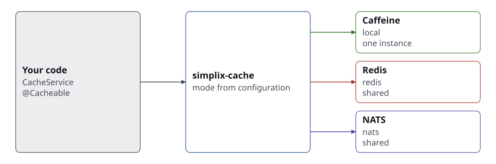

**English** | [한국어](ko/cache/readme.md)

# simplix-cache

Caching for a SimpliX application: a service for explicit cache calls, Spring's cache annotations, and a store chosen by configuration. Code written against it runs on a local Caffeine cache during development and on Redis or NATS in a cluster without change.



## Install

The [starter](en/starter/readme.md) includes the module. Without the starter:

```groovy
dependencies {
    implementation "dev.simplecore.simplix:simplix-cache:${version}"
}
```

## Documents

| To | Read |
|---|---|
| cache a first value | [Getting started](en/cache/getting-started.md) |
| read, write and evict from code | [Using the cache service](en/cache/using-the-cache-service.md) |
| cache the result of a method | [Caching method results](en/cache/caching-method-results.md) |
| share the cache between instances | [Choosing a store](en/cache/choosing-a-store.md) |
| watch hit rates and health | [Monitoring the cache](en/cache/monitoring-the-cache.md) |
| look a property up | [Configuration reference](en/cache/configuration-reference.md) |
| decide what to cache, its key and its lifetime | [Designing caches](en/cache/designing-caches.md) |
| see which bean keeps what | [How simplix-cache works](en/cache/how-it-works.md) |
| find the cause of a problem | [Troubleshooting](en/cache/troubleshooting.md) |

## Requirements

| Your project | SimpliX line | Version to declare |
|---|---|---|
| Spring Boot 4 | 2.x | a `2.x` release |
| Spring Boot 3 | 1.x | a `1.x` release |

Redis mode needs `spring-boot-starter-data-redis`, and NATS mode needs the NATS client `io.nats:jnats` and a `Connection` bean.

## License

[SimpleCORE License 1.0 (SCL-1.0)](en/license.md)
