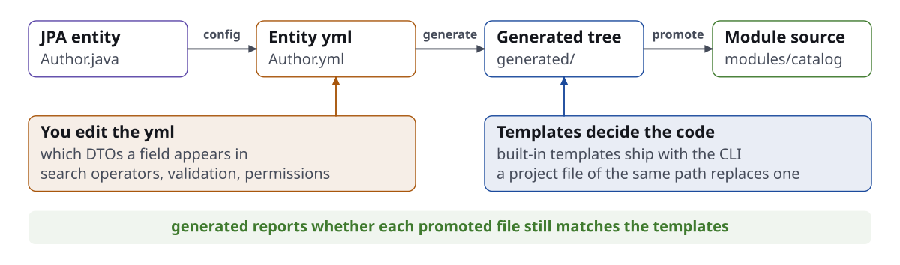
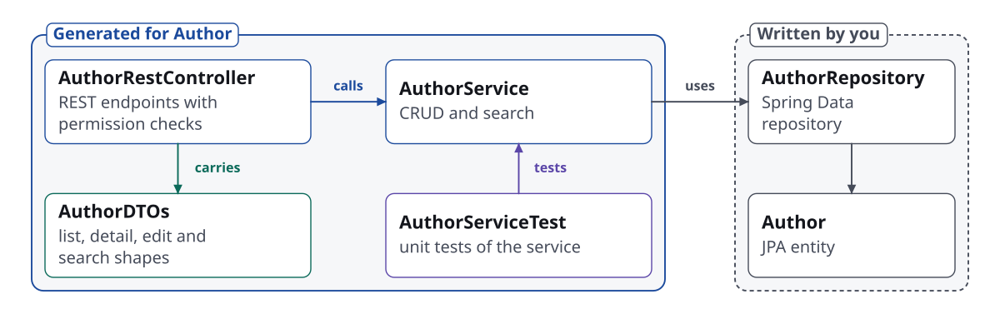

# How the SimpliX CLI works

This page explains what each command reads and writes, how an entity is analysed, and how a promoted file keeps both the template's changes and yours. Read it when you need to predict what a command will do to your files.

## From entity to module source



| Command | Reads | Writes |
|---|---|---|
| `config` | the entity source, its parent classes, the entities it refers to | `.simplix/entity/<Name>.yml` |
| `generate` | the entity source, the yml, the templates | files under `generated/` |
| `promote` | files under `generated/`, the module's files, `.simplix/bases/` | the module's files and `.simplix/bases/` |
| `generated` | everything `generate` and `promote` read | files under `generated/` and a report |

Rendering and writing into the module are separate commands on purpose. `generate` never touches your module, so you can render as often as you like and read the result. `promote` is the only command that changes module source, and it does so file by file with a rule for each case.

## What is generated for one entity



The components are the ones `target.targetPath` gives a path to. A repository and a web controller can be generated too, and an entity that implements `TreeEntity` gets a tree service with its test.

## How an entity is analysed

The CLI reads Java sources as text; it does not compile the project or load its classes. From the entity and its parent classes it takes:

- the identifier field and its type, and the fields of an `@EmbeddedId`
- each field's type, its `@Column` attributes and its `@Comment`
- the parent class and the interfaces, which is how a `TreeEntity` is recognised

Whether a field refers to another entity is decided by finding the source of its type under `entity.scanPath`: a type that declares `@Entity` is a related entity, and a type that does not is a value kept in the row, such as a record stored in a JSON column. A type whose source is not under the scan path is treated as a related entity.

## How a template is chosen

Each file is rendered from one template, looked up by relative path in the project's `.simplix/templates` first and among the built-in templates second. [Customizing templates](en/cli/customizing-templates.md) shows the lookup with a figure.

## Tracked renders

A file that `promote` moved into a module is a tracked render. It opens with two comment lines, and the same render is stored under `.simplix/bases/` at the module file's path.

```java
// @simplix-generated
// @simplix-render 2595cf7d3830 promote Author --module catalog
```

- The first line marks the file as generated.
- The second holds a fingerprint of the render and the command that laid it down. A file whose content still matches the fingerprint has not been edited.
- The stored copy is the base render: the common ancestor a three-way merge needs.

With these, `promote` can tell the base, your file and the fresh render apart for every file. An untouched file is simply rewritten. An edited file is merged, so that it ends up with the template's change and your edits. Where both changed the same lines, the file is left alone and the collision is reported. [Updating generated code](en/cli/updating-generated-code.md) covers every outcome and how to act on it.

> ℹ Commit `.simplix/bases/` with the module. Without the stored base, a teammate's `promote` cannot tell your edits from a template change and reports `no-base`.

## The version gate

Templates and yml keys change together between CLI versions. A project therefore records the version it is generated with, and a CLI older than that refuses to write. Each SimpliX release line has its own CLI, and a CLI only looks up versions of its own line. [Managing versions](en/cli/managing-versions.md) has the details.

## Related documents

- [Updating generated code](en/cli/updating-generated-code.md)
- [Customizing templates](en/cli/customizing-templates.md)
- [Command reference](en/cli/command-reference.md)
