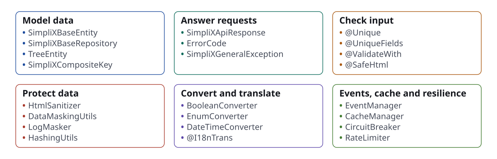

**English** | [한국어](ko/core/readme.md)

# simplix-core

The base library of SimpliX. Every other module builds on it: base classes for entities and repositories, tree structures, the API response and error model, validators, data protection utilities, type converters and field translation.



## Install

The [starter](en/starter/readme.md) brings `simplix-core`, so an application set up as [Getting started](en/getting-started.md) describes already has it. A library that needs the core classes alone declares it directly.

```groovy
dependencies {
    implementation "dev.simplecore.simplix:simplix-core:${version}"
}
```

## What it provides

| To | Use | Document |
|---|---|---|
| model entities and repositories | `SimpliXBaseEntity`, `SimpliXBaseRepository`, `SimpliXCompositeKey`, `@UuidV7Generator` | [Entities and repositories](en/core/entities-and-repositories.md) |
| keep records in a hierarchy | `TreeEntity`, `SimpliXTreeRepository`, `SimpliXTreeBaseService` | [Tree structures](en/core/tree-structures.md) |
| answer requests in one shape | `SimpliXApiResponse`, `ErrorCode`, `SimpliXGeneralException` | [API responses and errors](en/core/api-responses-and-errors.md) |
| check input | `@Unique`, `@UniqueFields`, `@ValidateWith`, `@SafeHtml` | [Validating input](en/core/validating-input.md) |
| protect personal data | `HtmlSanitizer`, `DataMaskingUtils`, `LogMasker`, `HashingUtils`, `@MaskSensitive` | [Protecting sensitive data](en/core/protecting-sensitive-data.md) |
| convert values | `BooleanConverter`, `EnumConverter`, `DateTimeConverter`, `SimpliXLabeledEnum` | [Converting types](en/core/converting-types.md) |
| serve text in the reader's language | `@I18nTrans` | [Translating fields](en/core/translating-fields.md) |
| describe fields for screens | `@NameField`, `@Tone`, `@MoneyValue`, `@References` | [Describing entities for screens](en/core/describing-entities-for-screens.md) |
| publish events | `EventManager`, `GenericEvent`, `@EntityEventConfig` | [Publishing events](en/core/publishing-events.md) |
| cache values | `CacheManager`, `CacheProvider` | [Caching](en/core/caching.md) |
| limit load and failures | `CircuitBreaker`, `RateLimiter`, `BackpressureGuard` | [Resilience utilities](en/core/resilience-utilities.md) |
| see what the module does alone and what the starter adds | `SimpliXRepositoryFactoryBean`, `SimpliXRuntimeHints` | [How simplix-core works](en/core/how-it-works.md) |
| find the cause of a problem |  | [Troubleshooting](en/core/troubleshooting.md) |

Error codes are listed in the [error code reference](en/core/error-code-reference.md).

## Start here

[Getting started](en/core/getting-started.md) writes a first entity and reports an error with a standard code. [Building a CRUD API](en/building-a-crud-api.md) takes the entity to a complete API.

## Requirements

| Your project | SimpliX line | Version to declare |
|---|---|---|
| Spring Boot 4 | 2.x | a `2.x` release |
| Spring Boot 3 | 1.x | a `1.x` release |

Java 17 or later, and Spring Data JPA for the entity, repository and tree classes.

## License

[SimpleCORE License 1.0 (SCL-1.0)](en/license.md)
