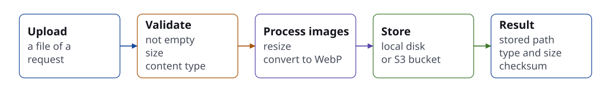

**English** | [한국어](ko/file/readme.md)

# simplix-file

Takes an uploaded file, checks it, and stores it on a local disk or in an S3-compatible bucket behind one interface. Images are resized, converted to WebP and served as thumbnails on the way. The application keeps the stored path and asks the module for the file, a link or a thumbnail when it needs one.



## Install

The module is part of the [starter](en/starter/readme.md). To use it alone, add the dependency.

```groovy
dependencies {
    implementation "dev.simplecore.simplix:simplix-file:${version}"
}
```

## A first upload

```java
ProcessedFileResult result = fileProcessingService.processAndStore(FileProcessingRequest.of(file, "documents"));

result.getStoredPath();                                   // documents/2026/03/01/<uuid>.pdf
fileStorageService.getPublicUrl(result.getStoredPath());  // /files/documents/2026/03/01/<uuid>.pdf
```

With no configuration the files go to `./uploads` on the local disk. [Getting started](en/file/getting-started.md) writes the upload and download endpoints around this call.

## Documents

| To | Read |
|---|---|
| write upload and download endpoints | [Getting started](en/file/getting-started.md) |
| limit sizes and types, and read the result of an upload | [Uploading files](en/file/uploading-files.md) |
| resize images, convert them to WebP and serve thumbnails | [Processing images](en/file/processing-images.md) |
| read, link, describe and delete stored files | [Working with stored files](en/file/working-with-stored-files.md) |
| store in AWS S3 or MinIO, with direct uploads and signed links | [Storing files in S3](en/file/storing-files-in-s3.md) |
| see which class does what | [How simplix-file works](en/file/how-it-works.md) |
| look a property up | [Configuration reference](en/file/configuration-reference.md) |
| find the cause of a problem | [Troubleshooting](en/file/troubleshooting.md) |

## Requirements

| Your project | SimpliX line | Version to declare |
|---|---|---|
| Spring Boot 4 | 2.x | a `2.x` release |
| Spring Boot 3 | 1.x | a `1.x` release |

Local storage, S3 storage and the WebP conversion work with what the module brings; no further dependency is needed.

## License

[SimpleCORE License 1.0 (SCL-1.0)](en/license.md)
