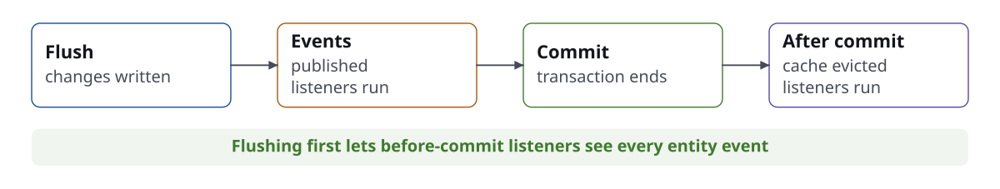

# How transactions are committed

Why the module replaces the JPA transaction manager, and what else it does at the edges of a transaction.

## Flush before the listeners

Hibernate writes pending changes when the session is flushed, and the entity lifecycle callbacks that publish events fire during that flush. Spring's `JpaTransactionManager` flushes inside the commit itself, after it has already run the `BEFORE_COMMIT` listeners it knew about. An event published by that late flush registers its listener too late, and the listener never runs.

`SimpliXJpaTransactionManager` flushes one step earlier, before Spring runs the `BEFORE_COMMIT` listeners. Every pending change has then published its event, and every listener runs in the transaction. The flush happens in the outermost read-write transaction only; inner transactions that join it and read-only transactions are left alone.

### Limits

- A `BEFORE_COMMIT` listener that changes entities itself causes a second flush during the commit. Events of those changes are too late for `BEFORE_COMMIT` listeners again.
- The guarantee holds for the transaction manager the module registers. With several data sources, check each manager.

## A transaction manager of your own

The module registers its manager before Spring Boot would register the default one. A transaction manager bean of the application still wins. At start the module checks which JPA manager is active: when it is not `SimpliXJpaTransactionManager` it logs an error, and with `simplix.transaction.fail-fast: true` the application does not start. Extend `SimpliXJpaTransactionManager` when you need a manager of your own.

## Cache eviction waits for the commit

An `@EvictCache` method that runs in a transaction does not clear the cache at once. The eviction is collected and carried out after the commit, so another transaction cannot reload the old row into the cache in between, and a rollback evicts nothing.

## Retrying when the write lock is refused

A database that admits one writer at a time, such as SQLite, can refuse a transaction the write lock after another connection wrote first; a server that locks rows reports the same condition as a lock timeout. Waiting does not help, because the transaction's view of the data is already stale. The module starts such a transaction over.

- Only a call that opens a transaction of its own is retried: the outermost `@Transactional` method, or one with `REQUIRES_NEW`. A method that joins a transaction shares its fate.
- The refusal is a rollback, so nothing of the failed attempt remains. What the method did outside the database, such as sending a message, is done again: keep such effects in an `AFTER_COMMIT` listener.
- `simplix.transaction.write-lock-retry.attempts` (6) and `initial-backoff` (25 ms) set how often and how soon.

## The parts of the module

| Auto-configuration | Registers | Switch |
|---|---|---|
| `SimpliXTransactionAutoConfiguration` | `SimpliXJpaTransactionManager`, the check at start, and `WriteLockRetryAspect` with its `WriteLockRetryProperties` | `simplix.transaction.enabled` |
| `EntityEventAutoConfiguration` | the entity event listener as a Spring bean, so it can publish through the application | `simplix.entity-events.enabled` |
| `SimpliXHibernateCacheAutoConfiguration` | the cache eviction support below, bound to `HibernateCacheProperties` | `simplix.hibernate.cache.disabled` |

| Class | Role in an eviction |
|---|---|
| `ModifyingQueryCacheEvictionAspect` | runs around a repository method marked `@EvictCache` and hands the evictions to the collector |
| `TransactionAwareCacheEvictionCollector` | keeps the `PendingEviction` entries of a transaction and publishes them after the commit; without a transaction it publishes at once |
| `PostCommitCacheEvictionHandler` | receives the `PendingEvictionCompletedEvent` and calls the strategy |
| `CacheEvictionStrategy` | removes the entries from the cache of this instance |
| `HibernateCacheHolder`, `HibernateCacheInitializer` | keep the reference to Hibernate's cache and set it up at start, together with the `EntityCacheScanner` |

## Other public methods

The guides show the methods a task needs. The types they name also have these public methods.

| Type | Method | Does |
|---|---|---|
| `PendingEvictionCompletedEvent` | `getEvictionCount()` | returns the number of evictions the event carries |
| `PendingEviction` | `getEntityClass()` | loads the entity class from the class name the record stores |
| `PendingEviction` | `getEntityClassName()`, `getEntityId()`, `getRegion()`, `getOperation()`, `isEvictQueryCache()`, `getTimestamp()` | the class name of the entity, the id when one record is meant, the region, the operation, whether the query cache is evicted too, and the time the eviction was collected |
| `PendingEvictionCompletedEvent` | `getPendingEvictions()` | returns the evictions of the transaction |
| `HibernateCacheHolder` | `getCache()`, `setCache(cache)`, `isReset()` | static access to the Hibernate `Cache` the module holds: the module sets it once at start, and `getCache()` returns it to code outside the Spring context |

## Related documents

- [Publishing entity events](en/hibernate/publishing-entity-events.md)
- [Configuration reference](en/hibernate/configuration-reference.md)
