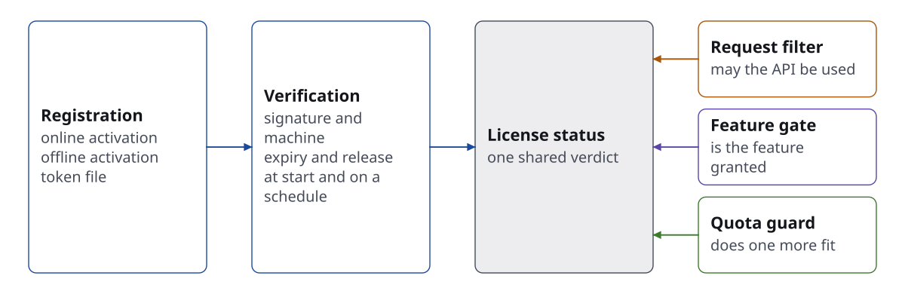

**English** | [한국어](ko/license/readme.md)

# simplix-license

Makes an application run under a license: it registers the license of a deployment, verifies it on a schedule, and enforces the verdict at the request, the feature and the quantity. The verdict itself comes from the license SDK; this module decides when it is asked for and where it applies in a Spring Boot application.



## Install

The starter does not include this module. Add it as a dependency of its own.

```groovy
dependencies {
    implementation "dev.simplecore.simplix:simplix-license:${version}"

    // Optional: keep the registration in the database
    implementation "org.springframework.boot:spring-boot-starter-data-jpa"

    // Optional: @RequiresFeature (the Spring AOP starter of your line, see the table below)
    implementation "org.springframework.boot:spring-boot-starter-aspectj"

    // Optional: health and metrics
    implementation "org.springframework.boot:spring-boot-starter-actuator"
}
```

The starter that brings Spring AOP is named differently on each release line.

| SimpliX line | Dependency for `@RequiresFeature` |
|---|---|
| 2.x | `org.springframework.boot:spring-boot-starter-aspectj` |
| 1.x | `org.springframework.boot:spring-boot-starter-aop` |

The module brings the license SDK (`dev.accesscore:license-sdk`), which is downloaded from a package repository of its own. Give Gradle the credentials for it.

```properties
accesscore.gpr.user=your_github_username
accesscore.gpr.token=your_github_personal_access_token
```

## What it does

| Feature | Meaning |
|---|---|
| signature verification | a token is accepted only when it verifies against a public key built into the application |
| online and offline activation | a product key becomes a token bound to the machine, through the license server or through a request file |
| heartbeat and re-verification | revocations, expiry and contract changes reach the deployment without a restart |
| request enforcement | a deployment without a usable license answers its API with status 403 |
| feature gating | `@RequiresFeature` ties an endpoint to a feature of the license |
| quantity limits | a registration beyond the contracted number is refused |
| installation gate | before the first installation is finished, only the setup wizard is reachable |

## Documents

| To | Read |
|---|---|
| add the module and name the product | [Getting started](en/license/getting-started.md) |
| register a license online, offline or from a file | [Activating a license](en/license/activating-a-license.md) |
| see what each status allows and which paths stay open | [Enforcing the license](en/license/enforcing-the-license.md) |
| tie endpoints and jobs to licensed features | [Gating features](en/license/gating-features.md) |
| hold counted items to the contracted number | [Limiting quantities](en/license/limiting-quantities.md) |
| watch the license with health checks, metrics and an audit trail | [Monitoring the license](en/license/monitoring-the-license.md) |
| understand the verdict, the keys and the stores | [How simplix-license works](en/license/how-it-works.md) |
| look a property or a required bean up | [Configuration reference](en/license/configuration-reference.md) |
| find the cause of a problem | [Troubleshooting](en/license/troubleshooting.md) |

## Requirements

| Your project | SimpliX line | Version to declare |
|---|---|---|
| Spring Boot 4 | 2.x | a `2.x` release |
| Spring Boot 3 | 1.x | a `1.x` release |

The re-verification and heartbeat jobs need `@EnableScheduling` on the application.

## License

[SimpleCORE License 1.0 (SCL-1.0)](en/license.md)
