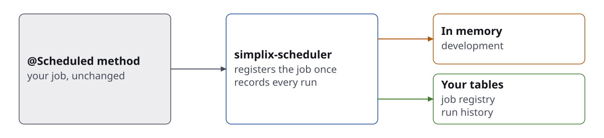

**English** | [한국어](ko/scheduler/readme.md)

# simplix-scheduler

A record of every scheduled job. The module watches the `@Scheduled` methods of an application and writes down which jobs exist and how each run went: when it started, how long it took, and whether it failed. Nothing changes in the jobs themselves.



## Install

The [starter](en/starter/readme.md) includes the module. Without the starter:

```groovy
dependencies {
    implementation "dev.simplecore.simplix:simplix-scheduler:${version}"
}
```

## Documents

| To | Read |
|---|---|
| see the first records | [Getting started](en/scheduler/getting-started.md) |
| keep the records in your database | [Recording runs in a database](en/scheduler/recording-runs-in-a-database.md) |
| run a job on one instance at a time | [Running on several instances](en/scheduler/running-on-several-instances.md) |
| look a property up | [Configuration reference](en/scheduler/configuration-reference.md) |
| see what happens around a run and what the module leaves to you | [How simplix-scheduler works](en/scheduler/how-it-works.md) |
| find the cause of a problem | [Troubleshooting](en/scheduler/troubleshooting.md) |

## Requirements

| Your project | SimpliX line | Version to declare |
|---|---|---|
| Spring Boot 4 | 2.x | a `2.x` release |
| Spring Boot 3 | 1.x | a `1.x` release |

## License

[SimpleCORE License 1.0 (SCL-1.0)](en/license.md)
