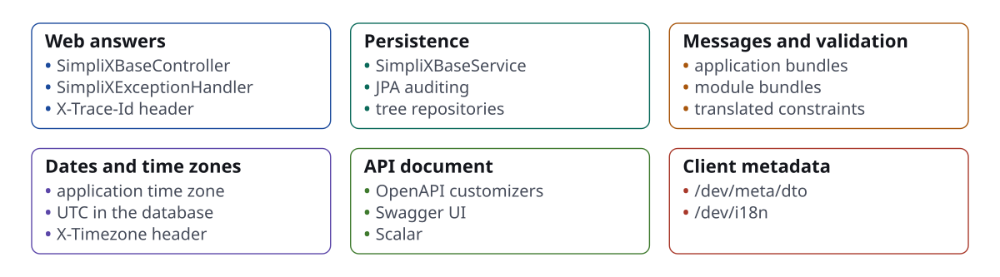

**English** | [한국어](ko/starter/readme.md)

# spring-boot-starter-simplix

The starter that turns a Spring Boot application into a SimpliX application. One dependency brings the SimpliX modules and configures the web layer, JPA, messages, validation, dates and the API document, so that every endpoint answers, fails and is described in the same way.



## Install

```groovy
dependencies {
    implementation "dev.simplecore.simplix:spring-boot-starter-simplix:${version}"
}
```

[Getting started](en/getting-started.md) lists the repositories, the other dependencies and the settings of a first application.

## What it configures

| Area | You get | Document |
|---|---|---|
| Services and controllers | `SimpliXBaseService`, `SimpliXBaseController`, `@SimpliXStandardApi` | [Writing services and controllers](en/starter/writing-services-and-controllers.md) |
| Errors | every exception answered as a `SimpliXApiResponse`, with a trace id | [Handling errors](en/starter/handling-errors.md) |
| Dates | one application time zone, UTC in the database, per-request zones | [Working with dates and time zones](en/starter/working-with-dates-and-time-zones.md) |
| Auditing | who created and changed a row, and when | [Auditing entities](en/starter/auditing-entities.md) |
| Messages | application and library message bundles, translated validation messages | [Messages and locales](en/starter/messages-and-locales.md) |
| API document | an OpenAPI document that describes the response wrapper, enums and nested objects | [Documenting the API](en/starter/documenting-the-api.md) |
| Client metadata | development endpoints that publish DTO metadata and labels | [Publishing metadata for clients](en/starter/publishing-metadata-for-clients.md) |

Every property and auto-configuration is listed in the [configuration reference](en/starter/configuration-reference.md). [How the starter works](en/starter/how-it-works.md) follows a request through the starter, the [metadata reference](en/starter/metadata-reference.md) describes the document the metadata endpoint returns, and [Troubleshooting](en/starter/troubleshooting.md) lists symptoms with their causes.

## Modules it brings

`simplix-core`, `simplix-auth`, `simplix-cache`, `simplix-egov`, `simplix-email`, `simplix-encryption`, `simplix-excel`, `simplix-file`, `simplix-hibernate`, `simplix-messaging`, `simplix-mybatis` and `simplix-scheduler`. `simplix-stream`, `simplix-sync` and `simplix-license` are added as dependencies of their own.

## Requirements

| Your project | SimpliX line | Version to declare |
|---|---|---|
| Spring Boot 4 | 2.x | a `2.x` release |
| Spring Boot 3 | 1.x | a `1.x` release |

## License

[SimpleCORE License 1.0 (SCL-1.0)](en/license.md)
