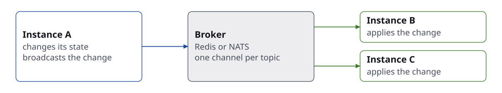

**English** | [한국어](ko/sync/readme.md)

# simplix-sync

Keeps the in-memory state of several application instances in step. One instance broadcasts a change and the others apply it: a cache entry to drop, a counter that moved, a device that came online. Delivery is fast and best-effort, which is what state that can be reloaded needs.



## Install

The starter does not include this module. Add it as a dependency of its own.

```groovy
dependencies {
    implementation "dev.simplecore.simplix:simplix-sync:${version}"
}
```

## When to use it

| Need | Use |
|---|---|
| tell the other instances that local state changed, and tolerate a lost message | simplix-sync |
| deliver every message, with retries, consumer groups and replay | [simplix-messaging](en/messaging/readme.md) |
| push data to browsers | [simplix-stream](en/stream/readme.md) |

## Documents

- [Getting started](en/sync/getting-started.md): broadcast a first change
- [Keeping state consistent](en/sync/keeping-state-consistent.md): state stores and reconciliation
- [How simplix-sync works](en/sync/how-it-works.md): the path of a message, and a transport of your own
- [Configuration reference](en/sync/configuration-reference.md)
- [Troubleshooting](en/sync/troubleshooting.md)

## Requirements

| Your project | SimpliX line | Version to declare |
|---|---|---|
| Spring Boot 4 | 2.x | a `2.x` release |
| Spring Boot 3 | 1.x | a `1.x` release |

Distributed mode needs Redis (`spring-boot-starter-data-redis`) or NATS (`io.nats:jnats` and a `Connection` bean).

## License

[SimpleCORE License 1.0 (SCL-1.0)](en/license.md)
