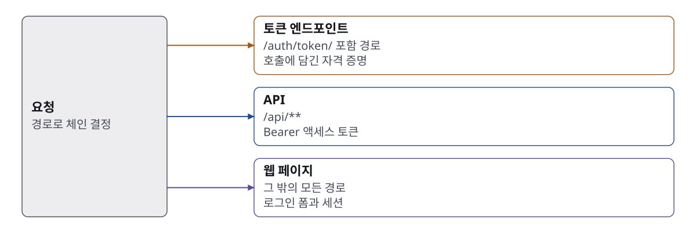

[English](en/auth/readme.md) | **한국어**

# simplix-auth

SimpliX 애플리케이션의 인증 모듈입니다. 클라이언트는 사용자 이름과 비밀번호 또는 소셜 계정으로 로그인해 암호화된 토큰을 받습니다. 모듈은 API 호출마다 토큰을 검사하고, 갱신과 폐기를 처리하며, 이에 맞게 Spring Security를 구성합니다.



## 설치

[스타터](ko/starter/readme.md)에 이 모듈이 포함되어 있습니다. 스타터 없이 사용할 때는 Spring Security와 함께 추가합니다.

```groovy
dependencies {
    implementation "dev.simplecore.simplix:simplix-auth:${version}"
    implementation 'org.springframework.boot:spring-boot-starter-security'
}
```

## 시작

[애플리케이션 보안 적용](ko/securing-an-application.md)에서 로그인이 없는 애플리케이션에 토큰과 권한을 적용합니다. [시작하기](ko/auth/getting-started.md)에는 모듈이 애플리케이션에 요구하는 내용이 정리되어 있습니다.

## 제공하는 기능

| 하려는 일 | 문서 |
|---|---|
| 토큰 발급, 사용, 갱신 | [토큰 발급과 갱신](ko/auth/issuing-and-refreshing-tokens.md) |
| 로그아웃을 즉시 적용 | [토큰 폐기](ko/auth/revoking-tokens.md) |
| 경로 공개, CORS · CSRF · 보안 헤더 설정 | [경로 보호](ko/auth/securing-paths.md) |
| 암호화 키를 주기적으로 교체 | [키 교체](ko/auth/rotating-keys.md) |
| Google, Kakao, Naver 등의 계정으로 로그인 | [소셜 계정 로그인](ko/auth/signing-in-with-social-accounts.md) |
| 다른 인증 제공자가 발급한 토큰 수용 | [외부 토큰 수용](ko/auth/accepting-external-tokens.md) |
| 다운로드 링크 같은 단기 토큰 서명 | [자체 토큰 서명](ko/auth/signing-your-own-tokens.md) |
| 인증 로그, 지표, 상태 확인 | [인증 모니터링](ko/auth/monitoring-authentication.md) |
| 요청에 응답하는 구성 요소와 등록 조건 확인 | [simplix-auth 동작 방식](ko/auth/how-it-works.md) |
| 속성 조회 | [설정 레퍼런스](ko/auth/configuration-reference.md) |
| 로그인 실패 해결 | [문제 해결](ko/auth/troubleshooting.md) |

## 요구 사항

| 프로젝트 | SimpliX 라인 | 선언할 버전 |
|---|---|---|
| Spring Boot 4 | 2.x | `2.x` 릴리스 |
| Spring Boot 3 | 1.x | `1.x` 릴리스 |

## 라이선스

[SimpleCORE License 1.0 (SCL-1.0)](ko/license.md)
