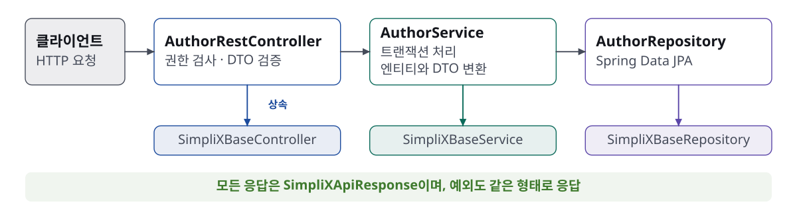

# CRUD API 만들기

이 문서는 엔티티 하나로 생성 · 조회 · 수정 · 삭제 · 검색을 갖춘 API를 만드는 과정을 안내합니다. 검증과 권한 검사도 포함합니다. 엔티티와 저장소는 직접 작성하고, 나머지는 명령줄 도구가 SimpliX 기본 클래스를 바탕으로 생성합니다.



## 준비

- [시작하기](ko/getting-started.md)에 따라 설정한 프로젝트
- 사용하는 릴리스 라인의 [SimpliX CLI](ko/cli/readme.md). Node.js 20 이상이 필요합니다.
- [서비스와 컨트롤러 작성](ko/starter/writing-services-and-controllers.md): 같은 클래스를 직접 작성하는 방법
- [엔티티 감사](ko/starter/auditing-entities.md): 작성자와 시각을 기록하는 기본 엔티티

## 1단계. 엔티티 작성

```java
package com.example.library.domain.catalog.entity;

@Entity
@Table(name = "authors")
@Getter
@Setter
@NoArgsConstructor
public class Author extends SimpliXBaseEntity<String> {

    @Id
    @GeneratedValue(strategy = GenerationType.UUID)
    @Column(name = "author_id", nullable = false, updatable = false)
    private String authorId;

    @Column(name = "pen_name", nullable = false, length = 120)
    @NameField
    private String penName;

    @Column(name = "biography", length = 2000)
    private String biography;

    @Override
    public String getId() {
        return authorId;
    }

    @Override
    public void setId(String id) {
        this.authorId = id;
    }
}
```

엔티티는 `SimpliXBaseEntity`를 상속하고, `getId`와 `setId`로 식별자 필드를 지정합니다. `@NameField`는 화면에서 레코드의 이름으로 사용하는 필드를 표시합니다. 목록의 첫 열, 삭제 확인 문구의 이름, 상세 화면의 제목에 이 필드를 사용합니다.

## 2단계. 저장소 작성

```java
package com.example.library.domain.catalog.repository;

public interface AuthorRepository extends SimpliXBaseRepository<Author, String> {
}
```

`SimpliXBaseRepository`는 `JpaSpecificationExecutor`를 포함한 `JpaRepository`입니다. 쿼리 메서드는 일반 Spring Data 저장소와 같은 방식으로 추가합니다.

## 3단계. API 생성

CLI 설정은 프로젝트마다 한 번 만듭니다. `init`을 실행한 뒤, CLI의 [시작하기](ko/cli/getting-started.md)에 있는 대로 `.simplix/generator-simplix.json`을 작성하세요. 그다음 엔티티를 기술합니다.

```bash
simplix-boot init
simplix-boot config Author
```

`config`는 `.simplix/entity/Author.yml`을 작성합니다. 파일 위쪽에 요청 경로와 권한 그룹을 지정하세요.

```yaml
entity: Author

modulePath: catalog
idField: authorId
nameField: penName
thymeleafBaseDir: catalog/author
permissionGroup: CATALOG
```

코드를 생성하고 모듈로 옮깁니다. `promote`를 실행하기 전에 모듈 폴더가 있어야 합니다.

```bash
simplix-boot generate Author
mkdir -p modules/catalog
simplix-boot promote Author --module catalog
```

멀티 프로젝트 빌드에서는 `modules/catalog`가 Gradle 하위 프로젝트입니다. 단일 프로젝트 빌드에서는 이 폴더를 소스 세트에 추가하세요.

```groovy
sourceSets {
    main { java { srcDir 'modules/catalog/src/main/java' } }
    test { java { srcDir 'modules/catalog/src/test/java' } }
}
```

## 4단계. API를 /api 아래에 제공

`simplix-auth`는 `/api/` 아래의 경로에서 액세스 토큰을 검사합니다. 그 밖의 경로는 웹 페이지로 취급하여, 세션이 없는 호출자를 로그인 페이지로 보냅니다. 애플리케이션의 REST 컨트롤러에 `/api` 접두 경로를 지정하세요.

```java
@Configuration
public class ApiPathConfig implements WebMvcConfigurer {

    @Override
    public void configurePathMatch(PathMatchConfigurer configurer) {
        configurer.addPathPrefix("/api", controller ->
            controller.isAnnotationPresent(RestController.class)
                && controller.getPackageName().startsWith("com.example.library"));
    }
}
```

## 생성 결과

`promote`를 실행하면 아래 파일이 모듈에 추가되며, 이후에는 다른 코드처럼 직접 수정합니다. 엔티티를 변경한 뒤에는 `generate`와 `promote`를 다시 실행하세요. `promote`는 새로 생성한 내용을 수정된 파일에 병합하고, 병합할 수 없는 파일은 충돌로 보고합니다([명령 레퍼런스](ko/cli/command-reference.md)).

| 파일 | 내용 |
|---|---|
| `web/catalog/dto/AuthorDTOs.java` | 엔티티의 요청 · 응답 클래스: 생성, 수정, 일괄 수정, 상세, 목록, 검색 |
| `web/catalog/service/AuthorService.java` | 서비스. 생성 · 수정 · 삭제 · 검색 메서드를 포함하는 `SimpliXBaseService`입니다 |
| `web/catalog/controller/AuthorRestController.java` | 아래 엔드포인트를 제공하는 REST 컨트롤러 |
| `src/test`의 `web/catalog/service/AuthorServiceTest.java` | 서비스 테스트 |

생성된 컨트롤러는 다음 엔드포인트를 제공합니다.

| 요청 | 동작 | 권한 동작 |
|---|---|---|
| `POST /api/catalog/author/create` | 레코드 생성 | `create` |
| `GET /api/catalog/author/{authorId}` | 레코드 한 건 조회 | `view` |
| `GET /api/catalog/author/{authorId}/edit` | 수정 폼 형태로 레코드 한 건 조회 | `view` |
| `PUT /api/catalog/author/{authorId}` | 레코드 수정 | `edit` |
| `PATCH /api/catalog/author` | 여러 레코드를 레코드별 값으로 수정 | `edit` |
| `PATCH /api/catalog/author/batch` | 여러 레코드에 같은 값 지정 | `edit` |
| `DELETE /api/catalog/author/{authorId}` | 레코드 삭제 | `delete` |
| `DELETE /api/catalog/author/batch` | 여러 레코드 삭제 | `delete` |
| `GET /api/catalog/author/search` | 쿼리 매개변수로 검색 | `list` |
| `POST /api/catalog/author/search` | 본문의 검색 조건으로 검색 | `list` |

애플리케이션에 로그인을 적용하기 전에는 엔드포인트가 401로 응답합니다. 로그인은 [애플리케이션 보안 적용](ko/securing-an-application.md)에서 추가하며, 아래 응답은 토큰으로 호출한 결과입니다.

### 응답

모든 엔드포인트는 `SimpliXApiResponse`로 응답합니다. `type`은 `SUCCESS`, `FAILURE`, `ERROR` 중 하나이고, `body`에 데이터를 담습니다. 값이 없는 필드는 JSON에서 생략합니다. 다음은 `POST /api/catalog/author/create`의 응답입니다.

```json
{
  "type" : "SUCCESS",
  "body" : {
    "authorId" : "<id>",
    "penName" : "Ursula",
    "biography" : "Writes about other worlds"
  },
  "timestamp" : "<time with zone>"
}
```

오류일 때는 `message`, `errorCode`, `errorDetail`에 내용을 담습니다. 같은 요청에서 `penName`을 빼면 상태 코드 400으로 응답합니다. 메시지 문구는 `Accept-Language` 헤더의 언어로 제공합니다.

```json
{
  "type" : "ERROR",
  "message" : "Validation failed",
  "timestamp" : "<time with zone>",
  "errorCode" : "VAL_VALIDATION_FAILED",
  "errorDetail" : [ {
    "field" : "penName",
    "message" : "This field cannot be blank",
    "code" : "NotBlank"
  } ]
}
```

### 권한

엔드포인트마다 `@PreAuthorize("hasPermission('CATALOG', '<동작>')")` 검사가 적용됩니다. Spring Security는 `hasPermission`을 `PermissionEvaluator` 빈으로 판정하며, 이 빈은 애플리케이션이 제공합니다. 현재 사용자가 해당 그룹에서 그 동작을 수행할 수 있는지를 여기서 결정합니다. 이 빈이 없으면 모든 호출에 403으로 응답합니다. 예제는 [애플리케이션 보안 적용](ko/securing-an-application.md)에 있습니다.

## 컨트롤러를 직접 작성할 때

엔티티 하나의 CRUD가 아닌 엔드포인트는 직접 작성합니다. 같은 형태로 응답하려면 `SimpliXApiResponse`를 반환하고, 같은 권한 검사를 적용하세요. `@SimpliXStandardApi`를 추가하면 OpenAPI 문서에 표준 응답이 기술됩니다. 4단계의 접두 경로가 적용되어 이 엔드포인트는 `GET /api/catalog/statistics/author-count`가 됩니다.

```java
@RestController
@RequestMapping("/catalog/statistics")
@RequiredArgsConstructor
@SimpliXStandardApi
public class CatalogStatisticsController {

    private final AuthorRepository authorRepository;

    @GetMapping("/author-count")
    @PreAuthorize("hasPermission('CATALOG', 'list')")
    public SimpliXApiResponse<Long> authorCount() {
        return SimpliXApiResponse.success(authorRepository.count());
    }
}
```

## 다음 단계

- [애플리케이션 보안 적용](ko/securing-an-application.md)
- [SimpliX CLI](ko/cli/readme.md): 템플릿, 재생성, 버전 관리
- [simplix-core](ko/core/readme.md): 엔티티, 저장소, 트리 구조, 예외
- [서비스와 컨트롤러 작성](ko/starter/writing-services-and-controllers.md): 같은 클래스를 직접 작성하는 방법
- [엔티티 감사](ko/starter/auditing-entities.md): 작성자와 시각을 기록하는 기본 엔티티
