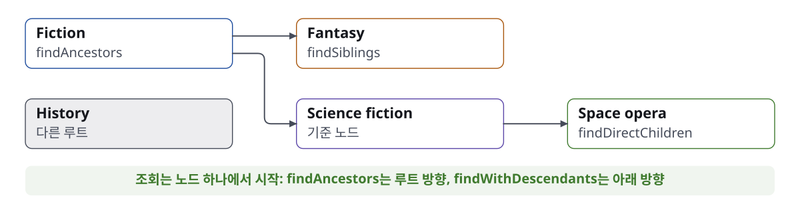

# 트리 구조

분류, 메뉴, 조직도처럼 계층 구조로 관리하는 레코드를 저장하고, 조회 · 이동 · 정렬하는 방법을 설명합니다.



이 모듈은 트리 엔티티에 재귀 SQL로 조회하는 저장소, 트리 화면에 필요한 연산(가지 조회, 노드 이동, 가지 복사, 형제 정렬)을 제공하는 서비스, 그리고 노드가 자기 자신의 조상이 되는 이동을 거부하는 것과 같은 정합성 검사를 제공합니다.

## 엔티티 작성

트리 엔티티는 `TreeEntity`를 구현하며, 형제 노드의 순서를 바꿀 수 있어야 하면 `SortableTreeEntity`를 구현합니다. `@TreeEntityAttributes`에는 트리 쿼리가 사용하는 테이블과 컬럼을 지정합니다. 쿼리는 네이티브 SQL이므로 Java 필드 이름이 아닌 데이터베이스의 이름을 지정합니다.

```java
@Entity
@Table(name = "categories")
@TreeEntityAttributes(
    tableName = "categories",
    idColumn = "id",
    parentIdColumn = "parent_id",
    sortOrderColumn = "sort_order",
    lookupColumns = {
        @LookupColumn(name = "name", type = LookupColumn.ColumnType.STRING)
    }
)
@Getter
@Setter
@NoArgsConstructor
public class Category implements SortableTreeEntity<Category, String> {

    @Id
    @UuidV7Generator
    private String id;

    @Column(name = "parent_id")
    private String parentId;

    @Column(nullable = false)
    private String name;

    @Column(name = "sort_order")
    private Integer sortOrder;

    @Transient
    private List<Category> children = new ArrayList<>();

    @Override
    public Comparable<?> getSortKey() {
        return sortOrder;
    }
}
```

### 인터페이스가 요구하는 멤버

| 멤버 | 인터페이스 | 의미 |
|---|---|---|
| `getId`, `setId` | `TreeEntity` | 노드의 식별자 |
| `getParentId`, `setParentId` | `TreeEntity` | 부모의 식별자. 루트는 `null`입니다 |
| `getChildren`, `setChildren` | `TreeEntity` | 노드의 자식 목록. 계층 조회에서 채우는 `@Transient` 목록입니다 |
| `getSortKey` | `TreeEntity` | 메모리에서 계층을 구성할 때 형제 노드를 비교하는 값 |
| `isRoot`, `isLeaf` | `TreeEntity` | 기본 메서드. 부모가 없는지, `children` 목록이 비어 있는지 판정합니다 |
| `getSortOrder`, `setSortOrder` | `SortableTreeEntity` | 형제 노드 사이의 정수 위치. `reorderChildren`이 이 값을 다시 지정합니다 |

### `@TreeEntityAttributes`의 속성

| 속성 | 기본값 | 의미 |
|---|---|---|
| `tableName` | 필수 | 엔티티의 테이블 |
| `idColumn` | 필수 | 기본 키 컬럼 |
| `parentIdColumn` | 필수 | 부모의 식별자를 저장하는 컬럼. 루트는 비어 있습니다 |
| `sortOrderColumn` | 필수 | 형제 노드의 정렬 기준 컬럼 |
| `sortDirection` | `ASC` | 형제 노드의 정렬 방향. `SortDirection`의 `ASC` 또는 `DESC` |
| `lookupColumns` | 없음 | `findByLookup`으로 검색할 수 있는 컬럼. 각각 `name`과 `type`을 지정한 `@LookupColumn`입니다 |
| `cascadeDelete` | `false` | 효과가 없습니다. 트리 쿼리에서 이 값을 읽지 않습니다 |
| `maxDepth` | `-1` | 효과가 없습니다. 트리 쿼리에서 이 값을 읽지 않습니다 |

`@LookupColumn`의 `type`은 `LookupColumn.ColumnType`입니다. `STRING`은 문자열을, `NUMBER`는 숫자를, `BOOLEAN`은 불리언 값을 비교합니다.

> ⚠ 식별자는 `String`으로 지정하세요. 트리 쿼리는 루트를 찾을 때 부모 컬럼을 빈 문자열과 비교하며, H2와 PostgreSQL에서는 숫자 컬럼에 이 비교를 실행할 수 없습니다.

## 저장소와 서비스 작성

```java
public interface CategoryRepository extends SimpliXTreeRepository<Category, String> {
}

@Service
public class CategoryService extends SimpliXSortableTreeBaseService<Category, String> {

    public CategoryService(CategoryRepository repository) {
        super(repository);
    }
}
```

`SimpliXRepositoryFactoryBean`은 `SimpliXTreeRepository`를 상속한 저장소를 인식해 트리 쿼리를 제공합니다. 애플리케이션에 한 번만 등록하세요: `@EnableJpaRepositories(repositoryFactoryBeanClass = SimpliXRepositoryFactoryBean.class)`. `SimpliXTreeBaseService`는 `SimpliXTreeService`의 모든 연산을 구현하고, `SimpliXSortableTreeBaseService`는 `SortableTreeEntity`용 `reorderChildren`을 추가합니다. 엔티티에 정수 정렬 순서가 없으면 `SimpliXTreeBaseService`를 상속하세요.

## 트리 생성

```java
Category fiction = categoryService.create(category("Fiction", null));
Category fantasy = categoryService.create(category("Fantasy", fiction.getId()));
Category scienceFiction = categoryService.create(category("Science fiction", fiction.getId()));
Category spaceOpera = categoryService.create(category("Space opera", scienceFiction.getId()));
Category cyberpunk = categoryService.create(category("Cyberpunk", scienceFiction.getId()));
Category history = categoryService.create(category("History", null));
```

```text
Fiction
├── Fantasy
└── Science fiction
    ├── Space opera
    └── Cyberpunk
History
```

`create`는 부모가 존재하는지 확인하고, 부모가 없으면 `NoSuchElementException: Parent entity not found with ID: ...`로 거부합니다. 정렬 순서 없이 저장한 노드에는 형제 노드의 최대 순서에 100을 더한 값을 지정합니다. 따라서 Fantasy는 100, Science fiction은 200으로 저장되며, 나중에 번호를 다시 지정하지 않고도 그 사이에 노드를 배치할 수 있습니다.

## 트리 조회

아래 결과는 위 트리를 조회한 값입니다.

| 호출 | 반환 | 결과 |
|---|---|---|
| `findRoots()` | 부모가 없는 노드 | Fiction, History |
| `findDirectChildren(fiction)` | 노드의 자식. 형제 순서로 반환합니다 | Fantasy, Science fiction |
| `findWithDescendants(scienceFiction)` | 노드와 그 아래의 모든 노드. 평면 목록입니다 | Science fiction, Space opera, Cyberpunk |
| `findAncestors(spaceOpera)` | 가까운 부모부터 루트까지의 조상 | Science fiction, Fiction |
| `getPath(spaceOpera)` | 루트부터 해당 노드까지의 경로. 해당 노드를 포함합니다 | Fiction, Science fiction, Space opera |
| `getDepth(spaceOpera)` | 노드의 단계. 루트는 0입니다 | `2` |
| `findSiblings(fantasy)` | 부모가 같은 다른 노드 | Science fiction |
| `findByLevel(1)` | 지정한 단계의 모든 노드 | Fantasy, Science fiction |
| `isDescendantOf(spaceOpera, fiction)` | 첫 번째 노드가 두 번째 노드의 아래에 있는지 여부 | `true` |
| `findCompleteHierarchy()` | 모든 단계의 `children`을 채운 루트 목록 | Fiction과 History. 각각 하위 가지를 포함합니다 |
| `findById(id)`, `findAll(pageable)` | 노드 한 건 또는 전체 노드의 페이지 |  |

중첩된 객체를 반환하는 조회는 `findCompleteHierarchy`와 `findHierarchyByLookup`뿐입니다. 나머지 조회는 `children`이 비어 있는 평면 목록을 반환하며, 중첩된 결과가 필요하면 이 목록을 저장소의 `buildHierarchy`에 전달하세요. `getDirectChildren`, `getAllDescendants`, `getRootItems`는 각각 `findDirectChildren`, `findWithDescendants`, `findRoots`의 다른 이름입니다.

## 트리 검색

```java
categoryService.findByLookup(Map.of("name", "Fantasy"));                        // Fantasy
categoryService.findByLookup(Map.of("name", "Fantasy"), PageRequest.of(0, 10));  // a page with one element
categoryService.findHierarchyByLookup(Map.of("name", "Space opera"));            // Fiction > Science fiction > Space opera
categoryService.findByPredicate(category -> category.getName().startsWith("S")); // Science fiction, Space opera
```

- `findByLookup`은 조회 컬럼의 값이 일치하는지 비교합니다. `Fant`로는 Fantasy를 찾지 못합니다. `lookupColumns`에 선언하지 않은 키를 전달하면 SQL 오류로 실패하므로, 클라이언트가 보낸 키를 선언한 컬럼과 대조하세요.
- `findHierarchyByLookup`은 조건에 맞는 노드를 루트부터 시작하는 조상 안에 포함해 반환하므로, 검색 결과를 트리로 그릴 수 있습니다.
- `findByPredicate`는 모든 노드를 읽어 메모리에서 필터링합니다. 작은 트리나 SQL로 표현할 수 없는 조건에 사용하세요.

## 구조 변경

```java
// Space opera becomes a child of History
categoryService.move(spaceOpera.getId(), history.getId());

// Cyberpunk becomes a root
categoryService.move(cyberpunk.getId(), null);

// IllegalArgumentException: Cannot move a node to its own descendant
categoryService.move(fiction.getId(), fantasy.getId());

// A copy of Science fiction and everything below it, with new identifiers, under History
Category copy = categoryService.copySubtree(scienceFiction.getId(), history.getId());

// The same, with the name of the copied root replaced
categoryService.copySubtreeWithProperties(fantasy.getId(), history.getId(), Map.of("name", "Fantasy (copy)"));

// Science fiction first, Fantasy second
categoryService.reorderChildren(fiction.getId(), List.of(scienceFiction.getId(), fantasy.getId()));
```

- `move`와 `update`는 노드가 자기 자신의 조상이 되는 변경을 거부합니다.
- `copySubtree`는 원본을 그대로 유지합니다. 복사본은 새 레코드이므로 식별자가 원본과 다릅니다.
- `copySubtreeWithProperties`는 필드 이름으로 지정한 속성을 복사본의 루트에 설정합니다.
- `reorderChildren`은 목록에 있는 자식에 목록 순서대로 0, 1, 2 순으로 번호를 지정합니다. 해당 부모의 자식이 아닌 식별자는 건너뛰고, 목록에 없는 자식은 기존 번호를 유지하므로 모든 자식을 전달하세요.

## 여러 노드 처리

`createBatch`, `updateBatch`, `deleteBatch`는 목록 전체를 한 트랜잭션에서 저장하거나 삭제합니다. `createBatch`는 전달한 노드를 그대로 저장합니다. `create`와 달리 정렬 순서를 지정하지 않으므로 노드마다 직접 지정하세요.

## 노드 삭제와 트리 복구

`deleteById`는 노드 한 건을 삭제하며, 존재하지 않는 식별자는 `IllegalArgumentException: Entity not found with ID: ...`로 거부합니다. 자식은 삭제하지 않으므로, 자식은 존재하지 않는 부모를 참조한 채 테이블에 남습니다. 가지를 삭제할 때는 리프부터 위쪽으로 삭제하거나 자식을 먼저 이동하세요.

```java
categoryService.deleteById(scienceFiction.getId());

categoryService.validateTreeIntegrity();
// {orphanedEntities=[Orphaned entity found: 01a20e39-... (parent: 01a20e39-...)]}

categoryService.repairTreeStructure();    // 1
categoryService.validateTreeIntegrity();  // {}
```

`validateTreeIntegrity`는 순환 참조, 부모가 없는 노드, 중복된 정렬 키를 보고합니다. 빈 맵은 문제가 없음을 뜻합니다. `repairTreeStructure`는 부모가 없는 노드를 모두 루트로 바꾸고, 변경한 노드 수를 반환합니다.

## 트리 지표

```java
categoryService.getTreeMetrics();
// {totalNodes=5, rootNodes=2, maxDepth=1, avgDepth=0.6, leafNodes=5, branchNodes=0, avgChildren=0.0}
```

`totalNodes`, `rootNodes`, `maxDepth`, `avgDepth`는 저장된 트리의 지표입니다. `leafNodes`, `branchNodes`, `avgChildren`은 `findLeafNodes`와 마찬가지로 노드의 `children` 목록으로 판정하는데, 내부에서 사용하는 평면 조회는 이 목록을 채우지 않으므로 모든 노드를 리프로 계산합니다. 리프 수는 `findCompleteHierarchy`의 결과에서 직접 계산하세요.

## 소프트 삭제된 노드

엔티티가 `SoftDeletable`을 구현하고, `deleted = :isDeleted`처럼 컬럼을 지정한 Hibernate `@Filter`가 있으면, 트리 쿼리는 재귀 쿼리를 포함한 모든 조회에 `deleted = false` 조건을 추가합니다. 소프트 삭제된 노드와 그 하위 노드는 결과에서 제외됩니다. 이 조건은 불리언 비교이므로 컬럼은 불리언 타입이어야 합니다.

## 데이터베이스

저장소는 연결의 제품 이름을 읽어 PostgreSQL, MySQL, MariaDB, Oracle, SQL Server, H2의 문법에 맞는 재귀 쿼리를 작성합니다.

## 직접 작성하는 서비스 메서드용 보조 메서드

직접 연산을 추가하는 서비스는 검사를 다시 구현하지 않고 `SimpliXTreeBaseService`의 protected 보조 메서드를 사용합니다.

```java
@Service
public class CategoryMaintenance extends SimpliXSortableTreeBaseService<Category, String> {

    private final CategoryRepository repository;

    public CategoryMaintenance(CategoryRepository repository) {
        super(repository);
        this.repository = repository;
    }

    @Transactional
    public Category reparent(String categoryId, String newParentId) {
        String parentId = normalizeParentId(newParentId);          // "" becomes null: a root
        validateNoCircularReference(categoryId, parentId);          // IllegalArgumentException
        return move(categoryId, parentId);
    }

    @Transactional
    public void removeLeaf(String categoryId) {
        validateNoChildren(categoryId, () ->
            new SimpliXGeneralException(ErrorCode.GEN_CONFLICT, "The category still has children", categoryId));
        deleteById(categoryId);
    }

    @Transactional(readOnly = true)
    public List<CategoryNode> outline() {
        List<Category> roots = buildTreeFromFlatList(repository.findAll(), null);
        return mapToTreeDto(roots,
            category -> new CategoryNode(category.getId(), category.getName()),
            Category::getChildren,
            CategoryNode::setChildren);
    }
}
```

```java
@Getter
@Setter
@RequiredArgsConstructor
public class CategoryNode {

    private final String id;
    private final String name;
    private List<CategoryNode> children = new ArrayList<>();
}
```

| 보조 메서드 | 동작 | 검사 실패 시 |
|---|---|---|
| `normalizeParentId(parentId)` | 빈 문자열을 루트의 상위 값인 `null`로 변환합니다. 폼에서 "상위 없음"을 빈 문자열로 보낼 때 사용합니다 | 실패하지 않음 |
| `validateNoCircularReference(nodeId, newParentId)` | 새 상위 노드가 자기 자신이나 자신의 하위 노드가 아닌지 검사합니다 | `IllegalArgumentException`: `Cannot move node <id> to its descendant <id>` |
| `validateNoChildren(id)` | 가지를 삭제하면 안 되는 삭제 전에 노드에 자식이 없는지 검사합니다 | `IllegalStateException` |
| supplier를 마지막 인수로 받는 형태의 검사 | 같은 검사 | supplier가 반환한 예외. 예: 오류 코드를 지정한 `SimpliXGeneralException` |
| `buildTreeFromFlatList(nodes, rootParentId)` | 평면 목록을 상위 ID 기준으로 메모리에서 중첩해 `children`이 채워진 루트 목록을 반환합니다 | 실패하지 않음 |
| `mapToTreeDto(entities, mapper, childrenGetter, childrenSetter)` | 중첩된 엔티티 트리를 중첩된 DTO 트리로 변환합니다 | 실패하지 않음 |
| `mapToTreeDtoWithChildInfo(entities, mapper, childrenGetter, setter)` | 같은 변환을 수행하며 setter에 자식 수도 전달합니다. 건수나 펼침 표시가 필요한 화면에 사용합니다 | 실패하지 않음 |

분류가 Fiction > Fantasy > Epic fantasy일 때 `reparent(fiction, epicFantasy)`는 거부되고, `reparent(epicFantasy, "")`를 호출하면 Epic fantasy가 루트가 됩니다. 이후 `outline()`은 Fantasy를 하위에 둔 Fiction과 Epic fantasy를 같은 수준으로 반환합니다.

## 저장소 메서드

서비스는 `SimpliXTreeRepository`의 아래 메서드를 호출합니다. 서비스 없이 행이 필요한 쿼리에서는 직접 호출하세요.

| 메서드 | 반환값 |
|---|---|
| `findRootItems()` | 상위가 없는 노드 |
| `findDirectChildren(parentId)` | 특정 노드의 자식 |
| `findItemWithAllDescendants(itemId)` | 노드와 모든 하위 노드의 평면 목록 |
| `findCompleteHierarchy()` | 모든 수준의 `children`이 채워진 루트 목록 |
| `buildHierarchy(allItems)` | 전달한 평면 목록을 중첩한 루트 목록 |
| `findByLookup(parameters)` | 조회 컬럼이 지정한 값과 같은 노드 |
| `countChildrenByParentId()` | 상위 ID와 자식 수로 구성된 행 |
| `findRootItemsWithChildCount()`, `findDirectChildrenWithChildCount(parentId)` | 엔티티와 자식 수로 구성된 행. 단계적으로 펼치는 트리 화면에 사용합니다 |

## 연산 요약

| 구분 | 메서드 |
|---|---|
| 생성 · 조회 · 수정 · 삭제 | `create`, `update`, `findById`, `findAll(Pageable)`, `deleteById` |
| 탐색 | `findCompleteHierarchy`, `findWithDescendants`, `findRoots`, `findDirectChildren`, `findAncestors`, `findSiblings`, `getPath`, `getDepth`, `isDescendantOf` |
| 구조 변경 | `move`, `copySubtree`, `copySubtreeWithProperties`, `reorderChildren` |
| 검색 | `findByLookup`, `findHierarchyByLookup`, `findByLevel`, `findByPredicate`, `findLeafNodes` |
| 일괄 처리 | `createBatch`, `updateBatch`, `deleteBatch` |
| 분석과 복구 | `getTreeMetrics`, `validateTreeIntegrity`, `repairTreeStructure` |

## 관련 문서

- [엔티티와 저장소](ko/core/entities-and-repositories.md)
- [SimpliX CLI](ko/cli/readme.md): 트리 엔티티의 트리 서비스와 컨트롤러를 생성합니다
