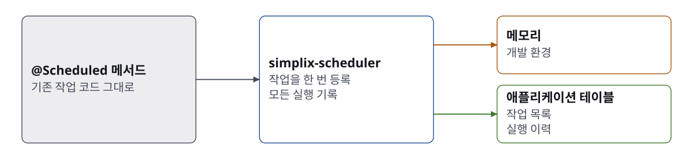

[English](en/scheduler/readme.md) | **한국어**

# simplix-scheduler

예약 작업의 실행 기록을 남기는 모듈입니다. 애플리케이션의 `@Scheduled` 메서드를 감시해 어떤 작업이 있는지와 실행 결과를 기록합니다. 시작 시각, 소요 시간, 실패 여부를 남기며, 작업 코드는 바꿀 필요가 없습니다.



## 설치

[스타터](ko/starter/readme.md)에 이 모듈이 포함되어 있습니다. 스타터 없이 사용할 때는 다음과 같이 추가합니다.

```groovy
dependencies {
    implementation "dev.simplecore.simplix:simplix-scheduler:${version}"
}
```

## 문서

| 하려는 일 | 문서 |
|---|---|
| 첫 실행 기록 확인 | [시작하기](ko/scheduler/getting-started.md) |
| 데이터베이스에 기록 보관 | [데이터베이스에 실행 기록 저장](ko/scheduler/recording-runs-in-a-database.md) |
| 작업을 한 번에 한 인스턴스에서만 실행 | [여러 인스턴스에서 실행](ko/scheduler/running-on-several-instances.md) |
| 속성 조회 | [설정 레퍼런스](ko/scheduler/configuration-reference.md) |
| 실행 전후의 처리와 직접 처리해야 하는 범위 확인 | [simplix-scheduler 동작 방식](ko/scheduler/how-it-works.md) |
| 문제의 원인 확인 | [문제 해결](ko/scheduler/troubleshooting.md) |

## 요구 사항

| 프로젝트 | SimpliX 라인 | 선언할 버전 |
|---|---|---|
| Spring Boot 4 | 2.x | `2.x` 릴리스 |
| Spring Boot 3 | 1.x | `1.x` 릴리스 |

## 라이선스

[SimpleCORE License 1.0 (SCL-1.0)](ko/license.md)
