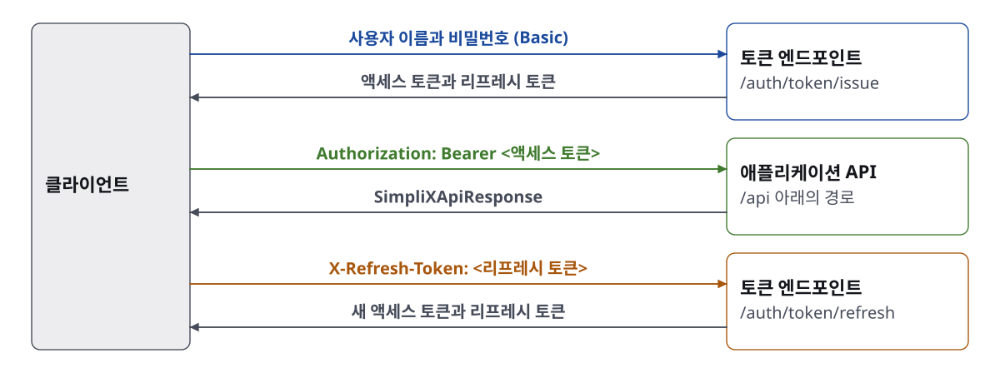

# 애플리케이션 보안 적용

이 문서는 애플리케이션에 로그인을 적용하는 과정을 안내합니다. 끝까지 따라 하면 클라이언트가 사용자 이름과 비밀번호로 로그인해 액세스 토큰과 리프레시 토큰을 받고, 액세스 토큰으로 API를 호출합니다. 인증은 스타터에 포함된 `simplix-auth`가 처리하며, 애플리케이션은 사용자 정보의 위치와 사용자별 권한을 제공합니다.



## 준비

- [시작하기](ko/getting-started.md)에 따라 설정하고 토큰 키를 만든 프로젝트
- [CRUD API 만들기](ko/building-a-crud-api.md)처럼 `/api` 아래에 제공하는 API
- 사용자의 이름, 비밀번호 해시, 역할을 저장하는 엔티티와 이름으로 사용자를 찾는 저장소. 예제에서는 `Member`와 `MemberRepository`입니다.

## 1단계. 사용자 정보 제공

`SimpliXUserDetailsService`를 구현하세요. Spring Security의 `UserDetailsService`에 인증 오류 문구용 메시지 소스를 더한 인터페이스입니다. 이 빈이 있으면 SimpliX가 보안 구성, 토큰 필터, 토큰 엔드포인트를 등록합니다.

```java
@Service
@RequiredArgsConstructor
public class LibraryUserDetailsService implements SimpliXUserDetailsService {

    private final MemberRepository memberRepository;
    private final MessageSource messageSource;

    @Override
    public MessageSource getMessageSource() {
        return messageSource;
    }

    @Override
    public UserDetails loadUserByUsername(String username) {
        Member member = memberRepository.findByUsername(username)
            .orElseThrow(() -> new UsernameNotFoundException(username));

        return User.withUsername(member.getUsername())
            .password(member.getPasswordHash())
            .roles(member.getRole())
            .build();
    }
}
```

비밀번호는 SimpliX가 등록하는 `PasswordEncoder` 빈(Spring Security의 위임 인코더)으로 검사합니다. 사용자를 만들거나 비밀번호를 바꿀 때 이 빈으로 만든 해시를 저장하세요.

```java
member.setPasswordHash(passwordEncoder.encode(rawPassword));
```

## 2단계. 토큰과 공개 경로 설정

```yaml
simplix:
  auth:
    jwe:
      encryption-key-location: classpath:keys/jwe-key.json
    token:
      access-token-lifetime: 1800
      refresh-token-lifetime: 604800
    security:
      permit-all-patterns:
        - /v3/api-docs/**
        - /swagger-ui/**
        - /swagger-ui.html
    cors:
      allowed-origins:
        - http://localhost:3000
```

| 속성 | 기본값 | 의미 |
|---|---|---|
| `simplix.auth.jwe.encryption-key-location` | 없음 | 토큰을 암호화하는 키의 위치. `simplix.auth.jwe.encryption-key`로 값을 직접 지정할 수도 있습니다 |
| `simplix.auth.token.access-token-lifetime` | `1800` | 액세스 토큰의 유효 시간(초) |
| `simplix.auth.token.refresh-token-lifetime` | `604800` | 리프레시 토큰의 유효 시간(초) |
| `simplix.auth.security.permit-all-patterns` | 없음 | 로그인 없이 접근할 수 있는 경로. 기본 공개 경로(`/login`, `/logout`, `/error`, `/actuator/**`, 정적 자원)에 추가됩니다 |
| `simplix.auth.cors.allowed-origins` | 없음 | 브라우저 클라이언트의 호출을 허용할 출처 |

예제의 패턴은 OpenAPI 문서와 Swagger UI를 공개합니다. 정적 키는 개발 환경에 적합합니다. 운영 환경에서는 키를 교체하세요. `simplix.auth.jwe.key-rolling.enabled`를 켜면 데이터베이스에 저장한 키를 사용하며, `JweKeyStore` 빈과 `simplix-encryption`이 필요합니다. 자세한 내용은 [simplix-auth](ko/auth/readme.md) 문서에 있습니다.

## 3단계. 사용자별 권한 결정

로그인은 호출자가 누구인지를 확인합니다. 호출자가 할 수 있는 일은 `simplix-auth`가 활성화하는 메서드 보안으로 결정합니다. CLI가 생성한 컨트롤러는 `hasPermission('<그룹>', '<동작>')`으로 검사하며, 애플리케이션의 `PermissionEvaluator` 빈이 이를 판정합니다. 다음 예제는 관리자에게 모든 동작을 허용하고, 그 밖의 사용자에게는 조회만 허용합니다.

```java
@Component
public class LibraryPermissionEvaluator implements PermissionEvaluator {

    private static final Set<String> READ_ACTIONS = Set.of("list", "view");

    @Override
    public boolean hasPermission(Authentication authentication, Object group, Object action) {
        boolean admin = authentication.getAuthorities().stream()
            .anyMatch(authority -> authority.getAuthority().equals("ROLE_ADMIN"));

        return admin || READ_ACTIONS.contains(String.valueOf(action));
    }

    @Override
    public boolean hasPermission(Authentication authentication, Serializable targetId,
                                 String targetType, Object permission) {
        return false;
    }
}
```

실제 애플리케이션에서는 자체 테이블에서 권한을 조회합니다. `@PreAuthorize("hasRole('ADMIN')")`를 비롯한 Spring Security 표현식은 일반 Spring 애플리케이션과 같게 동작합니다.

## 4단계. 로그인과 API 호출

```bash
# 1. Issue tokens with the user name and password
curl -X POST -u alice:secret http://localhost:8080/auth/token/issue

# 2. Call an API with the access token
curl -H "Authorization: Bearer <access token>" http://localhost:8080/api/catalog/author/search

# 3. Renew the tokens before the access token expires
curl -X POST -H "X-Refresh-Token: <refresh token>" http://localhost:8080/auth/token/refresh

# 4. Revoke the tokens on logout
curl -X POST -H "Authorization: Bearer <access token>" http://localhost:8080/auth/token/revoke
```

발급과 갱신 엔드포인트는 토큰과 만료 시각으로 응답합니다.

```json
{
  "accessToken" : "<token>",
  "refreshToken" : "<token>",
  "accessTokenExpiry" : "<time with zone>",
  "refreshTokenExpiry" : "<time with zone>"
}
```

| 엔드포인트 | 보내는 값 | 응답 |
|---|---|---|
| `POST /auth/token/issue` | 사용자 이름과 비밀번호(HTTP Basic) | 액세스 토큰과 리프레시 토큰 |
| `POST /auth/token/refresh` | `X-Refresh-Token` 헤더의 리프레시 토큰 | 새 액세스 토큰과 리프레시 토큰 |
| `POST /auth/token/revoke` | `Bearer` 액세스 토큰, `X-Refresh-Token` 헤더의 리프레시 토큰, 또는 둘 다 | `SimpliXApiResponse` |

권한 판정에서 거부된 사용자에게는 상태 코드 403으로 응답합니다. 3단계의 판정기를 사용할 때, 관리자가 아닌 사용자가 `POST /api/catalog/author/create`를 호출하면 다음 응답을 받습니다.

```json
{
  "type" : "ERROR",
  "message" : "Insufficient permissions",
  "timestamp" : "<time with zone>",
  "errorCode" : "AUTHZ_INSUFFICIENT_PERMISSIONS",
  "errorDetail" : "You do not have permission to access the requested resource"
}
```

폐기한 토큰을 실제로 거부하려면 블랙리스트를 켜야 합니다(`simplix.auth.token.enable-blacklist: true`).

## 토큰을 받는 경로

| 경로 | 호출자 인증 방식 | 자격 증명이 없는 호출자가 받는 응답 |
|---|---|---|
| `/auth/token/**` | 토큰 엔드포인트가 자격 증명을 직접 검사 | 상태 코드 401과 `SimpliXApiResponse` |
| `/api/**` | `Authorization: Bearer` 헤더의 액세스 토큰 | 상태 코드 401과 `SimpliXApiResponse` |
| 그 밖의 모든 경로 | `/login`의 로그인 폼으로 시작한 세션 | `/login`으로 리다이렉트 |

## 동작하지 않을 때

| 증상 | 원인 | 해결 |
|---|---|---|
| 모든 경로가 본문 없이 401로 응답하고, 올바른 자격 증명으로 호출한 `/auth/token/issue`도 같음 | `SimpliXUserDetailsService` 빈이 없어 SimpliX의 보안 구성이 활성화되지 않음 | 구현 클래스가 스캔 대상 패키지의 빈인지 확인 |
| 발급이 401과 `AUTH_INVALID_CREDENTIALS`로 응답 | 사용자 이름이나 비밀번호가 틀렸거나, 저장한 해시가 `PasswordEncoder` 빈으로 만든 것이 아님 | 등록된 `PasswordEncoder`로 만든 해시를 저장 |
| 유효한 토큰으로 호출한 API가 `/login`으로 리다이렉트됨 | 경로가 `/api/` 밖에 있음 | 컨트롤러를 `/api` 아래에 제공 |
| 엔드포인트가 모든 사용자에게 403과 `AUTHZ_INSUFFICIENT_PERMISSIONS`로 응답 | `hasPermission`을 판정할 `PermissionEvaluator` 빈이 없음 | 빈을 등록(3단계) |
| 브라우저가 `Access-Control-Allow-Origin` 누락을 보고 | 허용되지 않은 출처 | `simplix.auth.cors.allowed-origins`에 출처를 추가 |

## 다음 단계

- [simplix-auth](ko/auth/readme.md): 키 교체, OAuth2 로그인, 토큰 블랙리스트
- [simplix-encryption](ko/encryption/readme.md): 저장하는 개인정보의 암호화
- [경로 보호](ko/auth/securing-paths.md): 웹 로그인, CSRF, 직접 정의하는 규칙
- [소셜 계정 로그인](ko/auth/signing-in-with-social-accounts.md): OAuth2 제공자
