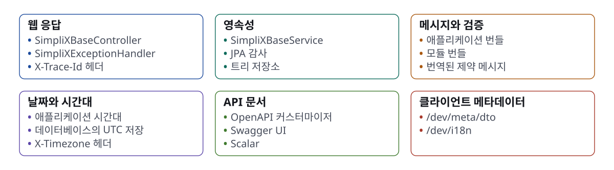

[English](en/starter/readme.md) | **한국어**

# spring-boot-starter-simplix

Spring Boot 애플리케이션을 SimpliX 애플리케이션으로 구성하는 스타터입니다. 의존성 하나로 SimpliX 모듈을 가져오고 웹 계층, JPA, 메시지, 검증, 날짜, API 문서를 구성합니다. 그 결과 모든 엔드포인트가 같은 방식으로 응답하고, 같은 방식으로 오류를 보고하며, 같은 방식으로 문서화됩니다.



## 설치

```groovy
dependencies {
    implementation "dev.simplecore.simplix:spring-boot-starter-simplix:${version}"
}
```

[시작하기](ko/getting-started.md)에 저장소, 함께 필요한 의존성, 첫 애플리케이션의 설정이 있습니다.

## 구성하는 내용

| 영역 | 제공하는 기능 | 문서 |
|---|---|---|
| 서비스와 컨트롤러 | `SimpliXBaseService`, `SimpliXBaseController`, `@SimpliXStandardApi` | [서비스와 컨트롤러 작성](ko/starter/writing-services-and-controllers.md) |
| 오류 | 모든 예외를 추적 ID와 함께 `SimpliXApiResponse`로 응답 | [오류 처리](ko/starter/handling-errors.md) |
| 날짜 | 애플리케이션 시간대, 데이터베이스의 UTC 저장, 요청별 시간대 | [날짜와 시간대 다루기](ko/starter/working-with-dates-and-time-zones.md) |
| 감사 | 행을 생성하고 수정한 사용자와 시각 | [엔티티 감사](ko/starter/auditing-entities.md) |
| 메시지 | 애플리케이션과 라이브러리의 메시지 번들, 번역된 검증 메시지 | [메시지와 로케일](ko/starter/messages-and-locales.md) |
| API 문서 | 응답 래퍼, 열거형, 중첩 객체를 기술한 OpenAPI 문서 | [API 문서화](ko/starter/documenting-the-api.md) |
| 클라이언트 메타데이터 | DTO 메타데이터와 라벨을 제공하는 개발용 엔드포인트 | [클라이언트용 메타데이터 제공](ko/starter/publishing-metadata-for-clients.md) |

모든 속성과 자동 구성은 [설정 레퍼런스](ko/starter/configuration-reference.md)에 정리되어 있습니다. [스타터 동작 방식](ko/starter/how-it-works.md)은 요청이 스타터에서 처리되는 과정을, [메타데이터 레퍼런스](ko/starter/metadata-reference.md)는 메타데이터 엔드포인트가 반환하는 문서의 구조를 설명하고, [문제 해결](ko/starter/troubleshooting.md)에는 증상과 원인이 정리되어 있습니다.

## 포함하는 모듈

`simplix-core`, `simplix-auth`, `simplix-cache`, `simplix-egov`, `simplix-email`, `simplix-encryption`, `simplix-excel`, `simplix-file`, `simplix-hibernate`, `simplix-messaging`, `simplix-mybatis`, `simplix-scheduler`를 포함합니다. `simplix-stream`, `simplix-sync`, `simplix-license`는 별도 의존성으로 추가합니다.

## 요구 사항

| 프로젝트 | SimpliX 라인 | 선언할 버전 |
|---|---|---|
| Spring Boot 4 | 2.x | `2.x` 릴리스 |
| Spring Boot 3 | 1.x | `1.x` 릴리스 |

## 라이선스

[SimpleCORE License 1.0 (SCL-1.0)](ko/license.md)
