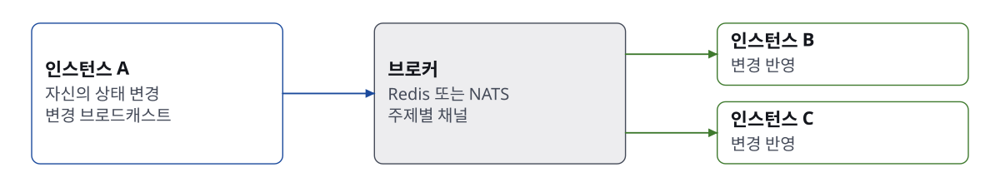

[English](en/sync/readme.md) | **한국어**

# simplix-sync

여러 애플리케이션 인스턴스의 메모리 상태를 동기화하는 모듈입니다. 한 인스턴스가 변경을 브로드캐스트하면 다른 인스턴스가 이를 반영합니다. 제거할 캐시 항목, 바뀐 카운터, 온라인 상태가 된 장치 같은 변경에 사용합니다. 전달은 빠르지만 최선형(best-effort)이므로, 다시 불러올 수 있는 상태에 적합합니다.



## 설치

스타터에는 이 모듈이 포함되어 있지 않습니다. 별도 의존성으로 추가하세요.

```groovy
dependencies {
    implementation "dev.simplecore.simplix:simplix-sync:${version}"
}
```

## 사용하는 경우

| 필요한 기능 | 사용할 모듈 |
|---|---|
| 로컬 상태가 바뀌었음을 다른 인스턴스에 알리고, 메시지 유실을 허용할 수 있음 | simplix-sync |
| 재시도, 컨슈머 그룹, 재생을 포함해 모든 메시지를 전달 | [simplix-messaging](ko/messaging/readme.md) |
| 브라우저로 데이터 전송 | [simplix-stream](ko/stream/readme.md) |

## 문서

- [시작하기](ko/sync/getting-started.md): 첫 변경 브로드캐스트
- [상태 일관성 유지](ko/sync/keeping-state-consistent.md): 상태 저장소와 재조정
- [simplix-sync 동작 방식](ko/sync/how-it-works.md): 메시지 전달 과정과 전송 수단 직접 작성
- [설정 레퍼런스](ko/sync/configuration-reference.md)
- [문제 해결](ko/sync/troubleshooting.md)

## 요구 사항

| 프로젝트 | SimpliX 라인 | 선언할 버전 |
|---|---|---|
| Spring Boot 4 | 2.x | `2.x` 릴리스 |
| Spring Boot 3 | 1.x | `1.x` 릴리스 |

분산 모드에는 Redis(`spring-boot-starter-data-redis`)나 NATS(`io.nats:jnats`와 `Connection` 빈)가 필요합니다.

## 라이선스

[SimpleCORE License 1.0 (SCL-1.0)](ko/license.md)
