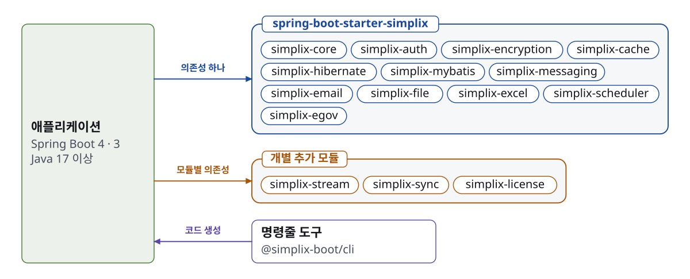

[English](./README.md) | **한국어**

# SimpliX

SimpliX는 업무용 애플리케이션을 위한 Spring Boot 스타터 모음입니다. 애플리케이션의 모든 API를 같은 형태로 만들 수 있도록 엔티티 · 저장소 · 서비스 · 컨트롤러의 기본 클래스와 공통 응답 타입, 일관된 오류 응답을 제공합니다. 이런 애플리케이션에서 매번 다시 만드는 인증, 암호화, 캐시, 파일, 이메일, Excel, 메시징, 스케줄링도 모듈로 제공합니다. 명령줄 도구는 이 구조에 맞는 엔티티의 CRUD 코드를 생성합니다.



## 모듈

| 모듈 | 제공하는 기능 | 스타터 포함 |
|---|---|---|
| [simplix-core](simplix-core/README.ko.md) | 기본 엔티티와 저장소, 트리 구조, 타입 변환, 예외, API 응답, 검증기, 보안 유틸리티 | ✔ |
| [spring-boot-starter-simplix](spring-boot-starter-simplix/README.ko.md) | 스타터: 웹, JPA, 다국어, 검증, 날짜와 시각, Jackson, OpenAPI의 자동 구성과 기본 서비스 · 컨트롤러 | ✔ |
| [simplix-auth](simplix-auth/README.ko.md) | JWE 토큰 인증, OAuth2 소셜 로그인, Spring Security 통합 | ✔ |
| [simplix-encryption](simplix-encryption/README.ko.md) | 키 교체를 지원하는 데이터 암호화 | ✔ |
| [simplix-cache](simplix-cache/README.ko.md) | Caffeine(로컬)과 Redis(분산)를 같은 API로 사용하는 캐시 | ✔ |
| [simplix-hibernate](simplix-hibernate/README.ko.md) | Hibernate 2차 캐시 관리 | ✔ |
| [simplix-mybatis](simplix-mybatis/README.ko.md) | 타입 핸들러를 포함한 MyBatis 통합 | ✔ |
| [simplix-messaging](simplix-messaging/README.ko.md) | NATS JetStream, Redis Streams, Kafka, RabbitMQ, 로컬 브로커를 지원하는 메시징 | ✔ |
| [simplix-email](simplix-email/README.ko.md) | SMTP, AWS SES, SendGrid, Resend를 지원하는 템플릿 기반 이메일 | ✔ |
| [simplix-file](simplix-file/README.ko.md) | 로컬 디스크, AWS S3, Google Cloud Storage를 지원하는 파일 저장 | ✔ |
| [simplix-excel](simplix-excel/README.ko.md) | Excel과 CSV 가져오기 · 내보내기 | ✔ |
| [simplix-scheduler](simplix-scheduler/README.ko.md) | `@Scheduled` 메서드의 실행 기록과 ShedLock 연동 | ✔ |
| [simplix-egov](simplix-egov/README.ko.md) | eGovFrame 연동 | ✔ |
| [simplix-stream](simplix-stream/README.ko.md) | SSE와 WebSocket 기반 실시간 구독 | 직접 추가 |
| [simplix-sync](simplix-sync/README.ko.md) | 인스턴스 간 상태 동기화와 경량 pub/sub | 직접 추가 |
| [simplix-license](simplix-license/README.ko.md) | 라이선스 등록 · 활성화와 기능 · 수량 제한 | 직접 추가 |

명령줄 도구 [`@simplix-boot/cli`](simplix-cli/README.ko.md)는 npm 패키지이며, JPA 엔티티의 서비스, REST 컨트롤러, DTO, 테스트를 생성합니다.

## 요구 사항

Java 17 이상이 필요합니다. SimpliX는 Spring Boot 세대마다 릴리스 라인이 하나씩 있으며, 모든 라인에 같은 기능과 수정이 반영됩니다.

| SimpliX 라인 | Spring Boot | 브랜치 | CLI |
|---|---|---|---|
| 2.x | 4 | `main` | `@simplix-boot/cli` |
| 1.x | 3 | `spring-boot-3x` | `@simplix-boot/cli@spring-boot-3x` |

## 설치

아티팩트는 GitHub Packages에 `dev.simplecore.simplix` 그룹으로 게시됩니다. `build.gradle`에 저장소와 스타터를 추가하세요.

```groovy
repositories {
    mavenCentral()
    maven {
        url = uri("https://maven.pkg.github.com/simplix-framework/simplix")
        credentials {
            username = project.findProperty("gpr.user") ?: System.getenv("GITHUB_USERNAME")
            password = project.findProperty("gpr.token") ?: System.getenv("GITHUB_TOKEN")
        }
    }
}

dependencies {
    implementation "dev.simplecore.simplix:spring-boot-starter-simplix:${version}"
}
```

GitHub Packages는 공개 패키지에도 인증 정보를 요구합니다. `read:packages` 권한이 있는 개인 액세스 토큰을 `gradle.properties`에 지정하고, 이 파일은 버전 관리에서 제외하세요.

```properties
gpr.user=<your GitHub user name>
gpr.token=<personal access token with read:packages>
```

## 빠른 시작

1. 프로젝트를 설정합니다: [시작하기](docs/ko/getting-started.md)
2. 엔티티를 작성하고 CLI로 API를 생성합니다: [CRUD API 만들기](docs/ko/building-a-crud-api.md)
3. 로그인을 적용합니다: [애플리케이션 보안 적용](docs/ko/securing-an-application.md)

## 문서

[문서 홈](docs/ko/README.md)에 하려는 일별로 모든 문서를 정리했습니다. 모듈별 소개 문서는 위 표에 연결되어 있습니다. [릴리스 라인](docs/ko/release-lines.md)에서 라인별 차이와 아티팩트의 게시 위치를 설명하고, [변경 이력](docs/ko/changelog.md)에 변경 내용을 기록합니다.

## 소스에서 빌드

```bash
git clone https://github.com/simplix-framework/simplix.git
cd simplix

# Build without tests
./gradlew clean build -x test

# Build with tests
./gradlew build

# Install into the local Maven repository
./gradlew publishToMavenLocal
```

`simplix-license`를 빌드하려면 라이선스 SDK 저장소의 인증 정보(`gradle.properties`의 `accesscore.gpr.user`, `accesscore.gpr.token`)가 필요합니다.

## 라이선스

SimpleCORE License 1.0 (SCL-1.0). [LICENSE](LICENSE)와 [요약](docs/ko/license.md)을 참조하세요.
