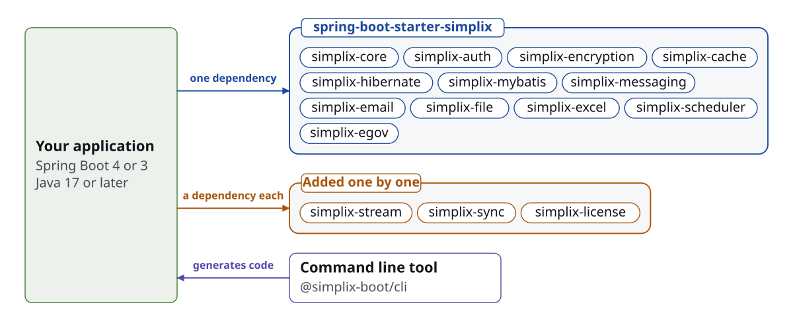

**English** | [한국어](./README.ko.md)

# SimpliX

SimpliX is a set of Spring Boot starters for business applications. It gives every API of an application the same shape (base classes for the entity, repository, service and controller, one response type, one way to report errors) and adds the parts such applications keep rebuilding: authentication, encryption, caching, files, email, Excel, messaging and scheduling. A command line tool generates the CRUD code of an entity on top of it.



## Modules

| Module | What it gives you | In the starter |
|---|---|---|
| [simplix-core](simplix-core/README.md) | Base entity and repository, tree structures, type converters, exceptions, the API response, validators, security utilities | ✔ |
| [spring-boot-starter-simplix](spring-boot-starter-simplix/README.md) | The starter: auto-configuration of web, JPA, i18n, validation, date and time, Jackson and OpenAPI, and the base service and controller | ✔ |
| [simplix-auth](simplix-auth/README.md) | JWE token authentication, OAuth2 social login, Spring Security integration | ✔ |
| [simplix-encryption](simplix-encryption/README.md) | Data encryption with key rotation | ✔ |
| [simplix-cache](simplix-cache/README.md) | One cache API over Caffeine (local) and Redis (distributed) | ✔ |
| [simplix-hibernate](simplix-hibernate/README.md) | Hibernate second-level cache management | ✔ |
| [simplix-mybatis](simplix-mybatis/README.md) | MyBatis integration with type handlers | ✔ |
| [simplix-messaging](simplix-messaging/README.md) | Messaging over NATS JetStream, Redis Streams, Kafka, RabbitMQ or a local broker | ✔ |
| [simplix-email](simplix-email/README.md) | Email through SMTP, AWS SES, SendGrid or Resend, with templates | ✔ |
| [simplix-file](simplix-file/README.md) | File storage on the local disk, AWS S3 or Google Cloud Storage | ✔ |
| [simplix-excel](simplix-excel/README.md) | Excel and CSV import and export | ✔ |
| [simplix-scheduler](simplix-scheduler/README.md) | Execution records of `@Scheduled` methods, with ShedLock | ✔ |
| [simplix-egov](simplix-egov/README.md) | eGovFrame integration | ✔ |
| [simplix-stream](simplix-stream/README.md) | Real-time subscriptions over SSE and WebSocket | add it yourself |
| [simplix-sync](simplix-sync/README.md) | State sync between instances and lightweight pub/sub | add it yourself |
| [simplix-license](simplix-license/README.md) | License registration, activation and feature or quota gating | add it yourself |

The command line tool [`@simplix-boot/cli`](simplix-cli/README.md) is an npm package: it generates the service, REST controller, DTOs and tests of a JPA entity.

## Requirements

Java 17 or later. SimpliX has one release line per Spring Boot generation, and every line receives the same features and fixes.

| SimpliX line | Spring Boot | Branch | CLI |
|---|---|---|---|
| 2.x | 4 | `main` | `@simplix-boot/cli` |
| 1.x | 3 | `spring-boot-3x` | `@simplix-boot/cli@spring-boot-3x` |

## Install

The artifacts are published to GitHub Packages under the group `dev.simplecore.simplix`. Add the repository and the starter to `build.gradle`.

```groovy
repositories {
    mavenCentral()
    maven {
        url = uri("https://maven.pkg.github.com/simplix-framework/simplix")
        credentials {
            username = project.findProperty("gpr.user") ?: System.getenv("GITHUB_USERNAME")
            password = project.findProperty("gpr.token") ?: System.getenv("GITHUB_TOKEN")
        }
    }
}

dependencies {
    implementation "dev.simplecore.simplix:spring-boot-starter-simplix:${version}"
}
```

GitHub Packages asks for credentials even for public packages. Put a personal access token with the `read:packages` scope in `gradle.properties`, and keep that file out of version control.

```properties
gpr.user=<your GitHub user name>
gpr.token=<personal access token with read:packages>
```

## Quick start

1. Set up a project: [Getting started](docs/en/getting-started.md).
2. Write an entity and let the CLI generate its API: [Building a CRUD API](docs/en/building-a-crud-api.md).
3. Put it behind a login: [Securing an application](docs/en/securing-an-application.md).

## Documentation

The [documentation home](docs/en/README.md) lists every document by what you want to do. Each module has an introduction of its own, linked in the table above. [Release lines](docs/en/release-lines.md) explains the release lines and where each artifact is published, and the [changelog](docs/en/changelog.md) lists what changed.

## Build from source

```bash
git clone https://github.com/simplix-framework/simplix.git
cd simplix

# Build without tests
./gradlew clean build -x test

# Build with tests
./gradlew build

# Install into the local Maven repository
./gradlew publishToMavenLocal
```

Building `simplix-license` needs credentials for the license SDK repository (`accesscore.gpr.user`, `accesscore.gpr.token` in `gradle.properties`).

## License

SimpleCORE License 1.0 (SCL-1.0). See [LICENSE](LICENSE) and the [summary](docs/en/license.md).
