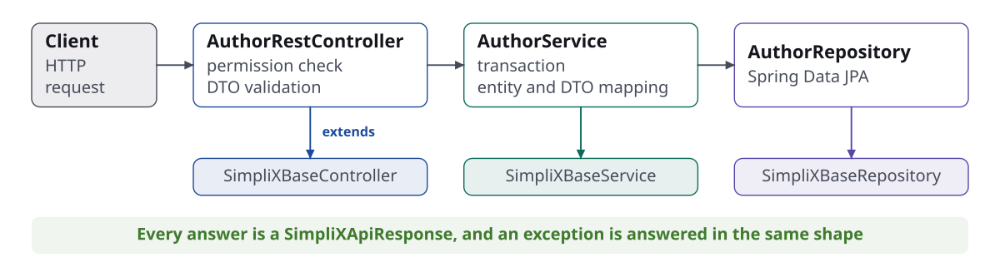

# Building a CRUD API

This page takes one entity to a complete API: create, read, update, delete and search, with validation and permission checks. You write the entity and its repository; the command line tool writes the rest on SimpliX base classes.



## Before you begin

- A project set up as [Getting started](./getting-started.md) describes.
- The [SimpliX CLI](../../simplix-cli/README.md) of your release line, which needs Node.js 20 or later.

## Step 1. Write the entity

```java
package com.example.library.domain.catalog.entity;

@Entity
@Table(name = "authors")
@Getter
@Setter
@NoArgsConstructor
public class Author extends SimpliXBaseEntity<String> {

    @Id
    @GeneratedValue(strategy = GenerationType.UUID)
    @Column(name = "author_id", nullable = false, updatable = false)
    private String authorId;

    @Column(name = "pen_name", nullable = false, length = 120)
    @NameField
    private String penName;

    @Column(name = "biography", length = 2000)
    private String biography;

    @Override
    public String getId() {
        return authorId;
    }

    @Override
    public void setId(String id) {
        this.authorId = id;
    }
}
```

An entity extends `SimpliXBaseEntity` and says which field is its identifier through `getId` and `setId`. `@NameField` marks the field a record is named by on a screen: the first column of its list, the name in a delete confirmation, the title of its detail.

## Step 2. Write the repository

```java
package com.example.library.domain.catalog.repository;

public interface AuthorRepository extends SimpliXBaseRepository<Author, String> {
}
```

`SimpliXBaseRepository` is a `JpaRepository` with `JpaSpecificationExecutor`. Add query methods as in any Spring Data repository.

## Step 3. Generate the API

Create the CLI configuration once per project: run `init`, then write `.simplix/generator-simplix.json` as the CLI's [getting started](../../simplix-cli/docs/en/getting-started.md) shows. Then describe the entity.

```bash
simplix-boot init
simplix-boot config Author
```

`config` writes `.simplix/entity/Author.yml`. Set the request path and the permission group at its top.

```yaml
entity: Author

modulePath: catalog
idField: authorId
nameField: penName
thymeleafBaseDir: catalog/author
permissionGroup: CATALOG
```

Generate the code and move it into a module. The module folder has to exist before `promote` runs.

```bash
simplix-boot generate Author
mkdir -p modules/catalog
simplix-boot promote Author --module catalog
```

In a multi-project build `modules/catalog` is a Gradle subproject. In a single-project build, add its folders to the source sets.

```groovy
sourceSets {
    main { java { srcDir 'modules/catalog/src/main/java' } }
    test { java { srcDir 'modules/catalog/src/test/java' } }
}
```

## Step 4. Serve the API under /api

`simplix-auth` checks access tokens on paths under `/api/`. Paths outside it are treated as web pages and send a caller without a session to the login page. Give the REST controllers of your application the `/api` prefix.

```java
@Configuration
public class ApiPathConfig implements WebMvcConfigurer {

    @Override
    public void configurePathMatch(PathMatchConfigurer configurer) {
        configurer.addPathPrefix("/api", controller ->
            controller.isAnnotationPresent(RestController.class)
                && controller.getPackageName().startsWith("com.example.library"));
    }
}
```

## What you get

`promote` puts these files into the module, where you edit them like any other code. When the entity changes, run `generate` and `promote` again: `promote` merges the new render into a file you edited and reports a file it cannot merge as a conflict ([command reference](../../simplix-cli/docs/en/command-reference.md)).

| File | Holds |
|---|---|
| `web/catalog/dto/AuthorDTOs.java` | the request and response classes of the entity: create, update, batch update, detail, list and search |
| `web/catalog/service/AuthorService.java` | the service, a `SimpliXBaseService` with create, update, delete and search methods |
| `web/catalog/controller/AuthorRestController.java` | the REST controller with the endpoints below |
| `web/catalog/service/AuthorServiceTest.java` under `src/test` | a test of the service |

The generated controller serves these endpoints.

| Request | Does | Permission action |
|---|---|---|
| `POST /api/catalog/author/create` | creates a record | `create` |
| `GET /api/catalog/author/{authorId}` | reads one record | `view` |
| `GET /api/catalog/author/{authorId}/edit` | reads one record in the shape of the update form | `view` |
| `PUT /api/catalog/author/{authorId}` | updates a record | `edit` |
| `PATCH /api/catalog/author` | updates several records, each with its own values | `edit` |
| `PATCH /api/catalog/author/batch` | sets the same values on several records | `edit` |
| `DELETE /api/catalog/author/{authorId}` | deletes a record | `delete` |
| `DELETE /api/catalog/author/batch` | deletes several records | `delete` |
| `GET /api/catalog/author/search` | searches with query parameters | `list` |
| `POST /api/catalog/author/search` | searches with a condition in the body | `list` |

Until the application has a login the endpoints answer 401. [Securing an application](./securing-an-application.md) adds the login; the responses below come from a call made with a token.

### The response

Every endpoint answers with a `SimpliXApiResponse`. `type` is `SUCCESS`, `FAILURE` or `ERROR`, and `body` carries the data. A field without a value is left out of the JSON. This is the answer to `POST /api/catalog/author/create`.

```json
{
  "type" : "SUCCESS",
  "body" : {
    "authorId" : "<id>",
    "penName" : "Ursula",
    "biography" : "Writes about other worlds"
  },
  "timestamp" : "<time with zone>"
}
```

An error fills `message`, `errorCode` and `errorDetail`. The same request without `penName` is answered with status 400. The message texts follow the `Accept-Language` header.

```json
{
  "type" : "ERROR",
  "message" : "Validation failed",
  "timestamp" : "<time with zone>",
  "errorCode" : "VAL_VALIDATION_FAILED",
  "errorDetail" : [ {
    "field" : "penName",
    "message" : "This field cannot be blank",
    "code" : "NotBlank"
  } ]
}
```

### Permissions

Each endpoint is guarded by `@PreAuthorize("hasPermission('CATALOG', '<action>')")`. Spring Security answers `hasPermission` through a `PermissionEvaluator` bean, which your application provides: it decides whether the current user may perform the action in the group. Without that bean every call is answered with 403. [Securing an application](./securing-an-application.md) shows one.

## Writing a controller by hand

An endpoint that is not the CRUD of one entity is written by hand. Return a `SimpliXApiResponse` so that it answers in the same shape, guard it with the same permission check, and add `@SimpliXStandardApi` to describe the standard responses in the OpenAPI document. The prefix of step 4 makes this one `GET /api/catalog/statistics/author-count`.

```java
@RestController
@RequestMapping("/catalog/statistics")
@RequiredArgsConstructor
@SimpliXStandardApi
public class CatalogStatisticsController {

    private final AuthorRepository authorRepository;

    @GetMapping("/author-count")
    @PreAuthorize("hasPermission('CATALOG', 'list')")
    public SimpliXApiResponse<Long> authorCount() {
        return SimpliXApiResponse.success(authorRepository.count());
    }
}
```

## Next steps

- [Securing an application](./securing-an-application.md)
- [SimpliX CLI](../../simplix-cli/README.md): templates, regeneration, versions
- [simplix-core](../../simplix-core/README.md): entities, repositories, tree structures, exceptions
