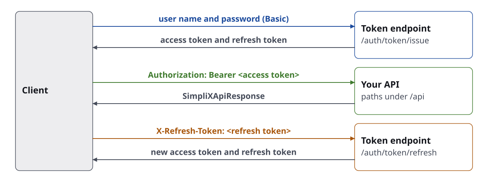

# Securing an application

This page puts an application behind a login. At the end a client signs in with a user name and a password, receives an access token and a refresh token, and calls the API with the access token. The work is done by `simplix-auth`, which the starter includes; you tell it where your users are and what each of them may do.



## Before you begin

- A project set up as [Getting started](./getting-started.md) describes, with its token key.
- An API served under `/api`, as in [Building a CRUD API](./building-a-crud-api.md).
- An entity that stores each user's name, password hash and role, and a repository that finds a user by name. The example calls them `Member` and `MemberRepository`.

## Step 1. Tell SimpliX where the users are

Implement `SimpliXUserDetailsService`. It is Spring Security's `UserDetailsService` plus a message source for the texts of authentication errors. Once this bean exists, SimpliX registers its security configuration, the token filter and the token endpoints.

```java
@Service
@RequiredArgsConstructor
public class LibraryUserDetailsService implements SimpliXUserDetailsService {

    private final MemberRepository memberRepository;
    private final MessageSource messageSource;

    @Override
    public MessageSource getMessageSource() {
        return messageSource;
    }

    @Override
    public UserDetails loadUserByUsername(String username) {
        Member member = memberRepository.findByUsername(username)
            .orElseThrow(() -> new UsernameNotFoundException(username));

        return User.withUsername(member.getUsername())
            .password(member.getPasswordHash())
            .roles(member.getRole())
            .build();
    }
}
```

Passwords are checked with the `PasswordEncoder` bean SimpliX registers, Spring Security's delegating encoder. Store the hash this bean produces when a user is created or changes the password.

```java
member.setPasswordHash(passwordEncoder.encode(rawPassword));
```

## Step 2. Configure tokens and open paths

```yaml
simplix:
  auth:
    jwe:
      encryption-key-location: classpath:keys/jwe-key.json
    token:
      access-token-lifetime: 1800
      refresh-token-lifetime: 604800
    security:
      permit-all-patterns:
        - /v3/api-docs/**
        - /swagger-ui/**
        - /swagger-ui.html
    cors:
      allowed-origins:
        - http://localhost:3000
```

| Property | Default | Meaning |
|---|---|---|
| `simplix.auth.jwe.encryption-key-location` | none | the key that encrypts the tokens; `simplix.auth.jwe.encryption-key` gives it inline |
| `simplix.auth.token.access-token-lifetime` | `1800` | seconds an access token is valid |
| `simplix.auth.token.refresh-token-lifetime` | `604800` | seconds a refresh token is valid |
| `simplix.auth.security.permit-all-patterns` | none | paths open without a login, added to the built-in ones (`/login`, `/logout`, `/error`, `/actuator/**`, static resources) |
| `simplix.auth.cors.allowed-origins` | none | origins a browser client may call from |

The patterns of the example open the OpenAPI document and Swagger UI. A static key suits development. In production, rotate keys: `simplix.auth.jwe.key-rolling.enabled` switches to keys stored in your database, which needs a `JweKeyStore` bean and `simplix-encryption`. The [simplix-auth](../../simplix-auth/README.md) documents describe it.

## Step 3. Decide what each user may do

A login says who the caller is. What the caller may do is decided by method security, which `simplix-auth` switches on. The controllers the CLI generates ask `hasPermission('<group>', '<action>')`, and a `PermissionEvaluator` bean of your application answers. This one lets an administrator do everything and everyone else read.

```java
@Component
public class LibraryPermissionEvaluator implements PermissionEvaluator {

    private static final Set<String> READ_ACTIONS = Set.of("list", "view");

    @Override
    public boolean hasPermission(Authentication authentication, Object group, Object action) {
        boolean admin = authentication.getAuthorities().stream()
            .anyMatch(authority -> authority.getAuthority().equals("ROLE_ADMIN"));

        return admin || READ_ACTIONS.contains(String.valueOf(action));
    }

    @Override
    public boolean hasPermission(Authentication authentication, Serializable targetId,
                                 String targetType, Object permission) {
        return false;
    }
}
```

A real application looks the permission up in its own tables. `@PreAuthorize("hasRole('ADMIN')")` and the other Spring Security expressions work as in any Spring application.

## Step 4. Sign in and call the API

```bash
# 1. Issue tokens with the user name and password
curl -X POST -u alice:secret http://localhost:8080/auth/token/issue

# 2. Call an API with the access token
curl -H "Authorization: Bearer <access token>" http://localhost:8080/api/catalog/author/search

# 3. Renew the tokens before the access token expires
curl -X POST -H "X-Refresh-Token: <refresh token>" http://localhost:8080/auth/token/refresh

# 4. Revoke the tokens on logout
curl -X POST -H "Authorization: Bearer <access token>" http://localhost:8080/auth/token/revoke
```

The issue and refresh endpoints answer with the tokens and their expiry times.

```json
{
  "accessToken" : "<token>",
  "refreshToken" : "<token>",
  "accessTokenExpiry" : "<time with zone>",
  "refreshTokenExpiry" : "<time with zone>"
}
```

| Endpoint | Send | Answers |
|---|---|---|
| `POST /auth/token/issue` | user name and password as HTTP Basic | an access token and a refresh token |
| `POST /auth/token/refresh` | the refresh token in `X-Refresh-Token` | a new access token and refresh token |
| `POST /auth/token/revoke` | the access token as `Bearer`, the refresh token in `X-Refresh-Token`, or both | a `SimpliXApiResponse` |

A user the evaluator refuses is answered with status 403. With the evaluator of step 3, this is what a member who is not an administrator receives from `POST /api/catalog/author/create`.

```json
{
  "type" : "ERROR",
  "message" : "Insufficient permissions",
  "timestamp" : "<time with zone>",
  "errorCode" : "AUTHZ_INSUFFICIENT_PERMISSIONS",
  "errorDetail" : "You do not have permission to access the requested resource"
}
```

Revoked tokens are refused only when the blacklist is on (`simplix.auth.token.enable-blacklist: true`).

## Which paths take a token

| Path | How a caller is authenticated | A caller without credentials receives |
|---|---|---|
| `/auth/token/**` | the token endpoints check the credentials themselves | status 401 as a `SimpliXApiResponse` |
| `/api/**` | the access token in `Authorization: Bearer` | status 401 as a `SimpliXApiResponse` |
| every other path | a session started by the login form at `/login` | a redirect to `/login` |

## If it does not work

| Symptom | Cause | Fix |
|---|---|---|
| every path answers 401 with an empty body, also `/auth/token/issue` with correct credentials | no `SimpliXUserDetailsService` bean, so SimpliX's security configuration is not active | check that the implementation is a bean in a scanned package |
| issue answers 401 with `AUTH_INVALID_CREDENTIALS` | wrong user name or password, or a stored hash the `PasswordEncoder` bean did not make | store hashes made by the registered `PasswordEncoder` |
| an API call with a valid token is redirected to `/login` | the path is outside `/api/` | serve the controller under `/api` |
| an endpoint answers 403 with `AUTHZ_INSUFFICIENT_PERMISSIONS` for every user | no `PermissionEvaluator` bean answers `hasPermission` | register one (step 3) |
| a browser reports a missing `Access-Control-Allow-Origin` | the origin is not allowed | add it to `simplix.auth.cors.allowed-origins` |

## Next steps

- [simplix-auth](../../simplix-auth/README.md): key rotation, OAuth2 login, the token blacklist
- [simplix-encryption](../../simplix-encryption/README.md): encrypting personal data at rest
- [Securing paths](../../simplix-auth/docs/en/securing-paths.md): the web login, CSRF and rules of your own
- [Signing in with social accounts](../../simplix-auth/docs/en/signing-in-with-social-accounts.md): OAuth2 providers
