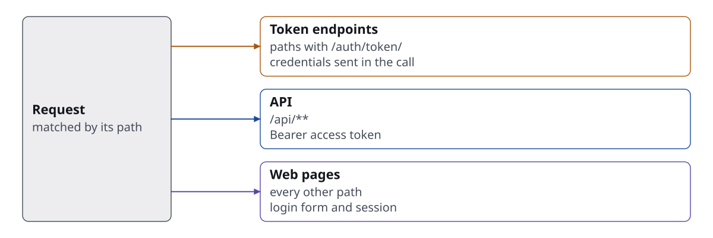

**English** | [한국어](./README.ko.md)

# simplix-auth

Authentication for a SimpliX application. A client signs in with a user name and password, or with a social account, and receives encrypted tokens; the module checks them on every API call, renews and revokes them, and configures Spring Security around them.



## Install

The [starter](../spring-boot-starter-simplix/README.md) includes the module. Without the starter, add it with Spring Security.

```groovy
dependencies {
    implementation "dev.simplecore.simplix:simplix-auth:${version}"
    implementation 'org.springframework.boot:spring-boot-starter-security'
}
```

## Start here

[Securing an application](../docs/en/securing-an-application.md) takes an application from no login to tokens and permissions. [Getting started](docs/en/getting-started.md) lists what the module needs from the application.

## What it provides

| To | Read |
|---|---|
| issue, use and renew tokens | [Issuing and refreshing tokens](docs/en/issuing-and-refreshing-tokens.md) |
| make a logout take effect at once | [Revoking tokens](docs/en/revoking-tokens.md) |
| open paths, set CORS, CSRF and security headers | [Securing paths](docs/en/securing-paths.md) |
| replace the encryption key on a schedule | [Rotating keys](docs/en/rotating-keys.md) |
| let users sign in with Google, Kakao, Naver and others | [Signing in with social accounts](docs/en/signing-in-with-social-accounts.md) |
| accept tokens another identity provider issued | [Accepting external tokens](docs/en/accepting-external-tokens.md) |
| sign download links and other short-lived tokens | [Signing your own tokens](docs/en/signing-your-own-tokens.md) |
| log, count and check authentication | [Monitoring authentication](docs/en/monitoring-authentication.md) |
| see which part answers a request and when each part is registered | [How simplix-auth works](docs/en/how-it-works.md) |
| look a property up | [Configuration reference](docs/en/configuration-reference.md) |
| fix a failing login | [Troubleshooting](docs/en/troubleshooting.md) |

## Requirements

| Your project | SimpliX line | Version to declare |
|---|---|---|
| Spring Boot 4 | 2.x | a `2.x` release |
| Spring Boot 3 | 1.x | a `1.x` release |

## License

[SimpleCORE License 1.0 (SCL-1.0)](../docs/en/license.md)
