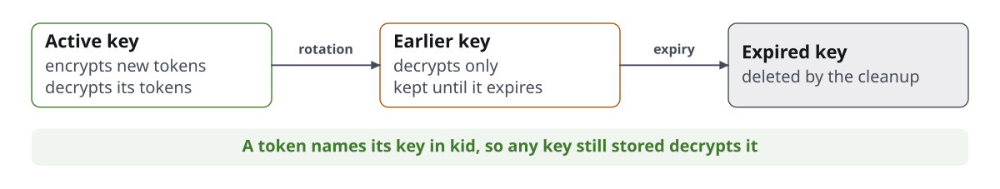

# Rotating keys

How to replace the key that encrypts tokens without signing anyone out. In key rolling mode the keys live in your database, encrypted; a new key encrypts new tokens while the earlier keys still decrypt the tokens issued before.



## Before you begin

- [simplix-encryption](../../../simplix-encryption/README.md) configured: the key material is encrypted with it before it is stored.
- A table for the keys.

## Step 1. Store the keys

Implement `JweKeyStore` over a table of your database. The module creates and encrypts the keys; the store only saves and finds them.

```java
@Entity
@Table(name = "jwe_keys", uniqueConstraints = @UniqueConstraint(columnNames = "initialization_marker"))
@Getter
@Setter
@NoArgsConstructor
public class JweKeyEntity {

    @Id
    @Column(length = 80)
    private String version;

    @Column(name = "encrypted_public_key", nullable = false, columnDefinition = "TEXT")
    private String encryptedPublicKey;

    @Column(name = "encrypted_private_key", nullable = false, columnDefinition = "TEXT")
    private String encryptedPrivateKey;

    @Column(nullable = false)
    private boolean active;

    @Column(name = "created_at", nullable = false)
    private Instant createdAt;

    @Column(name = "expires_at")
    private Instant expiresAt;

    @Column(name = "initialization_marker", length = 20)
    private String initializationMarker;
}
```

```java
public interface JweKeyRepository extends JpaRepository<JweKeyEntity, String> {

    Optional<JweKeyEntity> findFirstByActiveTrueOrderByCreatedAtDesc();

    List<JweKeyEntity> findByActiveFalseAndExpiresAtBefore(Instant time);

    @Modifying
    @Query("update JweKeyEntity k set k.active = false where k.version <> :version")
    void deactivateAllExcept(@Param("version") String version);
}
```

```java
@Component
@RequiredArgsConstructor
public class DatabaseJweKeyStore implements JweKeyStore {

    private final JweKeyRepository repository;

    @Override
    @Transactional
    public JweKeyData save(JweKeyData keyData) {
        return toData(repository.save(toEntity(keyData)));
    }

    @Override
    @Transactional(readOnly = true)
    public Optional<JweKeyData> findByVersion(String version) {
        return repository.findById(version).map(this::toData);
    }

    @Override
    @Transactional(readOnly = true)
    public Optional<JweKeyData> findCurrent() {
        return repository.findFirstByActiveTrueOrderByCreatedAtDesc().map(this::toData);
    }

    @Override
    @Transactional(readOnly = true)
    public List<JweKeyData> findAll() {
        return repository.findAll().stream().map(this::toData).toList();
    }

    @Override
    @Transactional
    public void deactivateAllExcept(String exceptVersion) {
        repository.deactivateAllExcept(exceptVersion);
    }

    @Override
    @Transactional(readOnly = true)
    public List<JweKeyData> findExpired() {
        return repository.findByActiveFalseAndExpiresAtBefore(Instant.now()).stream().map(this::toData).toList();
    }

    @Override
    @Transactional
    public boolean deleteByVersion(String version) {
        if (!repository.existsById(version)) {
            return false;
        }
        repository.deleteById(version);
        return true;
    }

    private JweKeyEntity toEntity(JweKeyData data) {
        JweKeyEntity entity = new JweKeyEntity();
        entity.setVersion(data.getVersion());
        entity.setEncryptedPublicKey(data.getEncryptedPublicKey());
        entity.setEncryptedPrivateKey(data.getEncryptedPrivateKey());
        entity.setActive(data.isActive());
        entity.setCreatedAt(data.getCreatedAt());
        entity.setExpiresAt(data.getExpiresAt());
        entity.setInitializationMarker(data.getInitializationMarker());
        return entity;
    }

    private JweKeyData toData(JweKeyEntity entity) {
        return JweKeyData.builder()
            .version(entity.getVersion())
            .encryptedPublicKey(entity.getEncryptedPublicKey())
            .encryptedPrivateKey(entity.getEncryptedPrivateKey())
            .active(entity.isActive())
            .createdAt(entity.getCreatedAt())
            .expiresAt(entity.getExpiresAt())
            .initializationMarker(entity.getInitializationMarker())
            .build();
    }
}
```

| Field of `JweKeyData` | Holds |
|---|---|
| `version` | the id of the key, such as `jwe-v1795531864917-a1dc1bfc`; it is the `kid` of the tokens |
| `encryptedPublicKey`, `encryptedPrivateKey` | the key pair, encrypted |
| `active` | whether this is the key that encrypts new tokens |
| `createdAt`, `expiresAt` | when the key was created and when it may be deleted |
| `initializationMarker` | a marker that keeps several instances from creating the first key at once; give its column a unique constraint |

- `findExpired` returns the keys that may be deleted. Return only keys that are no longer active and past `expiresAt`, as the repository method above does.
- `deleteByVersion` and `findExpired` have default implementations that delete nothing. A store that leaves them out keeps every key for ever.
- The unique constraint on `initialization_marker` lets only one instance insert the first key when several start together; the others read the key that was stored.

## Step 2. Switch key rolling on

```yaml
simplix:
  auth:
    jwe:
      key-rolling:
        enabled: true
        key-size: 2048
        auto-initialize: true
        retention:
          buffer-seconds: 86400
          auto-cleanup: false
```

> ⚠ Remove `encryption-key` and `encryption-key-location` when you switch key rolling on. With both configured, tokens are issued and then refused.

With `auto-initialize` the first key is created when the application starts and the store is empty. The log shows it.

```
JWE key rotation completed, new version: jwe-v1795531864917-a1dc1bfc, expires at: 2026-12-02T14:51:04.920433Z
JweKeyRotationService configured - keySize: 2048 bits, retention: 604800 + 86400 seconds, autoCleanup: false
```

## Step 3. Rotate on a schedule

```java
@Component
@RequiredArgsConstructor
public class JweKeyRotationJob {

    private final JweKeyRotationService rotationService;

    @Scheduled(cron = "0 0 3 1 * *")
    @SchedulerLock(name = "jwe-key-rotation")
    public void rotate() {
        rotationService.rotateKey();
        rotationService.cleanupExpiredKeys();
    }
}
```

`rotateKey()` creates a key, makes it the active one and returns its version. `cleanupExpiredKeys()` deletes the keys whose `expiresAt` has passed. The lock keeps several instances from rotating at the same moment; see [simplix-scheduler](../../../simplix-scheduler/README.md).

## How long a key is kept

`expiresAt` is set when a key is created: the creation time plus the refresh token lifetime plus `buffer-seconds`, eight days with the defaults. `cleanupExpiredKeys()` deletes what the `findExpired()` of your store returns, so return only keys that are no longer active and past `expiresAt`: a token encrypted with a key can be valid for one refresh token lifetime after the key stops being the active one. `auto-cleanup: true` runs the cleanup during a rotation.

## Choose the rotation interval

Rotation limits how much one key protects; retention decides how many keys are kept. Each key lives for the refresh token lifetime plus the buffer after it is created, so the number of keys in the table is about that time divided by the rotation interval, plus one.

| Rotation | With the default lifetimes (7 days and a 1 day buffer) |
|---|---|
| every month | one active key, and one earlier key during the first eight days after a rotation |
| every week | one active key and one or two earlier keys |
| every day | one active key and about eight earlier keys |

## Move from a static key

1. Create the table and the store, and deploy them with key rolling still off.
2. Switch `key-rolling.enabled` on and remove `encryption-key` and `encryption-key-location` in the same deployment.
3. Tell clients to sign in again: a token encrypted with the static key is not in the store, so it is refused after the switch.

## Several instances

Every instance reads the keys from the same store. An instance that did not run the rotation learns the new key when it meets a token whose `kid` it does not know, or when `DatabaseJweKeyProvider.refresh()` is called.

## Related documents

- [simplix-encryption](../../../simplix-encryption/README.md)
- [Issuing and refreshing tokens](./issuing-and-refreshing-tokens.md)
- [Configuration reference](./configuration-reference.md)
