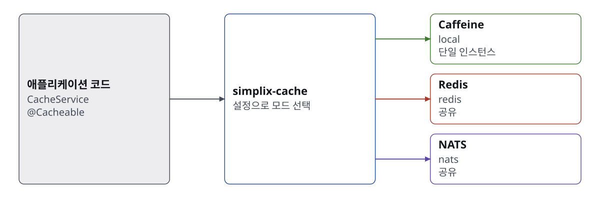

[English](./README.md) | **한국어**

# simplix-cache

SimpliX 애플리케이션의 캐시 모듈입니다. 캐시를 직접 호출하는 서비스, Spring의 캐시 어노테이션, 설정으로 선택하는 저장소를 제공합니다. 이 모듈로 작성한 코드는 개발 환경의 로컬 Caffeine 캐시와 클러스터의 Redis나 NATS에서 변경 없이 동작합니다.



## 설치

[스타터](../spring-boot-starter-simplix/README.ko.md)에 이 모듈이 포함되어 있습니다. 스타터 없이 사용할 때는 다음과 같이 추가합니다.

```groovy
dependencies {
    implementation "dev.simplecore.simplix:simplix-cache:${version}"
}
```

## 문서

| 하려는 일 | 문서 |
|---|---|
| 첫 값 캐싱 | [시작하기](docs/ko/getting-started.md) |
| 코드에서 조회, 저장, 제거 | [캐시 서비스 사용](docs/ko/using-the-cache-service.md) |
| 메서드 결과 캐싱 | [메서드 결과 캐싱](docs/ko/caching-method-results.md) |
| 인스턴스 간 캐시 공유 | [저장소 선택](docs/ko/choosing-a-store.md) |
| 적중률과 상태 확인 | [캐시 모니터링](docs/ko/monitoring-the-cache.md) |
| 속성 조회 | [설정 레퍼런스](docs/ko/configuration-reference.md) |
| 캐시 대상, 키, 유효 시간 결정 | [캐시 설계](docs/ko/designing-caches.md) |
| 빈별 역할과 저장 위치 확인 | [simplix-cache 동작 방식](docs/ko/how-it-works.md) |
| 문제의 원인 확인 | [문제 해결](docs/ko/troubleshooting.md) |

## 요구 사항

| 프로젝트 | SimpliX 라인 | 선언할 버전 |
|---|---|---|
| Spring Boot 4 | 2.x | `2.x` 릴리스 |
| Spring Boot 3 | 1.x | `1.x` 릴리스 |

Redis 모드에는 `spring-boot-starter-data-redis`가 필요하고, NATS 모드에는 NATS 클라이언트 `io.nats:jnats`와 `Connection` 빈이 필요합니다.

## 라이선스

[SimpleCORE License 1.0 (SCL-1.0)](../docs/ko/license.md)
