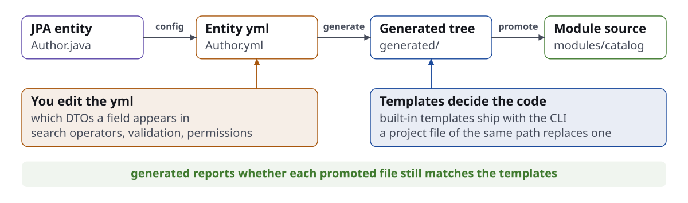

**English** | [한국어](./README.ko.md)

# SimpliX CLI

`simplix-boot` reads a JPA entity and writes the service, REST controller, DTOs and tests that expose it through SimpliX. You describe each field once in a yml file, and the CLI keeps the generated code and your own edits together when a template changes later.



## When to use it

- You add an entity and need its CRUD API in the shape every other SimpliX API of the project has.
- You change a field and want the DTOs, the search conditions and the tests to follow.
- You want hand edits in generated classes to survive the next template change.

A screen that is not backed by one entity (a dashboard, a report that joins several aggregates) is written by hand; the CLI has nothing to generate it from.

## Requirements

- Node.js 20 or later
- A Gradle or Maven project that depends on SimpliX
- The CLI of the same release line as the project's SimpliX

| Your project | SimpliX line | Install |
|---|---|---|
| Spring Boot 4 | 2.x | `npm install -g @simplix-boot/cli` |
| Spring Boot 3 | 1.x | `npm install -g @simplix-boot/cli@spring-boot-3x` |

## Install

```bash
# Spring Boot 4 projects (SimpliX 2.x)
npm install -g @simplix-boot/cli

# Spring Boot 3 projects (SimpliX 1.x)
npm install -g @simplix-boot/cli@spring-boot-3x

simplix-boot --version
```

To run it without installing, use `npx @simplix-boot/cli <command>` with the same package spec. [Managing versions](docs/en/managing-versions.md) covers pinning a version for a team and running the CLI from a framework checkout.

## Quick start

Run these in the root of a project that already has a JPA entity named `Author` and its repository.

```bash
# 1. Create the .simplix folder, then write .simplix/simplix-boot.json
simplix-boot init

# 2. Write .simplix/entity/Author.yml from the entity
simplix-boot config Author

# 3. Edit the yml, then generate the code into generated/
simplix-boot generate Author

# 4. Move the generated files into a module
simplix-boot promote Author --module catalog

# 5. Check that every promoted file matches the templates
simplix-boot generated
```

[Getting started](docs/en/getting-started.md) walks through the same steps with the configuration file, the yml edits and the output of each command.

## Documentation

| If you want to | Read |
|---|---|
| generate your first API step by step | [Getting started](docs/en/getting-started.md) |
| change what the generated code looks like | [Customizing templates](docs/en/customizing-templates.md) |
| regenerate after a template or yml change without losing edits | [Updating generated code](docs/en/updating-generated-code.md) |
| install the right line, pin a version, link a checkout | [Managing versions](docs/en/managing-versions.md) |
| move a project from generator-simplix | [Migrating from generator-simplix](docs/en/migrating-from-generator-simplix.md) |
| look up a command or an option | [Command reference](docs/en/command-reference.md) |
| look up a key of the configuration file or the entity yml | [Configuration reference](docs/en/configuration-reference.md) |
| look up a template variable or a built-in template | [Template reference](docs/en/template-reference.md) |
| understand what happens inside each command | [How it works](docs/en/how-it-works.md) |
| fix an error | [Troubleshooting](docs/en/troubleshooting.md) |

## License

SimpleCORE License 1.0 (SCL-1.0). See [LICENSE](../LICENSE).
