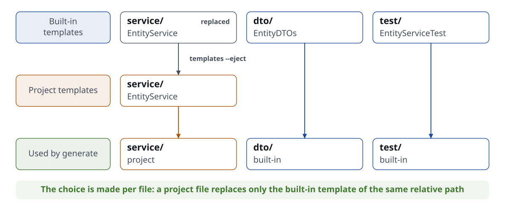

# Customizing templates

The CLI ships the templates it generates from. When the generated code should follow your project's conventions (another base class, an extra endpoint, your own test style), you change a template instead of editing every generated file. This page shows how a template is chosen and how to replace one.

## How a template is chosen

Every generated file comes from one template, named by a relative path such as `service/EntityService.java.template`. For each path, `generate` looks in the project's `.simplix/templates` first. A file found there is used; otherwise the built-in template of the same path is used. The choice is made file by file, so a project keeps only the templates it changed.



## See which templates are in use

```bash
simplix-boot templates
```

```
built-in  controller/rest/EntityRestController.java.template
built-in  controller/web/EntityWebController.java.template
built-in  dto/EntityDTOs.java.template
built-in  repository/EntityRepository.java.template
project   service/EntityService.java.template (replaces the built-in template)
built-in  service/EntityTreeService.java.template
built-in  test/EntityServiceTest.java.template
built-in  test/EntityTreeServiceTest.java.template
```

`project` marks a file of the project, `built-in` a template of the CLI.

## Copy a built-in template and edit it

```bash
# Copy one built-in template into .simplix/templates
simplix-boot templates --eject service/EntityService.java.template

# Copy every built-in template
simplix-boot templates --eject
```

A project file that already exists is kept unless you add `--force`. Edit the copy: templates are EJS files, and the values they can read are listed in the [template reference](./template-reference.md).

```java
package <%= packagePaths['service'] %>;

public class <%= classPrefix %>Service extends SimpliXBaseService<<%= entityName %>, <%= idType %>> {
}
```

Generate again to see the result. Files you already moved into a module are brought up to date with `promote`, which merges the template change into your edits: see [Updating generated code](./updating-generated-code.md).

```bash
simplix-boot generate Author --force
```

## Use a template of another name

To generate a component from a template with a path of your own, name it under `template` in `.simplix/generator-simplix.json`. The path is looked up the same way: the project folder first, the built-in templates second.

```json
{
  "template": {
    "dto": "dto/AdminDTOs.java.template"
  }
}
```

## Call a class of your application

A built-in template never imports a class of your application. Where generated code needs one (a helper that formats counts, your message utility), you name the class under `supportClasses` and the template asks for it by key.

```json
{
  "supportClasses": {
    "searchFigures": "com.example.library.app.search.ListFigures",
    "messages": "com.example.library.app.util.MessageUtils"
  }
}
```

Your own templates can do the same. `find` returns `undefined` when the key is not set; `require` stops the render with a message that names the yml and the key.

```java
<% const audit = supportClasses.find('auditTrail'); %>
<% if (audit) { %>
import <%= audit.fqn %>;
<% } %>
```

The keys the built-in templates use, and what each class has to provide, are in the [template reference](./template-reference.md#support-classes).

## After a CLI update

> ⚠ A template you copied into the project no longer receives the changes later CLI versions make to the built-in one. After updating the CLI, run `simplix-boot templates` and compare each `project` file with its built-in counterpart in the `templates/` folder of the installed package.

## Related documents

- [Template reference](./template-reference.md)
- [Updating generated code](./updating-generated-code.md)
- [Troubleshooting](./troubleshooting.md)
