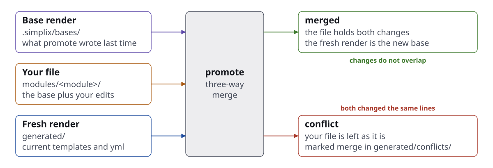
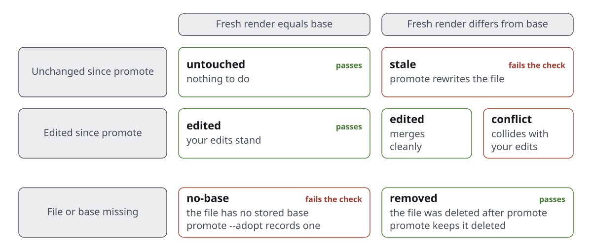

# Updating generated code

Once a file is in a module it is yours: you add methods, change checks, delete what you do not need. Later the entity gains a field, a template changes, or the CLI is updated, and the same file has to take that change without losing yours. `promote` does this merge. This page shows the routine, what `promote` does with each file, and how to read and repair the state of promoted files.

## The routine

```bash
# 1. Render again with the current yml and templates
simplix-boot generate Author --force

# 2. Bring the module's files up to date, merging into your edits
simplix-boot promote Author --module catalog

# 3. Check every promoted file
simplix-boot generated
```

Run it after you edit the entity yml (run `config Author --force` first when the entity itself changed, then restore your yml edits), after you change a template, and after you update the CLI.

## What promote does with each file

A promoted file opens with two comment lines: a mark that it was generated and a fingerprint of the render it was laid down as. `promote` also stored that render under `.simplix/bases/`. With the stored base, your file and the fresh render, it can tell your edits from the template's change and merge the two.



```
ℹ Service:
  From: generated/main/java/com/example/library/web/catalog/service/AuthorService.java
  To:   modules/catalog/src/main/java/com/example/library/web/catalog/service/AuthorService.java
  ✔ Merged the template change into the edits
```

| Result | The file was | What promote did |
|---|---|---|
| `written` | absent, or never edited | wrote the fresh render |
| `merged` | edited, and the template changed elsewhere | merged the template change into your edits |
| `current` | edited, and already holds the template change | left it as it is |
| `removed` | deleted by you after an earlier promote | left it deleted |
| `adopted` | present without a stored base, with `--adopt` | kept its content and stored the fresh render as the base |
| `conflict` | edited on the lines the template changed | left it, wrote the marked merge to `generated/conflicts/`, exit code 1 |
| `no-base` | present without a stored base | left it, exit code 1 |

> ℹ The merge runs `git merge-file`, so Git has to be installed. The project does not have to be a Git repository.

A template change can drop an import. The import stays in your file while code you wrote there still names the class, and goes when nothing names it any more.

## Read the state of promoted files

```bash
simplix-boot generated
```

```
edited     modules/catalog/src/main/java/com/example/library/web/catalog/service/AuthorService.java
untouched  modules/catalog/src/main/java/com/example/library/web/catalog/controller/AuthorRestController.java
untouched  modules/catalog/src/main/java/com/example/library/web/catalog/dto/AuthorDTOs.java
untouched  modules/catalog/src/test/java/com/example/library/web/catalog/service/AuthorServiceTest.java

edited 1 · untouched 3
```

`generated` renders every promoted entity again and compares the stored base, the file and the fresh render of each file. The state follows from whether the file was edited since promote and whether the fresh render differs from the base.



| State | Meaning | What to do | Exit code |
|---|---|---|---|
| `untouched` | the file is what the templates produce now | nothing | 0 |
| `edited` | you edited it, and the fresh render merges cleanly | nothing, or `promote` to take a template change | 0 |
| `removed` | you deleted it and a base is stored | nothing | 0 |
| `stale` | never edited, but the fresh render differs | run `promote` | 1 |
| `conflict` | the fresh render collides with your edits | resolve the conflict (below) | 1 |
| `no-base` | the file has no stored base | run `promote --adopt` (below) | 1 |

The exit code makes the command a check for CI: it fails while any file is `stale`, `conflict` or `no-base`. `--json` prints the same report as one line for a script, and `--no-render` judges against the stored bases without rendering, which cannot find `stale` or `conflict`.

## Resolve a conflict

```
ℹ Service:
  From: generated/main/java/com/example/library/web/catalog/service/AuthorService.java
  To:   modules/catalog/src/main/java/com/example/library/web/catalog/service/AuthorService.java
  ✖ Conflict: the file was kept; the merge with markers is at
    generated/conflicts/modules/catalog/src/main/java/com/example/library/web/catalog/service/AuthorService.java.conflict
```

Your file is unchanged, which also means it has none of the template changes of this run, not even the ones that did not collide. The file under `generated/conflicts/` has them all: it is the merge result, with every colliding region marked. Yours is under `edited`, the template's under `template`.

```java
// @simplix-generated
// @simplix-render 7a38d897f15a promote Author --module catalog
<<<<<<< edited
// Maintained by the catalog team
=======
// Generated for the library application
>>>>>>> template
package com.example.library.web.catalog.service;
```

1. Open the conflict file and settle each marked region: keep one side or combine them, and delete the marker lines.
2. Save the result over the file in the module. Do not edit the module file by hand instead: it lacks the template changes that merged cleanly.
3. When every region took the template's side, run `promote` again: it reports `current`.
4. When a region keeps your wording or a combination, tell the CLI that this file now stands against the fresh render: delete the stored base of that file and run `promote` with `--adopt`.

```bash
# 1. After resolving the marked regions in the conflict file, put it in place of the module file
cp generated/conflicts/modules/catalog/src/main/java/com/example/library/web/catalog/service/AuthorService.java.conflict \
   modules/catalog/src/main/java/com/example/library/web/catalog/service/AuthorService.java

# 2. Delete the stored base, which has the module file's path under .simplix/bases/
rm .simplix/bases/modules/catalog/src/main/java/com/example/library/web/catalog/service/AuthorService.java

# 3. Keep the file as it is and store the fresh render as its base
simplix-boot promote Author --module catalog --adopt
```

Afterwards `generated` reports the file as `edited`. `promote --force` is the other way out: it overwrites the file with the fresh render and discards your edits.

## Files without a stored base

A file is `no-base` when it sits where a promoted file belongs but `.simplix/bases/` holds nothing for it: it was written by hand, promoted by a tool that did not store bases, or the `.simplix/bases/` folder was not committed. `promote --adopt` keeps the file's content, stamps it and stores the fresh render as its base, so from then on template changes merge into it. Whatever differs from the fresh render at that moment counts as your edit.

## Remove a generated file you do not need

Delete the file from the module and keep its entry under `.simplix/bases/`. `promote` then leaves it deleted (`removed`) instead of writing it again.

## Related documents

- [Command reference](./command-reference.md#promote)
- [How it works](./how-it-works.md)
- [Troubleshooting](./troubleshooting.md)
