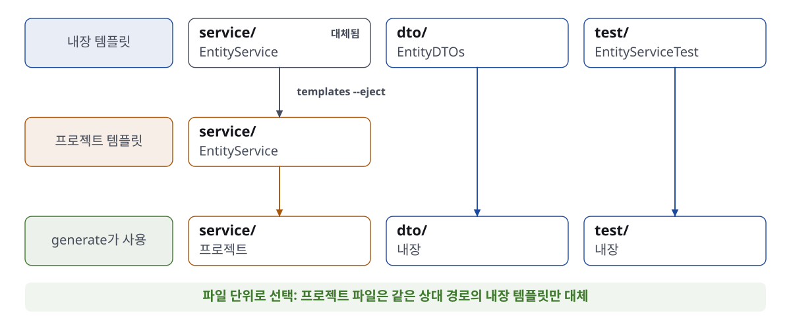

# 템플릿 사용자 지정

CLI에는 코드 생성에 쓰는 템플릿이 포함되어 있습니다. 생성 코드를 프로젝트의 규칙(다른 기본 클래스, 추가 엔드포인트, 자체 테스트 형식)에 맞춰야 할 때는 생성된 파일을 하나씩 고치지 말고 템플릿을 바꾸세요. 이 문서는 템플릿이 선택되는 방식과 템플릿을 대체하는 방법을 설명합니다.

## 템플릿이 선택되는 방식

생성되는 파일마다 템플릿이 하나씩 대응하며, 템플릿은 `service/EntityService.java.template` 같은 상대 경로로 구분합니다. `generate`는 경로마다 프로젝트의 `.simplix/templates`를 먼저 확인합니다. 그곳에 파일이 있으면 그 파일을 사용하고, 없으면 같은 경로의 내장 템플릿을 사용합니다. 파일 단위로 선택하므로 프로젝트에는 바꾼 템플릿만 두면 됩니다.



## 사용 중인 템플릿 확인

```bash
simplix-boot templates
```

```
built-in  controller/rest/EntityRestController.java.template
built-in  controller/web/EntityWebController.java.template
built-in  dto/EntityDTOs.java.template
built-in  repository/EntityRepository.java.template
project   service/EntityService.java.template (replaces the built-in template)
built-in  service/EntityTreeService.java.template
built-in  test/EntityServiceTest.java.template
built-in  test/EntityTreeServiceTest.java.template
```

`project`는 프로젝트의 파일, `built-in`은 CLI에 포함된 템플릿입니다.

## 내장 템플릿을 복사해 편집

```bash
# Copy one built-in template into .simplix/templates
simplix-boot templates --eject service/EntityService.java.template

# Copy every built-in template
simplix-boot templates --eject
```

프로젝트에 이미 있는 파일은 `--force`를 지정하지 않으면 그대로 둡니다. 복사한 파일을 편집하세요. 템플릿은 EJS 파일이며, 템플릿에서 읽을 수 있는 값은 [템플릿 레퍼런스](./template-reference.md)에 있습니다.

```java
package <%= packagePaths['service'] %>;

public class <%= classPrefix %>Service extends SimpliXBaseService<<%= entityName %>, <%= idType %>> {
}
```

다시 생성해 결과를 확인하세요. 이미 모듈로 옮긴 파일은 `promote`로 갱신하며, 이때 템플릿 변경이 직접 고친 내용에 병합됩니다. [생성 코드 갱신](./updating-generated-code.md)을 참조하세요.

```bash
simplix-boot generate Author --force
```

## 다른 이름의 템플릿 사용

구성 요소를 다른 경로의 템플릿으로 생성하려면 `.simplix/simplix-boot.json`의 `template`에 그 경로를 지정하세요. 지정한 경로도 같은 순서로 찾습니다. 프로젝트 폴더를 먼저, 내장 템플릿을 그다음에 확인합니다.

```json
{
  "template": {
    "dto": "dto/AdminDTOs.java.template"
  }
}
```

## 애플리케이션 클래스 호출

내장 템플릿은 애플리케이션의 클래스를 import하지 않습니다. 생성 코드에 애플리케이션 클래스가 필요한 경우(집계 값을 변환하는 도우미, 자체 메시지 유틸리티)에는 그 클래스를 `supportClasses`에 지정하고, 템플릿은 키로 조회합니다.

```json
{
  "supportClasses": {
    "searchFigures": "com.example.library.app.search.ListFigures",
    "messages": "com.example.library.app.util.MessageUtils"
  }
}
```

직접 작성한 템플릿에서도 같은 방식으로 조회할 수 있습니다. `find`는 키가 지정되지 않았으면 `undefined`를 돌려주고, `require`는 yml 이름과 키를 담은 메시지를 출력하며 렌더링을 중단합니다.

```java
<% const audit = supportClasses.find('auditTrail'); %>
<% if (audit) { %>
import <%= audit.fqn %>;
<% } %>
```

내장 템플릿이 사용하는 키와 각 클래스가 제공해야 하는 멤버는 [템플릿 레퍼런스](./template-reference.md#지원-클래스)에 있습니다.

## CLI 갱신 이후

> ⚠ 프로젝트로 복사한 템플릿에는 이후 CLI 버전의 내장 템플릿 변경이 반영되지 않습니다. CLI를 갱신한 뒤에는 `simplix-boot templates`를 실행하고, `project`로 표시된 파일을 설치된 패키지의 `templates/` 폴더에 있는 내장 템플릿과 비교하세요.

## 관련 문서

- [템플릿 레퍼런스](./template-reference.md)
- [생성 코드 갱신](./updating-generated-code.md)
- [문제 해결](./troubleshooting.md)
