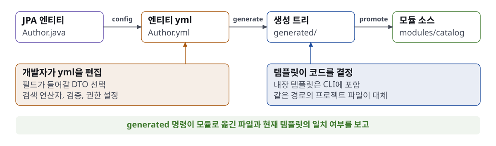
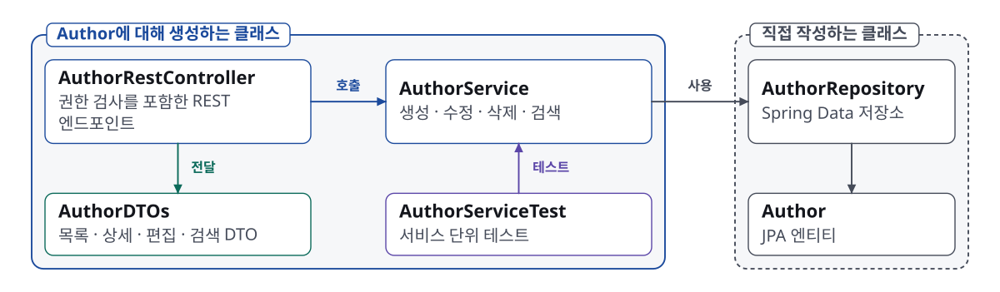

# SimpliX CLI의 동작 원리

이 문서는 명령마다 무엇을 읽고 쓰는지, 엔티티를 어떻게 분석하는지, 모듈로 옮긴 파일에 템플릿의 변경과 직접 고친 내용이 어떻게 함께 유지되는지 설명합니다. 명령이 파일에 미치는 영향을 미리 알아야 할 때 읽으세요.

## 엔티티에서 모듈 소스까지



| 명령 | 읽는 것 | 쓰는 것 |
|---|---|---|
| `config` | 엔티티 소스, 부모 클래스, 참조하는 엔티티 | `.simplix/entity/<이름>.yml` |
| `generate` | 엔티티 소스, 부모 클래스, yml, 템플릿 | `generated/` 아래의 파일 |
| `promote` | `generated/` 아래의 파일, 모듈의 파일, `.simplix/bases/` | 모듈의 파일과 `.simplix/bases/` |
| `generated` | `generate`와 `promote`가 읽는 모든 것 | `generated/` 아래의 파일과 보고 |

생성과 모듈 반영을 별도의 명령으로 나눈 데에는 이유가 있습니다. `generate`는 모듈을 건드리지 않으므로 몇 번이든 렌더링해 결과를 읽어 볼 수 있습니다. 모듈 소스를 바꾸는 명령은 `promote`뿐이며, 파일 단위로 정해진 규칙에 따라 처리합니다.

## 엔티티 하나에서 생성되는 클래스



생성하는 구성 요소는 `target.targetPath`에 경로를 지정한 것들입니다. 저장소와 웹 컨트롤러도 생성할 수 있고, `TreeEntity`를 구현한 엔티티에는 트리 서비스와 그 테스트를 추가로 생성합니다.

## 엔티티 분석

CLI는 Java 소스를 텍스트로 읽으며, 프로젝트를 컴파일하거나 클래스를 로드하지 않습니다. 엔티티와 부모 클래스에서 다음을 추출합니다.

- 식별자 필드와 타입, `@EmbeddedId`를 구성하는 필드
- 필드별 타입, `@Column` 속성, `@Comment`
- 부모 클래스와 인터페이스. `TreeEntity` 구현 여부를 여기서 판정합니다

필드가 다른 엔티티를 참조하는지는 `entity.scanPath` 아래에서 해당 타입의 소스를 찾아 판정합니다. `@Entity`를 선언한 타입은 연관 엔티티이고, 선언하지 않은 타입은 JSON 컬럼에 저장하는 레코드처럼 행에 포함되는 값입니다. 소스가 스캔 경로에 없는 타입은 연관 엔티티로 취급합니다.

## 템플릿 선택

파일마다 템플릿 하나로 렌더링하며, 상대 경로로 프로젝트의 `.simplix/templates`를 먼저, 내장 템플릿을 그다음에 찾습니다. 선택 과정을 그림으로 설명한 내용은 [템플릿 사용자 지정](./customizing-templates.md)에 있습니다.

## 추적 렌더

`promote`가 모듈로 옮긴 파일을 추적 렌더(tracked render)라고 합니다. 이 파일은 주석 두 줄로 시작하고, 같은 렌더가 `.simplix/bases/` 아래에 모듈 파일과 같은 경로로 저장됩니다.

```java
// @simplix-generated
// @simplix-render 2595cf7d3830 promote Author --module catalog
```

- 첫 줄은 생성된 파일임을 표시합니다.
- 둘째 줄에는 렌더의 지문(render fingerprint)과 파일을 옮긴 명령이 들어 있습니다. 내용이 지문과 일치하는 파일은 고친 적이 없는 파일입니다.
- 저장된 사본이 기준 렌더(base render)입니다. 3방향 병합에 필요한 공통 조상으로 사용합니다.

이 정보로 `promote`는 파일마다 기준 렌더, 모듈의 파일, 새 렌더를 구분합니다. 고친 적이 없는 파일은 새 렌더로 다시 씁니다. 직접 고친 파일은 병합하므로 템플릿의 변경과 직접 고친 내용이 모두 남습니다. 같은 줄을 양쪽이 바꾼 경우에는 파일을 그대로 두고 충돌을 보고합니다. 결과별 설명과 대응 방법은 [생성 코드 갱신](./updating-generated-code.md)에 있습니다.

> ℹ `.simplix/bases/`를 모듈과 함께 커밋하세요. 저장된 기준 렌더가 없으면 팀원의 `promote`가 직접 고친 내용과 템플릿 변경을 구분하지 못해 `no-base`를 보고합니다.

## 버전 검사

템플릿과 yml 키는 CLI 버전이 바뀔 때 함께 바뀝니다. 그래서 프로젝트는 생성에 사용하는 버전을 기록하고, 그보다 낮은 CLI는 파일 쓰기를 거부합니다. SimpliX 릴리스 라인마다 CLI가 따로 있으며, CLI는 자신의 라인에 게시된 버전만 조회합니다. 자세한 내용은 [버전 관리](./managing-versions.md)에 있습니다.

## 관련 문서

- [생성 코드 갱신](./updating-generated-code.md)
- [템플릿 사용자 지정](./customizing-templates.md)
- [명령 레퍼런스](./command-reference.md)
