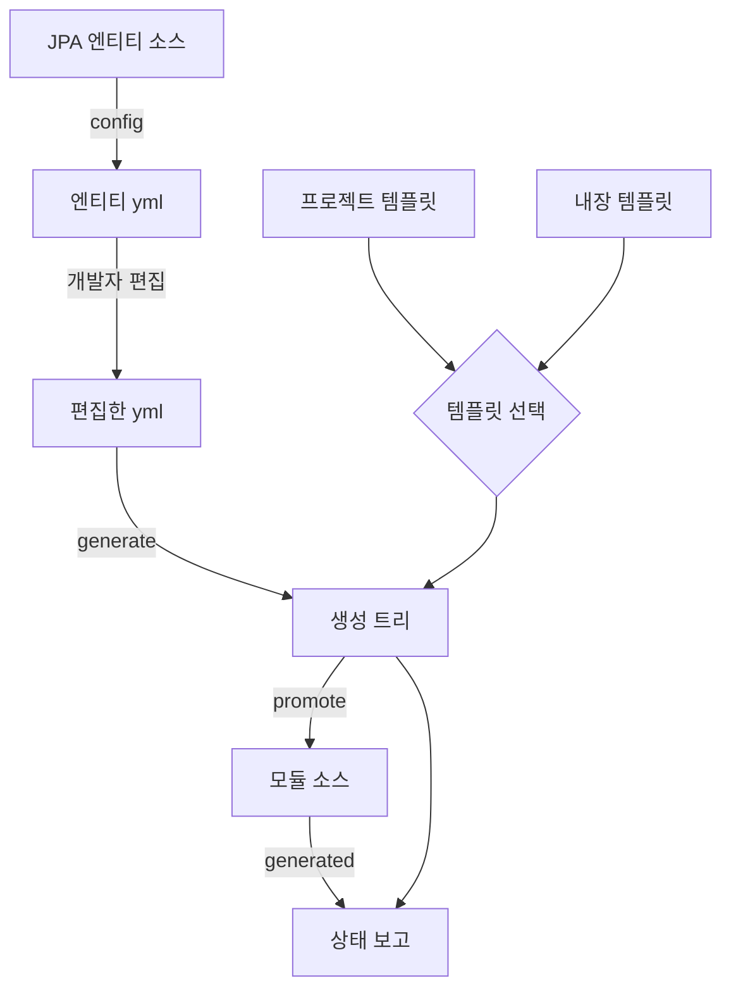
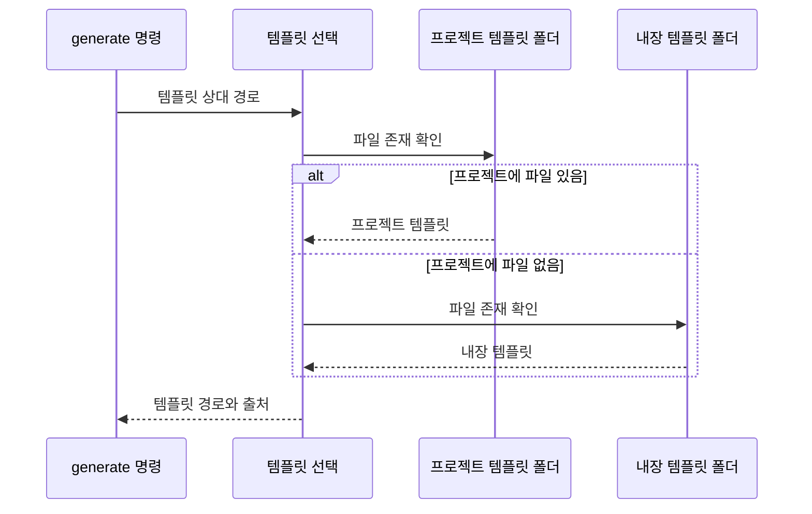

# SimpliX CLI 개요

SimpliX CLI는 JPA 엔티티 소스와 엔티티별 yml을 입력으로 받아 SimpliX 규칙에 맞는 Java 코드를 생성합니다. 이 문서는 처리 흐름과 구성 요소, 설정 구조를 설명합니다.

## 설치와 실행

`simplix-boot`를 실행하는 방법은 다음과 같습니다.

| 방법 | 명령 | 실행되는 버전 |
|------|------|---------------|
| 설치 없이 실행 | `npx @simplix-boot/cli <명령>` | npm에 게시된 최신 버전 |
| 전역 설치 | `npm install -g @simplix-boot/cli` | 설치한 시점의 게시 버전 |
| 체크아웃 연결 | `simplix-cli` 폴더에서 `npm link` | 프레임워크 체크아웃의 현재 소스 |

### 프레임워크 체크아웃 연결

SimpliX 프레임워크를 내려받은 체크아웃이 있으면 그 안의 `simplix-cli` 폴더를 전역 명령으로 연결할 수 있습니다. npm이 전역 패키지 폴더에 체크아웃을 가리키는 심볼릭 링크를 만들기 때문에, 파일을 복사하지 않고 체크아웃의 소스를 그대로 실행합니다.

```bash
cd <simplix checkout>/simplix-cli

# Install the runtime dependencies of the CLI
npm ci

# Register simplix-boot as a global command that points at this folder
npm link
```

연결한 뒤에는 어느 프로젝트에서든 `simplix-boot`를 실행할 수 있습니다. 다음 명령으로 연결 상태를 확인하세요.

```bash
# The version of the checkout
simplix-boot --version

# The global package list shows the link target
npm ls -g --depth=0
```

`npm ls -g`의 출력에서 `@simplix-boot/cli` 항목 뒤에 `->`와 체크아웃 경로가 표시되면 연결된 상태입니다.

| 상황 | 처리 |
|------|------|
| 체크아웃의 소스를 갱신함 | 다시 연결하지 않아도 됩니다. `git pull`로 받은 변경이 바로 적용됩니다. |
| `simplix-cli/package.json`의 의존성이 바뀜 | `simplix-cli` 폴더에서 `npm ci`를 다시 실행하세요. |
| Node.js 버전을 바꿈 | 버전 관리 도구(nvm 등)는 Node.js 버전마다 전역 패키지 폴더를 따로 둡니다. 바꾼 버전에서 `npm link`를 다시 실행하세요. |
| 체크아웃의 브랜치를 바꿈 | 연결은 체크아웃의 현재 파일을 가리킵니다. `simplix-cli` 폴더가 없는 브랜치로 바꾸면 명령을 실행할 수 없습니다. |
| 체크아웃 폴더를 옮기거나 삭제함 | 링크가 끊어집니다. 새 위치에서 `npm link`를 다시 실행하세요. |
| 연결을 해제함 | `npm unlink -g @simplix-boot/cli` |

⚠ 연결한 CLI는 체크아웃의 개발 버전(`-SNAPSHOT`)으로 실행됩니다. 팀과 CI가 같은 결과를 내야 하는 프로젝트에서는 게시된 버전을 설치하고 `simplix-boot version --write`로 그 버전을 기록하세요.

---

## 아키텍처



명령은 프로젝트 루트를 기준으로 동작합니다. 프로젝트 루트는 `.simplix` 폴더가 있는 디렉터리이며, 하위 디렉터리에서 실행하면 상위 디렉터리를 차례로 확인해 찾습니다.

```
project/
+-- .simplix/
|   +-- generator-simplix.json   # Project configuration
|   +-- entity/                  # One yml per generated surface
|   +-- templates/               # Templates that replace built-in ones
|   +-- bases/                   # Stored renders of promoted files
+-- generated/                   # Output of generate
+-- modules/                     # Targets of promote
```

---

## 주요 컴포넌트

### 명령

| 명령 | 역할 |
|------|------|
| `init` | `.simplix/entity`와 `.simplix/templates` 폴더를 만듭니다. |
| `config` | 엔티티 소스를 분석해 `.simplix/entity/<이름>.yml`을 작성합니다. |
| `generate` | yml과 템플릿으로 생성 트리(generated tree)에 Java 파일을 씁니다. 생성 트리는 `target.generatedBasePath` 아래의 폴더입니다. |
| `promote` | 생성 트리의 파일을 모듈로 옮기고 렌더 지문(render fingerprint)과 기준 렌더(base render)를 기록합니다. |
| `generated` | 모듈로 옮긴 파일의 상태를 보고합니다. |
| `templates` | 사용 중인 템플릿의 출처를 보여 주거나 내장 템플릿을 프로젝트로 복사합니다. |
| `version` | 실행 중인 버전, 프로젝트가 요구하는 버전, npm 최신 버전을 보고합니다. |

### 엔티티 분석기

`src/lib/entity-analyzer.js`와 `src/lib/analysis/`가 엔티티의 Java 소스를 텍스트로 읽어 다음을 추출합니다.

- 식별자 필드와 타입, `@EmbeddedId`의 구성 필드
- 필드별 타입 분류(기본 타입, 열거형, 연관 엔티티, 값 객체)와 `@Column` 속성
- 부모 클래스와 구현 인터페이스. `TreeEntity`를 구현한 엔티티에는 트리 서비스를 추가로 생성합니다.

필드 타입이 엔티티인지는 `entity.scanPath` 아래에서 해당 타입의 소스를 찾아 `@Entity` 선언 여부로 판정합니다. `@Entity`가 없는 타입은 JSON 컬럼에 저장하는 값으로 취급합니다.

### 템플릿 선택

`src/lib/templates.js`가 템플릿 상대 경로마다 사용할 파일을 정합니다. 프로젝트의 `.simplix/templates`에 파일이 있으면 그 파일을 사용하고, 없으면 CLI에 포함된 내장 템플릿을 사용합니다.



### 추적 렌더

추적 렌더(tracked render)는 `promote`가 모듈로 옮긴 파일입니다. `src/lib/tracked-render.js`가 이 파일을 관리합니다. `promote`는 파일 첫머리에 생성 표시와 렌더 지문을 주석으로 넣고, 같은 내용을 `.simplix/bases/`에 기준 렌더로 저장합니다.

```java
// @simplix-generated
// @simplix-render 3f2a9c1b7d4e promote Book --module catalog
```

이후 `promote`를 다시 실행하면 파일 상태에 따라 다음과 같이 처리합니다.

| 파일 상태 | 처리 |
|-----------|------|
| 없거나 지문이 그대로임 | 새 렌더로 다시 씁니다. |
| 직접 고침, 기준 렌더 있음 | 기준 렌더를 기준으로 템플릿 변경을 3방향 병합합니다. |
| 직접 고침, 병합 충돌 | 파일을 그대로 두고 충돌 표시가 든 병합 결과를 `generated/conflicts/`에 씁니다. |
| 직접 고침, 기준 렌더 없음 | 파일을 그대로 두고 실패로 끝냅니다. |
| 삭제함, 기준 렌더 있음 | 삭제한 상태를 유지합니다. |

---

## 설정 속성

### 전체 설정 구조

```json
{
  "generator": { "version": "<X.Y.Z>" },
  "entity": { "scanPath": "src/main/java", "basePackage": "com.example.library.domain" },
  "repository": { "scanPath": "src/main/java", "deriveFromEntity": true },
  "dto": { "excludeFields": ["version", "createdAt", "updatedAt"] },
  "target": {
    "generatedBasePath": "generated/main/java/com/example/library/web",
    "basePackage": "com.example.library.web",
    "targetPath": {
      "service": "{modulePath}/service",
      "controllerRest": "{modulePath}/controller",
      "dto": "{modulePath}/dto"
    },
    "testGeneratedBasePath": "generated/test/java/com/example/library/web",
    "testTargetPath": { "serviceTest": "{modulePath}/service" }
  },
  "promote": { "moduleRoot": "modules" },
  "template": { "service": "service/EntityService.java.template" },
  "supportClasses": { "searchFigures": "com.example.library.app.search.ListFigures" }
}
```

키별 설명은 [설정 레퍼런스](./configuration.md)에 있습니다.

---

## 실패 처리

| 상황 | 동작 |
|------|------|
| 프로젝트 밖에서 실행 | 표준 오류에 사유를 출력하고 종료 코드 1로 끝냅니다. |
| 선언하지 않은 옵션 | 옵션 이름을 출력하고 종료 코드 1로 끝냅니다. |
| 템플릿 렌더링 실패 | 실패한 파일과 사유를 출력하고, 나머지 파일을 쓴 뒤 종료 코드 1로 끝냅니다. |
| 프로젝트가 더 높은 CLI 버전을 요구 | 아무 파일도 쓰지 않고 종료 코드 1로 끝냅니다. |
| `promote` 병합 충돌 또는 기준 렌더 없음 | 해당 파일을 그대로 두고 종료 코드 1로 끝냅니다. |

---

## 관련 문서

- [명령 가이드](./command-guide.md)
- [템플릿 가이드](./template-guide.md)
- [설정 레퍼런스](./configuration.md)
- [전환 가이드](./migration-guide.md)
