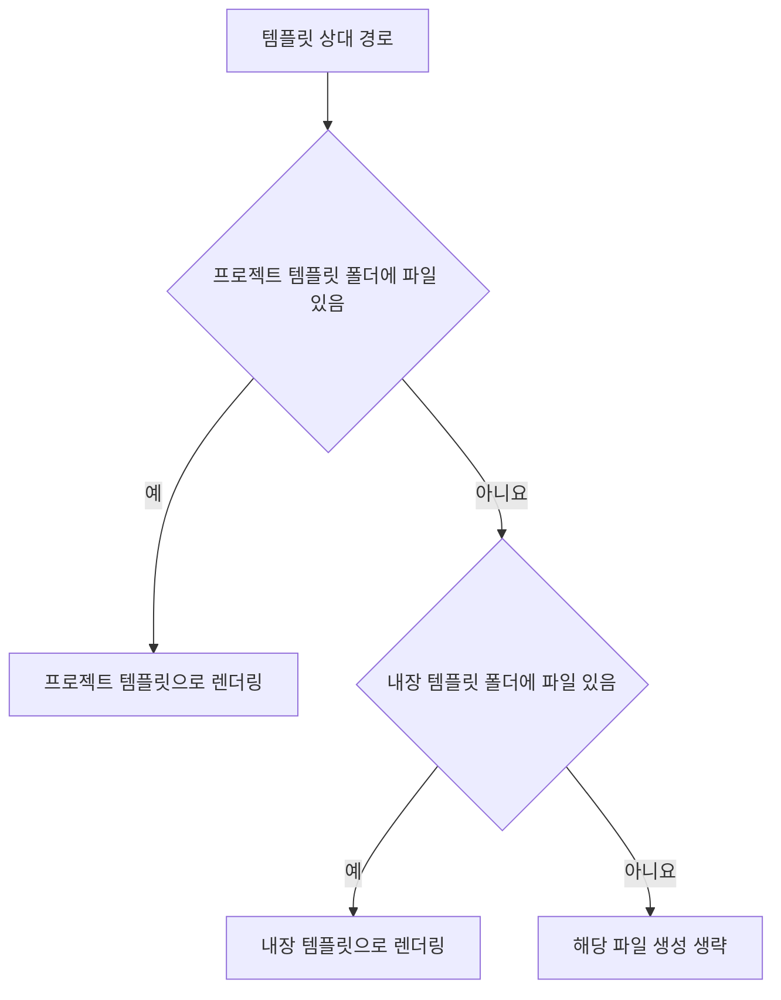

# 템플릿 가이드

`generate`가 사용하는 템플릿의 위치와 선택 순서, 템플릿 변수, 애플리케이션 클래스를 연결하는 방법을 설명합니다.

## 목차

- [내장 템플릿](#내장-템플릿)
- [프로젝트 템플릿](#프로젝트-템플릿)
- [템플릿 문법](#템플릿-문법)
- [템플릿 변수](#템플릿-변수)
- [애플리케이션 클래스 연결](#애플리케이션-클래스-연결)
- [애플리케이션 메시지 키](#애플리케이션-메시지-키)
- [문제 해결](#문제-해결)

## 내장 템플릿

CLI 패키지의 `templates/` 폴더에 포함된 템플릿입니다. 프로젝트에 템플릿이 없어도 이 템플릿으로 생성합니다.

| 상대 경로 | 구성 요소 |
|-----------|-----------|
| `service/EntityService.java.template` | `service` |
| `service/EntityTreeService.java.template` | 트리 서비스 |
| `controller/rest/EntityRestController.java.template` | `controllerRest` |
| `controller/web/EntityWebController.java.template` | `controllerWeb` |
| `dto/EntityDTOs.java.template` | `dto` |
| `repository/EntityRepository.java.template` | `repository` |
| `test/EntityServiceTest.java.template` | 서비스 테스트 |
| `test/EntityTreeServiceTest.java.template` | 트리 서비스 테스트 |

내장 템플릿이 생성하는 코드는 애플리케이션의 클래스를 import하지 않으며, 프레임워크 쪽에서는 CLI와 같은 버전의 SimpliX와 그 버전이 의존하는 searchable-jpa의 클래스를 사용합니다. 컨트롤러 테스트 템플릿(`test/EntityRestControllerTest.java.template`)은 내장하지 않으며, 프로젝트가 이 파일을 제공하면 컨트롤러 테스트를 생성합니다.

## 프로젝트 템플릿

프로젝트의 `.simplix/templates`에 내장 템플릿과 같은 상대 경로로 파일을 두면 그 파일로 렌더링합니다. 판정은 파일 단위이므로, 고칠 템플릿만 프로젝트에 두고 나머지는 내장 템플릿을 그대로 사용할 수 있습니다.



내장 템플릿을 고치려면 프로젝트로 복사한 뒤 편집하세요.

```bash
# Copy one built-in template into .simplix/templates
simplix-boot templates --eject dto/EntityDTOs.java.template

# Copy every built-in template
simplix-boot templates --eject

# See which templates are the project's own
simplix-boot templates
```

구성 요소가 사용할 템플릿의 상대 경로는 `generator-simplix.json`의 `template`에서 바꿀 수 있습니다.

```json
{
  "template": {
    "dto": "dto/AdminDTOs.java.template"
  }
}
```

`template`에 지정한 경로도 프로젝트 폴더를 먼저 확인하고 내장 템플릿 폴더를 그다음에 확인합니다.

⚠ 프로젝트로 복사한 템플릿에는 이후 CLI의 내장 템플릿 변경이 반영되지 않습니다. CLI를 올린 뒤에는 `simplix-boot templates`로 프로젝트 템플릿 목록을 확인하고 필요한 변경을 프로젝트 템플릿에 직접 반영하세요.

## 템플릿 문법

템플릿은 EJS로 작성합니다. 출력 태그 `<%= %>`는 HTML 이스케이프를 하지 않고 값을 그대로 출력합니다. 렌더링한 결과에서 줄 끝 공백을 제거하고 연속한 빈 줄을 한 줄로 줄인 뒤 파일에 씁니다.

```java
package <%= packagePaths['service'] %>;

public class <%= classPrefix %>Service extends SimpliXBaseService<<%= entityName %>, <%= idType %>> {
}
```

## 템플릿 변수

| 변수 | 내용 |
|------|------|
| `entityName` | 엔티티 클래스 이름 |
| `classPrefix` | 생성하는 클래스 이름의 접두어(yml 파일 이름) |
| `controllerName` | REST 컨트롤러 클래스 이름 |
| `entityNameLowerFirst`, `classPrefixLowerFirst` | 첫 글자를 소문자로 바꾼 이름 |
| `basePackage` | `target.basePackage` |
| `modulePath` | yml의 `modulePath` |
| `packagePaths` | 구성 요소별 패키지. `packagePaths.service`, `packagePaths.dto`, `packagePaths.repository` 등 |
| `targetPaths` | `target.targetPath` |
| `entityPackage`, `entityBasePackage` | 엔티티의 패키지와 `entity.basePackage` |
| `templatePath` | 요청 경로. yml의 `thymeleafBaseDir` 또는 클래스 이름의 케밥 표기 |
| `entityComment` | 엔티티의 테이블 주석 |
| `fields`, `entityFields` | 분석한 필드 목록 |
| `idType`, `idFieldName` | 식별자의 타입과 필드 이름 |
| `hasEmbeddedId`, `embeddedIdField`, `embeddedIdType`, `embeddedIdFields`, `embeddedIdPropertyNames` | 복합 식별자 정보 |
| `entitySearchFields`, `embeddedIdSearchFields` | 검색 DTO에 넣을 필드 |
| `ymlConfig` | 엔티티 yml 전체 |
| `dtoExcludeFields` | `dto.excludeFields` |
| `hasOrderField`, `orderField` | 정렬 순서 필드 정보 |
| `hasTreeEntity`, `treeEntityInterface` | `TreeEntity` 구현 여부와 인터페이스 정보 |
| `exportConfig` | yml의 `export`를 해석한 결과 |
| `supportClasses` | `supportClasses`에 지정한 애플리케이션 클래스 조회 |
| `capitalizeFirstLetter` | 첫 글자를 대문자로 바꾸는 함수 |
| `_` | lodash |
| `generatorVersion`, `generatedAt`, `gitUser`, `gitEmail` | CLI 버전, 생성 시각, Git 사용자 정보 |

## 애플리케이션 클래스 연결

생성 코드의 일부 멤버는 프레임워크가 제공하지 않아 애플리케이션이 직접 작성하는 클래스를 호출합니다. 그 클래스의 전체 이름을 `generator-simplix.json`의 `supportClasses`에 지정하세요.

```json
{
  "supportClasses": {
    "searchFigures": "com.example.library.app.search.ListFigures",
    "localizedSearchParams": "com.example.library.app.search.LocalizedSearchParams",
    "messages": "com.example.library.app.util.MessageUtils"
  }
}
```

| 키 | 필요한 경우 | 클래스가 제공해야 하는 멤버 |
|----|-------------|-----------------------------|
| `searchFigures` | yml에 `statusCounts`나 `aggregates`가 있을 때, 또는 `timeAxisField`와 `figureScope`를 함께 쓸 때 | 중첩 타입 `ValueCountDTO`(`of(ValueCount)`)와 `AggregateValueDTO`(`of(AggregateValue)`, `empty(Aggregate)`), 정적 메서드 `scoped(Map)`과 `scoped(Optional)` |
| `messages` | yml에 `notFoundMessageKey`가 있을 때 | 정적 메서드 `get(String)` |
| `localizedSearchParams` | 다국어 파생 컬럼으로 검색과 정렬을 처리할 때 | 정적 메서드 `rewrite(Map, String...)` |

`searchFigures`와 `messages`는 yml이 해당 기능을 요청했는데 클래스를 지정하지 않았으면 생성을 거부합니다.

```
Book.yml uses statusCounts or aggregates, which needs supportClasses.searchFigures in .simplix/generator-simplix.json
```

`localizedSearchParams`는 지정했을 때만 동작합니다. 엔티티에 `<name>I18n` 맵과 `<name>Search` 또는 `<name>Sort<Lang>` 파생 컬럼이 있으면, 검색 DTO가 파생 컬럼을 가리키고 서비스가 검색 매개변수를 이 클래스로 변환합니다. 지정하지 않으면 해당 필드를 일반 컬럼으로 취급합니다.

프로젝트 템플릿에서도 같은 방식으로 클래스를 조회할 수 있습니다.

```java
<% const audit = supportClasses.find('auditTrail'); %>
<% if (audit) { %>
import <%= audit.fqn %>;
<% } %>
```

- `supportClasses.find(key)`: 지정한 클래스의 `{ fqn, name }`을 돌려주고, 지정하지 않았으면 `undefined`를 돌려줍니다.
- `supportClasses.require(key, usedBy)`: 지정하지 않았으면 yml 이름과 키를 담은 오류로 렌더링을 중단합니다.

## 애플리케이션 메시지 키

생성 코드는 다음 메시지 키를 사용합니다. 프레임워크의 메시지 번들에는 이 키가 없으므로 애플리케이션의 메시지 번들에 정의하세요.

| 키 | 사용 위치 |
|----|-----------|
| `error.id.cannot.change` | 수정 요청의 식별자가 대상 레코드와 다를 때 서비스가 던지는 예외 |
| `error.search.countFieldUnknown` | `statusCounts`에 없는 필드로 건수를 요청했을 때 서비스가 던지는 예외 |
| `error.tree.circular.reference` | 트리에서 노드를 자신의 하위로 옮기려 할 때 트리 서비스가 던지는 예외 |
| `entities.<엔티티>.<필드>` | DTO 필드의 `@FieldLabel` |

## 문제 해결

### 템플릿 렌더링 실패

`generate`가 실패한 파일과 템플릿 경로, 줄 번호, 사유를 출력합니다.

```
   ✖ generated/main/java/com/example/library/web/catalog/dto/BookDTOs.java
     Failed to render dto/EntityDTOs.java.template: ...
✖ 1 of 4 files failed to render for Book: BookDTOs.java
```

템플릿을 고친 뒤 `--force`로 다시 실행하세요.

### 템플릿을 찾을 수 없음

```
   ⚠ SKIP: generated/.../BookDTOs.java (template not found: .simplix/templates/dto/AdminDTOs.java.template)
```

`template`에 지정한 상대 경로의 파일이 프로젝트에도 내장 템플릿에도 없습니다. 경로를 고치거나 해당 위치에 템플릿을 두세요.

### 내장 템플릿 변경이 반영되지 않음

같은 상대 경로의 프로젝트 템플릿이 있으면 내장 템플릿을 사용하지 않습니다. `simplix-boot templates`의 출력에서 `project`로 표시된 파일을 확인하세요.

## 관련 문서

- [개요](./overview.md)
- [명령 가이드](./command-guide.md)
- [설정 레퍼런스](./configuration.md)
