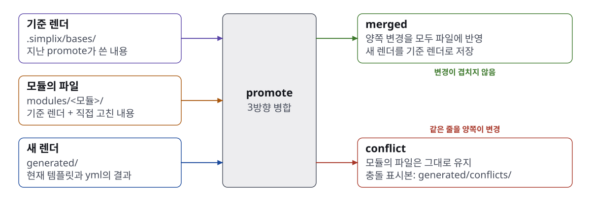
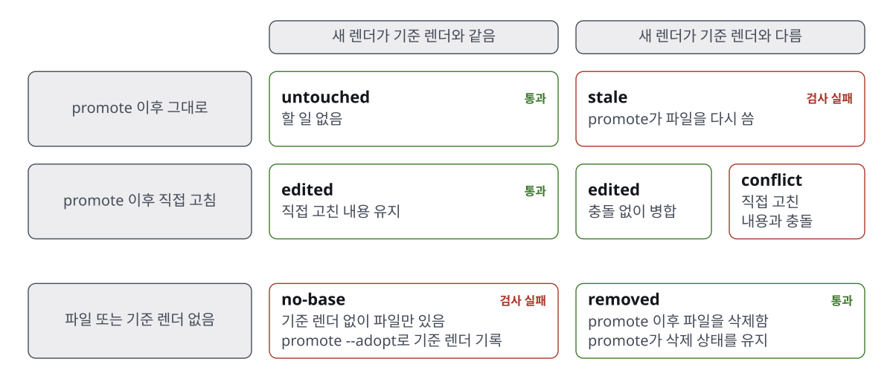

# 생성 코드 갱신

모듈로 옮긴 파일은 자유롭게 고칠 수 있습니다. 메서드를 추가하고, 검사를 바꾸고, 필요 없는 부분을 지웁니다. 이후 엔티티에 필드가 생기거나 템플릿이 바뀌거나 CLI를 갱신하면, 같은 파일에 그 변경을 반영하면서 직접 고친 내용도 유지해야 합니다. 이 병합을 `promote`가 수행합니다. 이 문서는 기본 절차, `promote`가 파일마다 하는 일, 옮긴 파일의 상태를 확인하고 문제를 해결하는 방법을 설명합니다.

## 기본 절차

```bash
# 1. Render again with the current yml and templates
simplix-boot generate Author --force

# 2. Bring the module's files up to date, merging into your edits
simplix-boot promote Author --module catalog

# 3. Check every promoted file
simplix-boot generated
```

엔티티 yml을 편집한 뒤, 템플릿을 바꾼 뒤, CLI를 갱신한 뒤에 실행하세요. 엔티티 자체가 바뀌었으면 먼저 `config Author --force`를 실행하고 yml에 편집했던 내용을 다시 반영합니다.

## promote가 파일마다 하는 일

모듈로 옮긴 파일은 주석 두 줄로 시작합니다. 생성 표시와, 옮길 당시 렌더의 지문입니다. `promote`는 그 렌더를 `.simplix/bases/`에도 저장해 두었습니다. 저장된 기준 렌더, 모듈의 파일, 새 렌더가 있으므로 직접 고친 내용과 템플릿의 변경을 구분해 병합할 수 있습니다.



```
ℹ Service:
  From: generated/main/java/com/example/library/web/catalog/service/AuthorService.java
  To:   modules/catalog/src/main/java/com/example/library/web/catalog/service/AuthorService.java
  ✔ Merged the template change into the edits
```

| 결과 | 파일의 상태 | promote의 처리 |
|---|---|---|
| `written` | 없거나 고친 적이 없음 | 새 렌더로 씀 |
| `merged` | 직접 고쳤고, 템플릿은 다른 곳이 바뀜 | 템플릿 변경을 직접 고친 내용에 병합 |
| `current` | 직접 고쳤고, 템플릿 변경이 이미 들어 있음 | 파일을 그대로 둠 |
| `removed` | 이전 promote 이후 직접 삭제함 | 삭제한 상태로 둠 |
| `adopted` | 기준 렌더 없이 존재하며 `--adopt`를 지정함 | 내용을 유지하고 새 렌더를 기준 렌더로 저장 |
| `conflict` | 템플릿이 바뀐 줄을 직접 고침 | 파일을 그대로 두고 충돌 표시본을 `generated/conflicts/`에 기록, 종료 코드 1 |
| `no-base` | 기준 렌더 없이 존재함 | 파일을 그대로 둠, 종료 코드 1 |

> ℹ 병합은 `git merge-file`로 수행하므로 Git이 설치되어 있어야 합니다. 프로젝트가 Git 저장소일 필요는 없습니다.

템플릿 변경으로 import가 없어지는 경우가 있습니다. 직접 작성한 코드가 그 클래스를 계속 사용하면 파일에 import를 남기고, 사용하는 곳이 없으면 삭제합니다.

## 옮긴 파일의 상태 확인

```bash
simplix-boot generated
```

```
edited     modules/catalog/src/main/java/com/example/library/web/catalog/service/AuthorService.java
untouched  modules/catalog/src/main/java/com/example/library/web/catalog/controller/AuthorRestController.java
untouched  modules/catalog/src/main/java/com/example/library/web/catalog/dto/AuthorDTOs.java
untouched  modules/catalog/src/test/java/com/example/library/web/catalog/service/AuthorServiceTest.java

edited 1 · untouched 3
```

`generated`는 모듈로 옮긴 엔티티를 모두 다시 렌더링하고, 파일마다 저장된 기준 렌더, 모듈의 파일, 새 렌더를 비교합니다. 상태는 promote 이후 파일을 고쳤는지와 새 렌더가 기준 렌더와 다른지에 따라 정해집니다.



| 상태 | 의미 | 할 일 | 종료 코드 |
|---|---|---|---|
| `untouched` | 현재 템플릿이 만드는 내용과 같음 | 없음 | 0 |
| `edited` | 직접 고쳤고, 새 렌더가 충돌 없이 병합됨 | 없음(템플릿 변경을 반영하려면 `promote` 실행) | 0 |
| `removed` | 직접 삭제했고 기준 렌더가 저장되어 있음 | 없음 | 0 |
| `stale` | 고친 적은 없지만 새 렌더와 다름 | `promote` 실행 | 1 |
| `conflict` | 새 렌더가 직접 고친 내용과 충돌 | 충돌 해결(아래) | 1 |
| `no-base` | 기준 렌더가 저장되어 있지 않음 | `promote --adopt` 실행(아래) | 1 |

종료 코드 덕분에 이 명령을 CI 검사로 쓸 수 있습니다. `stale`, `conflict`, `no-base`인 파일이 하나라도 있으면 실패합니다. `--json`은 같은 보고를 스크립트가 읽을 수 있는 한 줄로 출력하고, `--no-render`는 렌더링하지 않고 저장된 기준 렌더만으로 판정하므로 `stale`과 `conflict`를 찾지 못합니다.

## 충돌 해결

```
ℹ Service:
  From: generated/main/java/com/example/library/web/catalog/service/AuthorService.java
  To:   modules/catalog/src/main/java/com/example/library/web/catalog/service/AuthorService.java
  ✖ Conflict: the file was kept; the merge with markers is at
    generated/conflicts/modules/catalog/src/main/java/com/example/library/web/catalog/service/AuthorService.java.conflict
```

모듈의 파일은 바뀌지 않았습니다. 따라서 이번 실행의 템플릿 변경은 충돌하지 않은 부분까지 포함해 하나도 반영되지 않은 상태입니다. `generated/conflicts/` 아래의 파일에는 그 변경이 모두 들어 있습니다. 이 파일은 병합 결과이며, 충돌한 구간에만 표시가 있습니다. `edited` 아래가 직접 고친 내용, `template` 아래가 템플릿의 내용입니다.

```java
// @simplix-generated
// @simplix-render 7a38d897f15a promote Author --module catalog
<<<<<<< edited
// Maintained by the catalog team
=======
// Generated for the library application
>>>>>>> template
package com.example.library.web.catalog.service;
```

1. 충돌 파일을 열어 표시된 구간을 정리합니다. 한쪽을 택하거나 양쪽을 합치고, 표시 줄을 삭제합니다.
2. 정리한 결과를 모듈의 파일에 덮어씁니다. 모듈의 파일을 직접 편집하지 마세요. 그 파일에는 충돌 없이 병합된 템플릿 변경이 들어 있지 않습니다.
3. 모든 구간에서 템플릿 쪽 내용을 택했다면 `promote`를 다시 실행하세요. `current`로 보고됩니다.
4. 직접 고친 내용을 유지했거나 양쪽을 합친 구간이 있다면, 이 파일의 기준을 새 렌더로 바꿔야 합니다. 해당 파일의 저장된 기준 렌더를 삭제하고 `--adopt`를 지정해 `promote`를 실행하세요.

```bash
# 1. After resolving the marked regions in the conflict file, put it in place of the module file
cp generated/conflicts/modules/catalog/src/main/java/com/example/library/web/catalog/service/AuthorService.java.conflict \
   modules/catalog/src/main/java/com/example/library/web/catalog/service/AuthorService.java

# 2. Delete the stored base, which has the module file's path under .simplix/bases/
rm .simplix/bases/modules/catalog/src/main/java/com/example/library/web/catalog/service/AuthorService.java

# 3. Keep the file as it is and store the fresh render as its base
simplix-boot promote Author --module catalog --adopt
```

이후 `generated`는 이 파일을 `edited`로 보고합니다. 다른 방법은 `promote --force`입니다. 파일을 새 렌더로 덮어쓰고 직접 고친 내용을 버립니다.

## 기준 렌더가 없는 파일

모듈로 옮긴 파일이 있어야 할 위치에 파일은 있는데 `.simplix/bases/`에 대응하는 기준 렌더가 없으면 `no-base`입니다. 직접 작성했거나, 기준 렌더를 저장하지 않는 도구로 옮겼거나, `.simplix/bases/` 폴더를 커밋하지 않은 경우입니다. `promote --adopt`는 파일의 내용을 유지한 채 생성 표시를 넣고 새 렌더를 기준 렌더로 저장하므로, 이후의 템플릿 변경이 이 파일에 병합됩니다. 그 시점에 새 렌더와 다른 부분은 모두 직접 고친 내용으로 취급합니다.

## 필요 없는 생성 파일 제거

모듈에서 파일을 삭제하고 `.simplix/bases/`의 기준 렌더는 그대로 두세요. 이후 `promote`는 파일을 다시 쓰지 않고 삭제한 상태로 둡니다(`removed`).

## 관련 문서

- [명령 레퍼런스](./command-reference.md#promote)
- [동작 원리](./how-it-works.md)
- [문제 해결](./troubleshooting.md)
