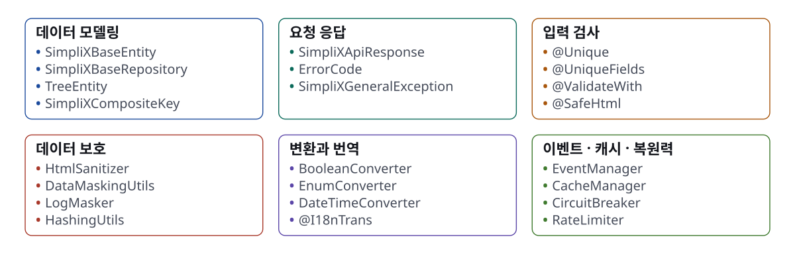

[English](./README.md) | **한국어**

# simplix-core

SimpliX의 기반 라이브러리입니다. 다른 모든 모듈이 이 모듈을 바탕으로 동작합니다. 엔티티와 저장소의 기본 클래스, 트리 구조, API 응답과 오류 모델, 검증기, 데이터 보호 유틸리티, 타입 변환, 필드 번역을 제공합니다.



## 설치

[스타터](../spring-boot-starter-simplix/README.ko.md)에 `simplix-core`가 포함되어 있으므로, [시작하기](../docs/ko/getting-started.md)에 따라 설정한 애플리케이션에는 이미 들어 있습니다. 코어 클래스만 필요한 라이브러리는 직접 선언합니다.

```groovy
dependencies {
    implementation "dev.simplecore.simplix:simplix-core:${version}"
}
```

## 제공하는 기능

| 하려는 일 | 사용하는 클래스 | 문서 |
|---|---|---|
| 엔티티와 저장소 모델링 | `SimpliXBaseEntity`, `SimpliXBaseRepository`, `SimpliXCompositeKey`, `@UuidV7Generator` | [엔티티와 저장소](docs/ko/entities-and-repositories.md) |
| 계층 구조로 레코드 관리 | `TreeEntity`, `SimpliXTreeRepository`, `SimpliXTreeBaseService` | [트리 구조](docs/ko/tree-structures.md) |
| 같은 형태로 요청에 응답 | `SimpliXApiResponse`, `ErrorCode`, `SimpliXGeneralException` | [API 응답과 오류](docs/ko/api-responses-and-errors.md) |
| 입력 검사 | `@Unique`, `@UniqueFields`, `@ValidateWith`, `@SafeHtml` | [입력 검증](docs/ko/validating-input.md) |
| 개인정보 보호 | `HtmlSanitizer`, `DataMaskingUtils`, `LogMasker`, `HashingUtils`, `@MaskSensitive` | [민감한 데이터 보호](docs/ko/protecting-sensitive-data.md) |
| 값 변환 | `BooleanConverter`, `EnumConverter`, `DateTimeConverter`, `SimpliXLabeledEnum` | [타입 변환](docs/ko/converting-types.md) |
| 독자의 언어로 문구 제공 | `@I18nTrans` | [필드 번역](docs/ko/translating-fields.md) |
| 화면을 위한 필드 설명 | `@NameField`, `@Tone`, `@MoneyValue`, `@References` | [화면을 위한 엔티티 설명](docs/ko/describing-entities-for-screens.md) |
| 이벤트 발행 | `EventManager`, `GenericEvent`, `@EntityEventConfig` | [이벤트 발행](docs/ko/publishing-events.md) |
| 값 캐싱 | `CacheManager`, `CacheProvider` | [캐싱](docs/ko/caching.md) |
| 부하와 장애 제한 | `CircuitBreaker`, `RateLimiter`, `BackpressureGuard` | [복원력 유틸리티](docs/ko/resilience-utilities.md) |
| 모듈이 단독으로 처리하는 범위와 스타터가 추가하는 범위 확인 | `SimpliXRepositoryFactoryBean`, `SimpliXRuntimeHints` | [simplix-core 동작 방식](docs/ko/how-it-works.md) |
| 문제의 원인 확인 |  | [문제 해결](docs/ko/troubleshooting.md) |

오류 코드는 [오류 코드 레퍼런스](docs/ko/error-code-reference.md)에 정리되어 있습니다.

## 시작

[시작하기](docs/ko/getting-started.md)에서 첫 엔티티를 작성하고 표준 코드로 오류를 보고합니다. [CRUD API 만들기](../docs/ko/building-a-crud-api.md)에서는 이 엔티티로 전체 API를 만듭니다.

## 요구 사항

| 프로젝트 | SimpliX 라인 | 선언할 버전 |
|---|---|---|
| Spring Boot 4 | 2.x | `2.x` 릴리스 |
| Spring Boot 3 | 1.x | `1.x` 릴리스 |

Java 17 이상이 필요하며, 엔티티 · 저장소 · 트리 클래스는 Spring Data JPA를 사용합니다.

## 라이선스

[SimpleCORE License 1.0 (SCL-1.0)](../docs/ko/license.md)
