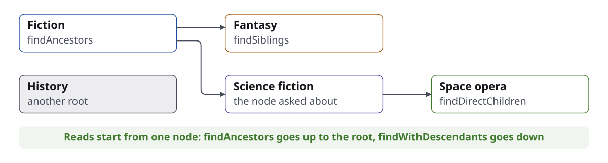

# Tree structures

How to keep records in a hierarchy, such as categories, menus or an organisation chart, and read, move and reorder them.



The module gives a tree entity a repository whose reads run as recursive SQL, a service with the operations a tree screen needs (read a branch, move a node, copy a branch, reorder siblings), and checks that keep the tree sound, such as refusing a move that would make a node its own ancestor.

## Write the entity

A tree entity implements `TreeEntity`, or `SortableTreeEntity` when the order of siblings can be changed. `@TreeEntityAttributes` names the table and the columns the tree queries use; the queries are native SQL, so the names are those of the database, not of the Java fields.

```java
@Entity
@Table(name = "categories")
@TreeEntityAttributes(
    tableName = "categories",
    idColumn = "id",
    parentIdColumn = "parent_id",
    sortOrderColumn = "sort_order",
    lookupColumns = {
        @LookupColumn(name = "name", type = LookupColumn.ColumnType.STRING)
    }
)
@Getter
@Setter
@NoArgsConstructor
public class Category implements SortableTreeEntity<Category, String> {

    @Id
    @UuidV7Generator
    private String id;

    @Column(name = "parent_id")
    private String parentId;

    @Column(nullable = false)
    private String name;

    @Column(name = "sort_order")
    private Integer sortOrder;

    @Transient
    private List<Category> children = new ArrayList<>();

    @Override
    public Comparable<?> getSortKey() {
        return sortOrder;
    }
}
```

### What the interfaces ask for

| Member | Interface | Meaning |
|---|---|---|
| `getId`, `setId` | `TreeEntity` | the identifier of the node |
| `getParentId`, `setParentId` | `TreeEntity` | the identifier of the parent; `null` for a root |
| `getChildren`, `setChildren` | `TreeEntity` | the children of the node; a `@Transient` list that the hierarchy reads fill in |
| `getSortKey` | `TreeEntity` | the value siblings are compared by when a hierarchy is built in memory |
| `isRoot`, `isLeaf` | `TreeEntity` | default methods: no parent, and no children in the `children` list |
| `getSortOrder`, `setSortOrder` | `SortableTreeEntity` | the integer position among siblings, which `reorderChildren` rewrites |

### Attributes of `@TreeEntityAttributes`

| Attribute | Default | Meaning |
|---|---|---|
| `tableName` | required | the table of the entity |
| `idColumn` | required | the primary key column |
| `parentIdColumn` | required | the column that holds the parent's id; empty for a root |
| `sortOrderColumn` | required | the column siblings are ordered by |
| `sortDirection` | `ASC` | the order of siblings, a `SortDirection`: `ASC` or `DESC` |
| `lookupColumns` | none | the columns `findByLookup` may search, each a `@LookupColumn` with a `name` and a `type` |
| `cascadeDelete` | `false` | no effect: the tree queries do not read it |
| `maxDepth` | `-1` | no effect: the tree queries do not read it |

The `type` of a `@LookupColumn` is a `LookupColumn.ColumnType`: `STRING` compares text, `NUMBER` a number and `BOOLEAN` a boolean value.

> ⚠ Use a `String` identifier. The tree queries compare the parent column with an empty string to find roots, which a numeric column refuses on H2 and PostgreSQL.

## Write the repository and the service

```java
public interface CategoryRepository extends SimpliXTreeRepository<Category, String> {
}

@Service
public class CategoryService extends SimpliXSortableTreeBaseService<Category, String> {

    public CategoryService(CategoryRepository repository) {
        super(repository);
    }
}
```

`SimpliXRepositoryFactoryBean` recognises a repository that extends `SimpliXTreeRepository` and gives it the tree queries. Register it once on the application: `@EnableJpaRepositories(repositoryFactoryBeanClass = SimpliXRepositoryFactoryBean.class)`. `SimpliXTreeBaseService` implements every operation of `SimpliXTreeService`; `SimpliXSortableTreeBaseService` adds `reorderChildren` for a `SortableTreeEntity`. Extend the first when the entity has no integer sort order.

## Build a tree

```java
Category fiction = categoryService.create(category("Fiction", null));
Category fantasy = categoryService.create(category("Fantasy", fiction.getId()));
Category scienceFiction = categoryService.create(category("Science fiction", fiction.getId()));
Category spaceOpera = categoryService.create(category("Space opera", scienceFiction.getId()));
Category cyberpunk = categoryService.create(category("Cyberpunk", scienceFiction.getId()));
Category history = categoryService.create(category("History", null));
```

```text
Fiction
├── Fantasy
└── Science fiction
    ├── Space opera
    └── Cyberpunk
History
```

`create` checks that the parent exists and refuses a missing one with `NoSuchElementException: Parent entity not found with ID: ...`. A node saved without a sort order gets the highest order among its siblings plus 100, so Fantasy is stored with 100 and Science fiction with 200, and a node can later be placed between them without renumbering.

## Read the tree

The results below are for the tree above.

| Call | Returns | Result |
|---|---|---|
| `findRoots()` | the nodes without a parent | Fiction, History |
| `findDirectChildren(fiction)` | the children of a node, in sibling order | Fantasy, Science fiction |
| `findWithDescendants(scienceFiction)` | the node and everything below it, as a flat list | Science fiction, Space opera, Cyberpunk |
| `findAncestors(spaceOpera)` | the parents, from the nearest up to the root | Science fiction, Fiction |
| `getPath(spaceOpera)` | the way from the root down to the node, the node included | Fiction, Science fiction, Space opera |
| `getDepth(spaceOpera)` | the level of the node; a root is at 0 | `2` |
| `findSiblings(fantasy)` | the other children of the same parent | Science fiction |
| `findByLevel(1)` | every node at one level | Fantasy, Science fiction |
| `isDescendantOf(spaceOpera, fiction)` | whether the first node is below the second | `true` |
| `findCompleteHierarchy()` | the roots, with `children` filled in at every level | Fiction and History, each with its branch |
| `findById(id)`, `findAll(pageable)` | one node, or a page of all nodes |  |

Only `findCompleteHierarchy` and `findHierarchyByLookup` return nested objects. Every other read returns a flat list whose `children` are empty; pass such a list to `buildHierarchy` of the repository when a nested result is needed. `getDirectChildren`, `getAllDescendants` and `getRootItems` are other names for `findDirectChildren`, `findWithDescendants` and `findRoots`.

## Search the tree

```java
categoryService.findByLookup(Map.of("name", "Fantasy"));                        // Fantasy
categoryService.findByLookup(Map.of("name", "Fantasy"), PageRequest.of(0, 10));  // a page with one element
categoryService.findHierarchyByLookup(Map.of("name", "Space opera"));            // Fiction > Science fiction > Space opera
categoryService.findByPredicate(category -> category.getName().startsWith("S")); // Science fiction, Space opera
```

- `findByLookup` compares a lookup column with a value for equality: `Fant` does not find Fantasy. A key that is not declared in `lookupColumns` fails with a SQL error, so check the keys a client sends against the declared columns.
- `findHierarchyByLookup` returns the matching nodes inside their ancestors, starting at the root, so a search result can be drawn as a tree.
- `findByPredicate` reads every node and filters in memory. Use it for small trees or for a condition SQL cannot express.

## Change the structure

```java
// Space opera becomes a child of History
categoryService.move(spaceOpera.getId(), history.getId());

// Cyberpunk becomes a root
categoryService.move(cyberpunk.getId(), null);

// IllegalArgumentException: Cannot move a node to its own descendant
categoryService.move(fiction.getId(), fantasy.getId());

// A copy of Science fiction and everything below it, with new identifiers, under History
Category copy = categoryService.copySubtree(scienceFiction.getId(), history.getId());

// The same, with the name of the copied root replaced
categoryService.copySubtreeWithProperties(fantasy.getId(), history.getId(), Map.of("name", "Fantasy (copy)"));

// Science fiction first, Fantasy second
categoryService.reorderChildren(fiction.getId(), List.of(scienceFiction.getId(), fantasy.getId()));
```

- `move` and `update` refuse a change that would make a node its own ancestor.
- `copySubtree` leaves the source where it is. The copies are new records: their identifiers differ from the originals.
- `copySubtreeWithProperties` sets the given properties, by field name, on the root of the copy.
- `reorderChildren` numbers the listed children 0, 1, 2 and so on, in the order of the list. An identifier that is not a child of the parent is skipped, and a child that is not listed keeps its number, so pass every child.

## Work on several nodes

`createBatch`, `updateBatch` and `deleteBatch` save or delete a list in one transaction. `createBatch` stores the nodes as they are given: unlike `create`, it assigns no sort order, so set one on each node.

## Delete nodes and repair the tree

`deleteById` deletes one node and refuses an unknown identifier with `IllegalArgumentException: Entity not found with ID: ...`. It does not delete the children: they stay in the table with a parent that no longer exists. Delete a branch from the leaves up, or move the children first.

```java
categoryService.deleteById(scienceFiction.getId());

categoryService.validateTreeIntegrity();
// {orphanedEntities=[Orphaned entity found: 01a20e39-... (parent: 01a20e39-...)]}

categoryService.repairTreeStructure();    // 1
categoryService.validateTreeIntegrity();  // {}
```

`validateTreeIntegrity` reports circular references, nodes whose parent is missing and duplicate sort keys; an empty map means none were found. `repairTreeStructure` turns every node whose parent is missing into a root and returns how many it changed.

## Measure the tree

```java
categoryService.getTreeMetrics();
// {totalNodes=5, rootNodes=2, maxDepth=1, avgDepth=0.6, leafNodes=5, branchNodes=0, avgChildren=0.0}
```

`totalNodes`, `rootNodes`, `maxDepth` and `avgDepth` describe the stored tree. `leafNodes`, `branchNodes` and `avgChildren`, like `findLeafNodes`, judge a node by its `children` list, which the flat read behind them leaves empty: every node is counted as a leaf. Count leaves from `findCompleteHierarchy` instead.

## Soft-deleted nodes

When the entity implements `SoftDeletable` and carries a Hibernate `@Filter` whose condition names the column, such as `deleted = :isDeleted`, the tree queries add `deleted = false` to every read, the recursive ones included. A soft-deleted node, and through it the branch below it, is left out of the results. The condition is a boolean comparison, so the column is a boolean one.

## Databases

The repository reads the product name of the connection and writes the recursive queries in the dialect of PostgreSQL, MySQL, MariaDB, Oracle, SQL Server or H2.

## Operations at a glance

| Group | Methods |
|---|---|
| Create, read, update, delete | `create`, `update`, `findById`, `findAll(Pageable)`, `deleteById` |
| Traversal | `findCompleteHierarchy`, `findWithDescendants`, `findRoots`, `findDirectChildren`, `findAncestors`, `findSiblings`, `getPath`, `getDepth`, `isDescendantOf` |
| Change of structure | `move`, `copySubtree`, `copySubtreeWithProperties`, `reorderChildren` |
| Search | `findByLookup`, `findHierarchyByLookup`, `findByLevel`, `findByPredicate`, `findLeafNodes` |
| Batch | `createBatch`, `updateBatch`, `deleteBatch` |
| Analysis and repair | `getTreeMetrics`, `validateTreeIntegrity`, `repairTreeStructure` |

## Related documents

- [Entities and repositories](./entities-and-repositories.md)
- [SimpliX CLI](../../../simplix-cli/README.md): generates a tree service and controller for a tree entity
