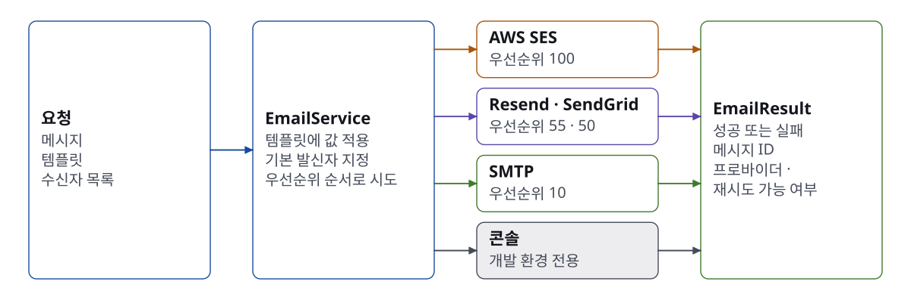

[English](./README.md) | **한국어**

# simplix-email

애플리케이션에서 서비스 하나로 메일을 발송하는 모듈입니다. SMTP 서버, AWS SES, SendGrid, Resend 중 어느 프로바이더로 전달하든 같은 방식으로 호출합니다. 단건 메시지, 수신자의 언어에 맞는 템플릿 메시지, 여러 수신자를 대상으로 한 템플릿 발송을 지원하며, 예외를 발생시키지 않고 결과를 반환합니다.



## 설치

이 모듈은 [스타터](../spring-boot-starter-simplix/README.ko.md)에 포함되어 있습니다. 단독으로 사용하려면 의존성을 추가하세요.

```groovy
dependencies {
    implementation "dev.simplecore.simplix:simplix-email:${version}"
}
```

## 첫 메시지

```java
@Service
@RequiredArgsConstructor
@Slf4j
public class WelcomeMailer {

    private final EmailService emailService;

    public void welcome(String address, String name) {
        EmailResult result = emailService.send(
            EmailRequest.simple(address, "Welcome to the library", "<p>Hello " + name + "</p>"));

        if (!result.isSuccess()) {
            log.warn("welcome mail failed: {}", result.getErrorMessage());
        }
    }
}
```

설정하지 않으면 메일은 외부로 발송되지 않습니다. 콘솔 프로바이더가 메시지를 로그에 출력하므로 개발 환경에서 그대로 사용할 수 있습니다. 실제 프로바이더 연결은 [시작하기](docs/ko/getting-started.md)에서 설명합니다.

## 문서

| 목적 | 문서 |
|---|---|
| 첫 메시지 발송과 프로바이더 연결 | [시작하기](docs/ko/getting-started.md) |
| 수신자, 본문, 첨부 파일, 인라인 이미지 지정과 백그라운드 발송 | [메일 발송](docs/ko/sending-mail.md) |
| 언어별로 메시지를 작성하고 값을 채워 발송 | [템플릿 사용](docs/ko/using-templates.md) |
| 여러 수신자에게 템플릿 발송 | [여러 수신자에게 발송](docs/ko/sending-to-many-recipients.md) |
| SMTP, AWS SES, SendGrid, Resend 선택과 설정, 프로바이더 간 장애 전환 | [프로바이더 선택](docs/ko/choosing-a-provider.md) |
| 클래스별 역할 확인 | [simplix-email 동작 방식](docs/ko/how-it-works.md) |
| 속성 조회 | [설정 레퍼런스](docs/ko/configuration-reference.md) |
| 문제의 원인 확인 | [문제 해결](docs/ko/troubleshooting.md) |

## 요구 사항

| 프로젝트 | SimpliX 라인 | 선언할 버전 |
|---|---|---|
| Spring Boot 4 | 2.x | `2.x` 릴리스 |
| Spring Boot 3 | 1.x | `1.x` 릴리스 |

SMTP는 모듈에 포함된 의존성만으로 동작합니다. AWS SES는 `software.amazon.awssdk:sesv2`, SendGrid는 `com.sendgrid:sendgrid-java`, Resend는 `com.resend:resend-java`를 애플리케이션의 의존성에 추가해야 합니다.

## 라이선스

[SimpleCORE License 1.0 (SCL-1.0)](../docs/ko/license.md)
