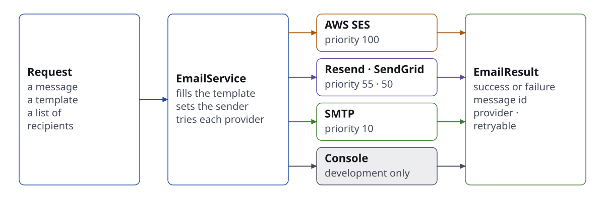

**English** | [한국어](./README.ko.md)

# simplix-email

Sends mail from an application through one service, whichever provider delivers it: an SMTP server, AWS SES, SendGrid or Resend. The same call sends a single message, a message from a template in the language of the reader, or one template to many recipients, and it answers with a result instead of throwing.



## Install

The module is part of the [starter](../spring-boot-starter-simplix/README.md). To use it alone, add the dependency.

```groovy
dependencies {
    implementation "dev.simplecore.simplix:simplix-email:${version}"
}
```

## A first message

```java
@Service
@RequiredArgsConstructor
@Slf4j
public class WelcomeMailer {

    private final EmailService emailService;

    public void welcome(String address, String name) {
        EmailResult result = emailService.send(
            EmailRequest.simple(address, "Welcome to the library", "<p>Hello " + name + "</p>"));

        if (!result.isSuccess()) {
            log.warn("welcome mail failed: {}", result.getErrorMessage());
        }
    }
}
```

Without configuration nothing leaves the machine: the console provider prints the message to the log, which is what development needs. [Getting started](docs/en/getting-started.md) connects a real provider.

## Documents

| To | Read |
|---|---|
| send a first message and connect a provider | [Getting started](docs/en/getting-started.md) |
| set recipients, bodies, attachments and inline images, and send in the background | [Sending mail](docs/en/sending-mail.md) |
| write a message once per language and fill it with values | [Using templates](docs/en/using-templates.md) |
| send one template to many recipients | [Sending to many recipients](docs/en/sending-to-many-recipients.md) |
| choose and configure SMTP, AWS SES, SendGrid or Resend, and fail over between them | [Choosing a provider](docs/en/choosing-a-provider.md) |
| see which class does what | [How simplix-email works](docs/en/how-it-works.md) |
| look a property up | [Configuration reference](docs/en/configuration-reference.md) |
| find the cause of a problem | [Troubleshooting](docs/en/troubleshooting.md) |

## Requirements

| Your project | SimpliX line | Version to declare |
|---|---|---|
| Spring Boot 4 | 2.x | a `2.x` release |
| Spring Boot 3 | 1.x | a `1.x` release |

SMTP works with what the module brings. AWS SES needs `software.amazon.awssdk:sesv2`, SendGrid `com.sendgrid:sendgrid-java` and Resend `com.resend:resend-java` among the dependencies of the application.

## License

[SimpleCORE License 1.0 (SCL-1.0)](../docs/en/license.md)
