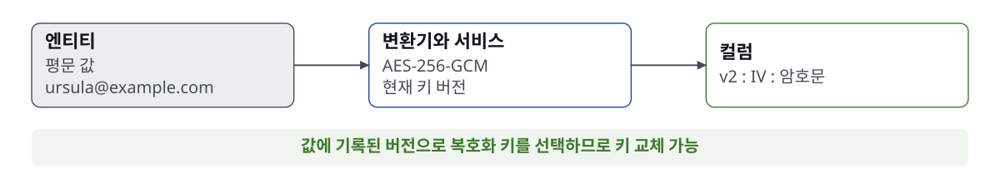

[English](./README.md) | **한국어**

# simplix-encryption

저장하는 데이터를 암호화하는 모듈입니다. 컬럼에 변환기를 지정하면 데이터베이스에 저장할 때 AES-256-GCM으로 암호화하고 읽을 때 복호화합니다. 저장된 값마다 암호화에 사용한 키 버전이 기록되므로, 기존 데이터를 유지한 채 키를 교체할 수 있습니다.



## 설치

[스타터](../spring-boot-starter-simplix/README.ko.md)에 이 모듈이 포함되어 있습니다. 스타터 없이 사용할 때는 다음과 같이 추가합니다.

```groovy
dependencies {
    implementation "dev.simplecore.simplix:simplix-encryption:${version}"
}
```

## 문서

| 하려는 일 | 문서 |
|---|---|
| 첫 컬럼 암호화 | [시작하기](docs/ko/getting-started.md) |
| 코드에서 값 암호화 | [코드에서 값 암호화](docs/ko/encrypting-values-in-code.md) |
| 키의 출처 결정 | [키 프로바이더 선택](docs/ko/choosing-a-key-provider.md) |
| 키 교체 | [키 교체](docs/ko/rotating-keys.md) |
| 키 생성 · 보관 · 운영 점검, 노출 대응 | [키 안전하게 운영하기](docs/ko/keeping-keys-safe.md) |
| 속성 조회 | [설정 레퍼런스](docs/ko/configuration-reference.md) |
| 암호화한 컬럼의 크기 산정, 검색, 전환 | [컬럼 암호화](docs/ko/encrypting-columns.md) |
| 값의 암호화 과정과 프로바이더 선택 방식 확인 | [simplix-encryption 동작 방식](docs/ko/how-it-works.md) |
| 문제의 원인 확인 | [문제 해결](docs/ko/troubleshooting.md) |

## 요구 사항

| 프로젝트 | SimpliX 라인 | 선언할 버전 |
|---|---|---|
| Spring Boot 4 | 2.x | `2.x` 릴리스 |
| Spring Boot 3 | 1.x | `1.x` 릴리스 |

## 라이선스

[SimpleCORE License 1.0 (SCL-1.0)](../docs/ko/license.md)
