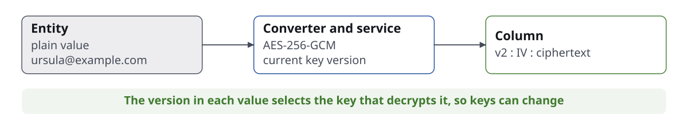

**English** | [한국어](./README.ko.md)

# simplix-encryption

Encryption of data at rest. Mark a column and its value is encrypted with AES-256-GCM on the way into the database and decrypted on the way out; every stored value names the key version that encrypted it, so keys can be replaced without losing old data.



## Install

The [starter](../spring-boot-starter-simplix/README.md) includes the module. Without the starter:

```groovy
dependencies {
    implementation "dev.simplecore.simplix:simplix-encryption:${version}"
}
```

## Documents

| To | Read |
|---|---|
| encrypt a first column | [Getting started](docs/en/getting-started.md) |
| encrypt values in code | [Encrypting values in code](docs/en/encrypting-values-in-code.md) |
| decide where the keys come from | [Choosing a key provider](docs/en/choosing-a-key-provider.md) |
| replace a key | [Rotating keys](docs/en/rotating-keys.md) |
| look a property up | [Configuration reference](docs/en/configuration-reference.md) |
| size, search and migrate an encrypted column | [Encrypting columns](docs/en/encrypting-columns.md) |
| see how a value is encrypted and which provider is chosen | [How simplix-encryption works](docs/en/how-it-works.md) |
| find the cause of a problem | [Troubleshooting](docs/en/troubleshooting.md) |

## Requirements

| Your project | SimpliX line | Version to declare |
|---|---|---|
| Spring Boot 4 | 2.x | a `2.x` release |
| Spring Boot 3 | 1.x | a `1.x` release |

## License

[SimpleCORE License 1.0 (SCL-1.0)](../docs/en/license.md)
