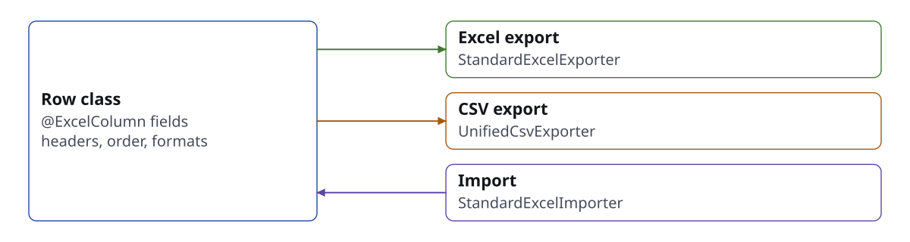

**English** | [한국어](./README.ko.md)

# simplix-excel

Excel and CSV files for a SimpliX application. Annotate a row class once and the same class is exported to `.xlsx`, exported to `.csv` and read back from an uploaded file, with headers, formats and labels in the reader's language.



## Install

The [starter](../spring-boot-starter-simplix/README.md) includes the module. Without the starter:

```groovy
dependencies {
    implementation "dev.simplecore.simplix:simplix-excel:${version}"
}
```

## Documents

| To | Read |
|---|---|
| download a first file | [Getting started](docs/en/getting-started.md) |
| export lists, large and small | [Exporting data](docs/en/exporting-data.md) |
| read an uploaded file | [Importing files](docs/en/importing-files.md) |
| translate headers and values | [Labelling columns and values](docs/en/labelling-columns-and-values.md) |
| fill a designed workbook | [Exporting with a template](docs/en/exporting-with-a-template.md) |
| look a property up | [Configuration reference](docs/en/configuration-reference.md) |
| set widths, fonts, colours and formats | [Styling columns](docs/en/styling-columns.md) |
| see which class does what | [How simplix-excel works](docs/en/how-it-works.md) |
| find the cause of a problem | [Troubleshooting](docs/en/troubleshooting.md) |

## Requirements

| Your project | SimpliX line | Version to declare |
|---|---|---|
| Spring Boot 4 | 2.x | a `2.x` release |
| Spring Boot 3 | 1.x | a `1.x` release |

## License

[SimpleCORE License 1.0 (SCL-1.0)](../docs/en/license.md)
