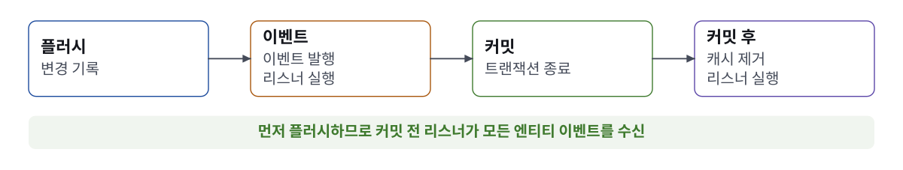

[English](./README.md) | **한국어**

# simplix-hibernate

JPA 애플리케이션에 필요하지만 Hibernate가 기본으로 제공하지 않는 기능을 제공합니다. 일괄 수정 후에도 정확한 2차 캐시, 트랜잭션 안에서 전달되는 엔티티 변경 이벤트, 이 기능을 안정적으로 동작하게 하는 트랜잭션 매니저입니다.



## 설치

[스타터](../spring-boot-starter-simplix/README.ko.md)에 이 모듈이 포함되어 있습니다. 스타터 없이 사용할 때는 다음과 같이 추가합니다.

```groovy
dependencies {
    implementation "dev.simplecore.simplix:simplix-hibernate:${version}"
}
```

## 문서

| 하려는 일 | 문서 |
|---|---|
| 엔티티 캐싱 | [시작하기](docs/ko/getting-started.md) |
| 일괄 쿼리 후에도 정확한 캐시 유지 | [엔티티 캐시 제거](docs/ko/evicting-the-entity-cache.md) |
| 엔티티 변경에 대응 | [엔티티 이벤트 발행](docs/ko/publishing-entity-events.md) |
| 커밋 시점의 동작 이해 | [트랜잭션 커밋 방식](docs/ko/how-it-works.md) |
| 속성 조회 | [설정 레퍼런스](docs/ko/configuration-reference.md) |
| 엔티티와 쿼리 결과 캐싱, 캐시 크기 지정 | [엔티티 캐싱](docs/ko/caching-entities.md) |
| 문제의 원인 확인 | [문제 해결](docs/ko/troubleshooting.md) |

## 요구 사항

| 프로젝트 | SimpliX 라인 | 선언할 버전 |
|---|---|---|
| Spring Boot 4 | 2.x | `2.x` 릴리스 |
| Spring Boot 3 | 1.x | `1.x` 릴리스 |

## 라이선스

[SimpleCORE License 1.0 (SCL-1.0)](../docs/ko/license.md)
