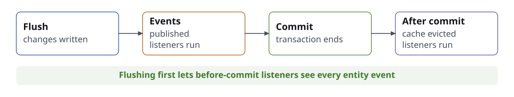

**English** | [한국어](./README.ko.md)

# simplix-hibernate

What a JPA application needs around Hibernate and does not get from it: a second-level cache that stays correct after bulk updates, events for entity changes that arrive inside the transaction, and a transaction manager that makes both reliable.



## Install

The [starter](../spring-boot-starter-simplix/README.md) includes the module. Without the starter:

```groovy
dependencies {
    implementation "dev.simplecore.simplix:simplix-hibernate:${version}"
}
```

## Documents

| To | Read |
|---|---|
| cache an entity | [Getting started](docs/en/getting-started.md) |
| keep the cache correct after bulk queries | [Evicting the entity cache](docs/en/evicting-the-entity-cache.md) |
| react to entity changes | [Publishing entity events](docs/en/publishing-entity-events.md) |
| understand what happens at commit | [How transactions are committed](docs/en/how-it-works.md) |
| look a property up | [Configuration reference](docs/en/configuration-reference.md) |
| cache entities and query results, and size the caches | [Caching entities](docs/en/caching-entities.md) |
| find the cause of a problem | [Troubleshooting](docs/en/troubleshooting.md) |

## Requirements

| Your project | SimpliX line | Version to declare |
|---|---|---|
| Spring Boot 4 | 2.x | a `2.x` release |
| Spring Boot 3 | 1.x | a `1.x` release |

## License

[SimpleCORE License 1.0 (SCL-1.0)](../docs/en/license.md)
