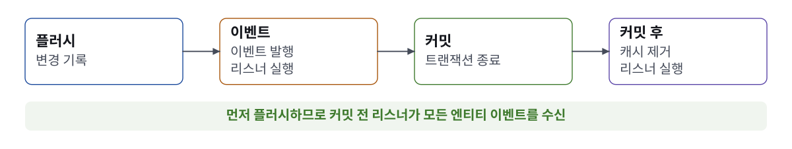

# 트랜잭션 커밋 방식

모듈이 JPA 트랜잭션 매니저를 교체하는 이유와, 트랜잭션 경계에서 추가로 처리하는 내용을 설명합니다.

## 리스너보다 먼저 플러시

Hibernate는 세션을 플러시할 때 대기 중인 변경을 기록하며, 이벤트를 발행하는 엔티티 생명주기 콜백도 이때 실행됩니다. Spring의 `JpaTransactionManager`는 커밋 과정 안에서 플러시하는데, 이 시점은 이미 등록되어 있던 `BEFORE_COMMIT` 리스너를 실행한 뒤입니다. 이렇게 늦은 플러시에서 발행된 이벤트의 리스너는 너무 늦게 등록되어 실행되지 않습니다.

`SimpliXJpaTransactionManager`는 Spring이 `BEFORE_COMMIT` 리스너를 실행하기 전에 먼저 플러시합니다. 그 시점에는 대기 중인 모든 변경의 이벤트가 발행되어 있으므로 모든 리스너가 트랜잭션 안에서 실행됩니다. 이 플러시는 가장 바깥의 읽기 · 쓰기 트랜잭션에서만 실행되며, 참여 중인 안쪽 트랜잭션과 읽기 전용 트랜잭션에서는 실행되지 않습니다.

### 제약

- `BEFORE_COMMIT` 리스너에서 엔티티를 변경하면 커밋 과정에서 두 번째 플러시가 실행됩니다. 이 변경의 이벤트는 `BEFORE_COMMIT` 리스너에 전달되지 않습니다.
- 이 보장은 모듈이 등록한 트랜잭션 매니저에만 적용됩니다. 데이터 소스가 여러 개이면 매니저별로 확인하세요.

## 직접 등록한 트랜잭션 매니저

모듈은 Spring Boot가 기본 매니저를 등록하기 전에 자체 매니저를 등록합니다. 애플리케이션이 등록한 트랜잭션 매니저 빈이 있으면 그 빈이 우선합니다. 모듈은 시작할 때 활성 JPA 매니저를 확인합니다. `SimpliXJpaTransactionManager`가 아니면 오류를 기록하고, `simplix.transaction.fail-fast: true`이면 애플리케이션이 시작되지 않습니다. 매니저를 직접 구현해야 하면 `SimpliXJpaTransactionManager`를 상속하세요.

## 커밋 후 캐시 제거

트랜잭션 안에서 실행된 `@EvictCache` 메서드는 캐시를 즉시 비우지 않습니다. 제거 요청을 모아 두었다가 커밋 후에 실행하므로, 그 사이에 다른 트랜잭션이 이전 행을 캐시에 다시 적재하지 않으며 롤백하면 아무것도 제거하지 않습니다.

## 쓰기 잠금이 거부되었을 때 재시도

SQLite처럼 한 번에 한 writer만 허용하는 데이터베이스는 다른 연결이 먼저 기록하면 트랜잭션의 쓰기 잠금을 거부할 수 있습니다. 행 단위로 잠그는 서버는 같은 상황을 잠금 타임아웃으로 보고합니다. 트랜잭션이 읽은 데이터가 이미 오래되었으므로 기다려도 해결되지 않습니다. 모듈은 이런 트랜잭션을 처음부터 다시 실행합니다.

- 자체 트랜잭션을 시작한 호출만 재시도합니다. 가장 바깥의 `@Transactional` 메서드나 `REQUIRES_NEW`를 지정한 메서드입니다. 기존 트랜잭션에 참여한 메서드는 그 트랜잭션의 결과를 따릅니다.
- 잠금 거부는 롤백이므로 실패한 시도의 변경은 남지 않습니다. 메시지 전송처럼 데이터베이스 밖에서 수행한 작업은 다시 실행되므로, 이런 작업은 `AFTER_COMMIT` 리스너에서 처리하세요.
- `simplix.transaction.write-lock-retry.attempts`(6)와 `initial-backoff`(25ms)로 재시도 횟수와 간격을 설정합니다.

## 모듈의 구성 요소

| 자동 구성 | 등록 대상 | 전환 속성 |
|---|---|---|
| `SimpliXTransactionAutoConfiguration` | `SimpliXJpaTransactionManager`, 시작 시 검사, `WriteLockRetryAspect`와 `WriteLockRetryProperties` | `simplix.transaction.enabled` |
| `EntityEventAutoConfiguration` | 엔티티 이벤트 리스너를 Spring 빈으로 등록해 애플리케이션으로 이벤트를 발행하게 합니다 | `simplix.entity-events.enabled` |
| `SimpliXHibernateCacheAutoConfiguration` | 아래의 캐시 제거 지원 구성. `HibernateCacheProperties`에 바인딩됩니다 | `simplix.hibernate.cache.disabled` |

| 클래스 | 캐시 제거 과정의 역할 |
|---|---|
| `ModifyingQueryCacheEvictionAspect` | `@EvictCache`를 지정한 저장소 메서드 전후에 실행되어 제거 항목을 수집기에 전달합니다 |
| `TransactionAwareCacheEvictionCollector` | 트랜잭션의 `PendingEviction` 항목을 보관했다가 커밋 후에 발행합니다. 트랜잭션이 없으면 바로 발행합니다 |
| `PostCommitCacheEvictionHandler` | `PendingEvictionCompletedEvent`를 받아 전략을 호출합니다 |
| `CacheEvictionStrategy` | 이 인스턴스의 캐시에서 항목을 제거합니다 |
| `HibernateCacheHolder`, `HibernateCacheInitializer` | Hibernate 캐시의 참조를 보관하고, `EntityCacheScanner`와 함께 시작 시 초기화합니다 |

## 관련 문서

- [엔티티 이벤트 발행](./publishing-entity-events.md)
- [설정 레퍼런스](./configuration-reference.md)
