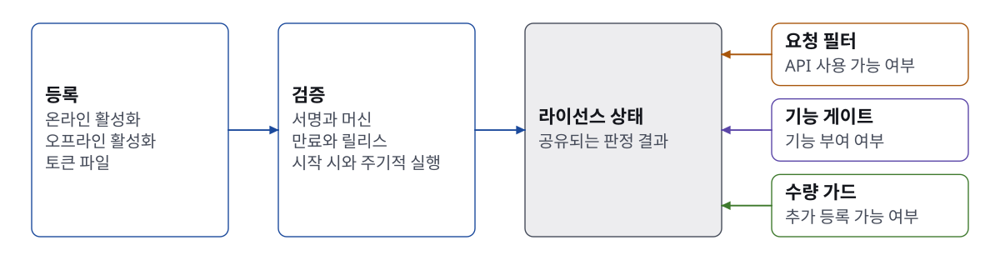

[English](./README.md) | **한국어**

# simplix-license

애플리케이션이 라이선스에 따라 동작하도록 하는 모듈입니다. 배포본의 라이선스를 등록하고 주기적으로 검증하며, 판정 결과를 요청, 기능, 수량 지점에서 강제 적용합니다. 판정은 라이선스 SDK가 수행하고, 이 모듈은 Spring Boot 애플리케이션에서 판정을 요청하는 시점과 적용 지점을 구성합니다.



## 설치

스타터에는 이 모듈이 포함되어 있지 않습니다. 별도 의존성으로 추가하세요.

```groovy
dependencies {
    implementation "dev.simplecore.simplix:simplix-license:${version}"

    // Optional: keep the registration in the database
    implementation "org.springframework.boot:spring-boot-starter-data-jpa"

    // Optional: @RequiresFeature
    implementation "org.springframework.boot:spring-boot-starter-aspectj"

    // Optional: health and metrics
    implementation "org.springframework.boot:spring-boot-starter-actuator"
}
```

이 모듈은 라이선스 SDK(`dev.accesscore:license-sdk`)를 함께 가져오며, SDK는 별도의 패키지 저장소에서 내려받습니다. Gradle에 해당 저장소의 인증 정보를 지정하세요.

```properties
accesscore.gpr.user=your_github_username
accesscore.gpr.token=your_github_personal_access_token
```

## 제공 기능

| 기능 | 의미 |
|---|---|
| 서명 검증 | 애플리케이션에 내장된 공개키로 검증된 토큰만 허용합니다 |
| 온라인 · 오프라인 활성화 | 라이선스 서버나 요청 파일로 제품 키를 머신에 바인딩된 토큰으로 교환합니다 |
| 하트비트와 재검증 | 폐기, 만료, 계약 변경이 재시작 없이 배포본에 반영됩니다 |
| 요청 강제 적용 | 사용할 수 있는 라이선스가 없는 배포본은 API 요청에 상태 403으로 응답합니다 |
| 기능 게이팅 | `@RequiresFeature`로 엔드포인트를 라이선스의 기능에 연결합니다 |
| 수량 제한 | 계약 수량을 넘는 등록을 거부합니다 |
| 설치 게이트 | 최초 설치가 끝나기 전에는 설치 마법사에만 접근할 수 있습니다 |

## 문서

| 목적 | 문서 |
|---|---|
| 모듈 추가와 제품 지정 | [시작하기](docs/ko/getting-started.md) |
| 온라인, 오프라인, 파일로 라이선스 등록 | [라이선스 활성화](docs/ko/activating-a-license.md) |
| 상태별 허용 범위와 열려 있는 경로 확인 | [라이선스 강제 적용](docs/ko/enforcing-the-license.md) |
| 엔드포인트와 작업을 라이선스 기능에 연결 | [기능 게이팅](docs/ko/gating-features.md) |
| 집계 항목을 계약 수량으로 제한 | [수량 제한](docs/ko/limiting-quantities.md) |
| 헬스 체크, 메트릭, 감사 기록으로 라이선스 확인 | [라이선스 모니터링](docs/ko/monitoring-the-license.md) |
| 판정, 검증 키, 저장소의 동작 이해 | [simplix-license 동작 방식](docs/ko/how-it-works.md) |
| 속성과 필수 빈 조회 | [설정 레퍼런스](docs/ko/configuration-reference.md) |
| 문제의 원인 확인 | [문제 해결](docs/ko/troubleshooting.md) |

## 요구 사항

| 프로젝트 | SimpliX 라인 | 선언할 버전 |
|---|---|---|
| Spring Boot 4 | 2.x | `2.x` 릴리스 |
| Spring Boot 3 | 1.x | `1.x` 릴리스 |

재검증과 하트비트 작업을 실행하려면 애플리케이션에 `@EnableScheduling`이 필요합니다.

## 라이선스

[SimpleCORE License 1.0 (SCL-1.0)](../docs/ko/license.md)
