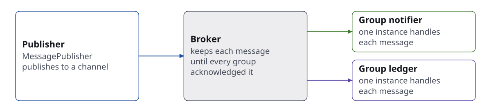

**English** | [한국어](./README.ko.md)

# simplix-messaging

Sends messages between the parts of a system through a broker, with one API whichever broker carries them: NATS JetStream, Redis Streams, Kafka, RabbitMQ, or an in-memory broker for tests. A message is kept by the broker until a handler of each consumer group has processed it, which is the difference from [simplix-sync](../simplix-sync/README.md), where a lost message is acceptable.



## Install

The module is part of the [starter](../spring-boot-starter-simplix/README.md). To use it alone, add the dependency.

```groovy
dependencies {
    implementation "dev.simplecore.simplix:simplix-messaging:${version}"
}
```

## A first message

```java
@Service
@RequiredArgsConstructor
public class LoanDesk {

    private final MessagePublisher messagePublisher;

    public void open(String loanId, String memberId) {
        byte[] payload = JsonCodec.serialize(new LoanOpened(loanId, memberId));
        messagePublisher.publish(Message.ofBytes("loan-opened", payload));
    }
}
```

```java
@Component
public class LoanNotifier {

    @MessageHandler(channel = "loan-opened", group = "notifier")
    public void onLoanOpened(Message<byte[]> message) {
        LoanOpened event = JsonCodec.deserialize(message.getPayload(), LoanOpened.class);
        // notify the member
    }
}
```

With no configuration the broker is `local`: the message is delivered inside the same process, which is enough to develop and to test. [Choosing a broker](docs/en/choosing-a-broker.md) connects a real one without a change to this code.

## Documents

| To | Read |
|---|---|
| publish and handle a first message | [Getting started](docs/en/getting-started.md) |
| build messages, set headers and ids, publish in the background | [Publishing messages](docs/en/publishing-messages.md) |
| write handlers, acknowledge by hand, skip duplicates, scale consumers | [Handling messages](docs/en/handling-messages.md) |
| decide what happens to a message a handler cannot process | [Handling failures](docs/en/handling-failures.md) |
| choose and configure NATS, Redis, Kafka or RabbitMQ | [Choosing a broker](docs/en/choosing-a-broker.md) |
| read old messages again, and ask a question over a channel | [Replaying messages and request-reply](docs/en/replaying-messages-and-request-reply.md) |
| watch the broker with health checks and metrics | [Monitoring messaging](docs/en/monitoring-messaging.md) |
| see which class does what | [How simplix-messaging works](docs/en/how-it-works.md) |
| look a property up | [Configuration reference](docs/en/configuration-reference.md) |
| find the cause of a problem | [Troubleshooting](docs/en/troubleshooting.md) |

## Requirements

| Your project | SimpliX line | Version to declare |
|---|---|---|
| Spring Boot 4 | 2.x | a `2.x` release |
| Spring Boot 3 | 1.x | a `1.x` release |

The local broker needs nothing else. Each real broker needs its client library among the dependencies of the application: `io.nats:jnats`, `spring-boot-starter-data-redis`, the Kafka starter of your release line or `spring-boot-starter-amqp`.

## License

[SimpleCORE License 1.0 (SCL-1.0)](../docs/en/license.md)
