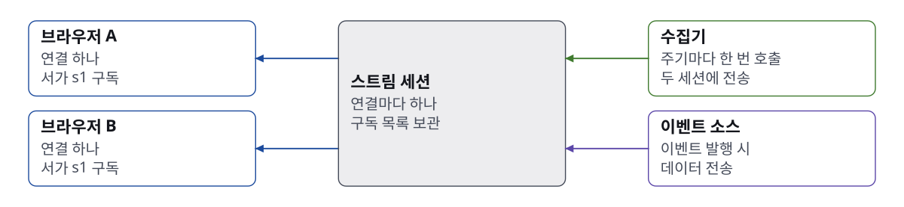

[English](./README.md) | **한국어**

# simplix-stream

서버의 실시간 데이터를 Server-Sent Events 또는 WebSocket으로 브라우저에 전송하는 모듈입니다. 클라이언트는 연결 하나를 열고 구독할 리소스를 지정합니다. 서버는 구독 클라이언트 수와 관계없이 리소스마다 한 번만 수집해 모든 구독자에게 전송합니다. 대시보드, 상태 보드, 알림 목록처럼 변경 사항을 실시간으로 표시하는 화면에 사용합니다.



## 설치

이 모듈은 [스타터](../spring-boot-starter-simplix/README.ko.md)에 포함되어 있지 않습니다. 별도 의존성으로 추가하세요.

```groovy
dependencies {
    implementation "dev.simplecore.simplix:simplix-stream:${version}"
}
```

## 첫 스트림

```java
@Component
@RequiredArgsConstructor
public class ShelfOccupancyCollector implements SimpliXStreamDataCollector {

    private final ShelfCounter shelfCounter;

    @Override
    public String getResource() {
        return "shelf-occupancy";
    }

    @Override
    public Object collect(Map<String, Object> params) {
        String shelfId = String.valueOf(params.get("shelfId"));
        return Map.of("shelfId", shelfId, "free", shelfCounter.freeSlots(shelfId));
    }

    @Override
    public long getDefaultIntervalMs() {
        return 1000L;
    }

    @Override
    public boolean validateParams(Map<String, Object> params) {
        return params.get("shelfId") != null;
    }
}
```

```bash
curl -N -H "Authorization: Bearer $ACCESS_TOKEN" http://localhost:8080/api/stream/connect
```

수집기는 리소스 이름을 정하고 현재 데이터를 반환합니다. 클라이언트는 연결한 뒤 조회할 서가를 지정해 `shelf-occupancy`를 구독하고 1초마다 데이터를 받습니다. 호출 순서는 [시작하기](docs/ko/getting-started.md)에서 설명합니다.

## 문서

| 목적 | 문서 |
|---|---|
| 첫 연결로 데이터 수신 확인 | [시작하기](docs/ko/getting-started.md) |
| 수집기 작성, 주기 · 매개변수 · 수집 공유 이해 | [데이터 수집](docs/ko/collecting-data.md) |
| 변경이 발생한 시점에 데이터 전송 | [이벤트 스트리밍](docs/ko/streaming-events.md) |
| 브라우저에서 티켓과 재연결을 포함한 프로토콜 사용 | [클라이언트 연결](docs/ko/connecting-clients.md) |
| 연결 · 구독 권한 결정, 접근 권한을 잃은 세션 종료 | [스트림 보안](docs/ko/securing-streams.md) |
| STOMP로 스트림 제공 | [WebSocket 사용](docs/ko/using-websocket.md) |
| 세션을 데이터베이스에 보관하며 로드 밸런서 뒤에서 실행 | [다중 인스턴스 실행](docs/ko/running-several-instances.md) |
| 세션 조회 · 종료, 수집 중지 · 즉시 실행 | [스트림 관리](docs/ko/managing-streams.md) |
| 헬스 체크와 메트릭 확인 | [스트림 모니터링](docs/ko/monitoring-streams.md) |
| 클래스별 역할 확인 | [simplix-stream 동작 방식](docs/ko/how-it-works.md) |
| 속성 조회 | [설정 레퍼런스](docs/ko/configuration-reference.md) |
| 문제의 원인 확인 | [문제 해결](docs/ko/troubleshooting.md) |

## 요구 사항

| 프로젝트 | SimpliX 라인 | 선언할 버전 |
|---|---|---|
| Spring Boot 4 | 2.x | `2.x` 릴리스 |
| Spring Boot 3 | 1.x | `1.x` 릴리스 |

## 라이선스

[SimpleCORE License 1.0 (SCL-1.0)](../docs/ko/license.md)
