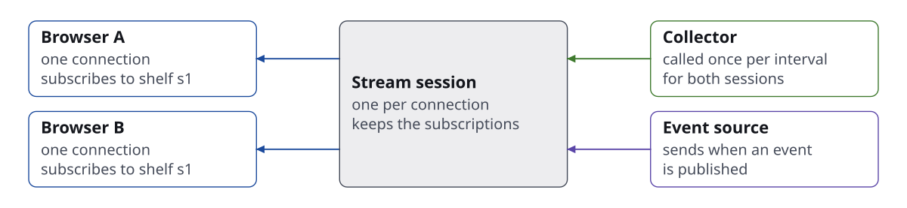

**English** | [한국어](./README.ko.md)

# simplix-stream

Sends live data from the server to browsers over Server-Sent Events or WebSocket. A client opens one connection and states which resources it wants; the server collects each resource once, however many clients watch it, and pushes the data to all of them. It is meant for screens that follow something as it changes: a dashboard, a status board, a notification list.



## Install

The module is not part of the [starter](../spring-boot-starter-simplix/README.md). Add it as a dependency of its own.

```groovy
dependencies {
    implementation "dev.simplecore.simplix:simplix-stream:${version}"
}
```

## A first stream

```java
@Component
@RequiredArgsConstructor
public class ShelfOccupancyCollector implements SimpliXStreamDataCollector {

    private final ShelfCounter shelfCounter;

    @Override
    public String getResource() {
        return "shelf-occupancy";
    }

    @Override
    public Object collect(Map<String, Object> params) {
        String shelfId = String.valueOf(params.get("shelfId"));
        return Map.of("shelfId", shelfId, "free", shelfCounter.freeSlots(shelfId));
    }

    @Override
    public long getDefaultIntervalMs() {
        return 1000L;
    }

    @Override
    public boolean validateParams(Map<String, Object> params) {
        return params.get("shelfId") != null;
    }
}
```

```bash
curl -N -H "Authorization: Bearer $ACCESS_TOKEN" http://localhost:8080/api/stream/connect
```

A collector names a resource and returns its current data. A client connects, subscribes to `shelf-occupancy` with the shelf it watches, and receives the data once a second. [Getting started](docs/en/getting-started.md) walks through the calls.

## Documents

| To | Read |
|---|---|
| see data arrive over a first connection | [Getting started](docs/en/getting-started.md) |
| write collectors, and understand intervals, parameters and shared collection | [Collecting data](docs/en/collecting-data.md) |
| send data at the moment something happens | [Streaming events](docs/en/streaming-events.md) |
| use the protocol from a browser, with tickets and reconnection | [Connecting clients](docs/en/connecting-clients.md) |
| decide who may connect and subscribe, and end sessions that lost access | [Securing streams](docs/en/securing-streams.md) |
| offer the stream over STOMP | [Using WebSocket](docs/en/using-websocket.md) |
| run behind a load balancer with sessions in the database | [Running several instances](docs/en/running-several-instances.md) |
| list and end sessions, and stop or trigger a collection | [Managing streams](docs/en/managing-streams.md) |
| watch health and metrics | [Monitoring streams](docs/en/monitoring-streams.md) |
| see which class does what | [How simplix-stream works](docs/en/how-it-works.md) |
| look a property up | [Configuration reference](docs/en/configuration-reference.md) |
| find the cause of a problem | [Troubleshooting](docs/en/troubleshooting.md) |

## Requirements

| Your project | SimpliX line | Version to declare |
|---|---|---|
| Spring Boot 4 | 2.x | a `2.x` release |
| Spring Boot 3 | 1.x | a `1.x` release |

## License

[SimpleCORE License 1.0 (SCL-1.0)](../docs/en/license.md)
