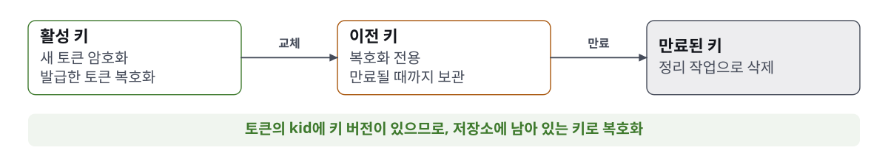

# 키 교체

사용자를 로그아웃시키지 않고 토큰 암호화 키를 교체하는 방법을 설명합니다. 키 교체 모드에서는 키를 암호화해 데이터베이스에 보관합니다. 새 키로 새 토큰을 암호화하고, 이전 키로는 이전에 발급한 토큰을 계속 복호화합니다.



## 준비

- [simplix-encryption](ko/encryption/readme.md) 설정. 키를 저장하기 전에 이 모듈로 암호화합니다.
- 키를 저장할 테이블

## 1단계. 키 저장소 구현

데이터베이스 테이블을 사용하는 `JweKeyStore`를 구현합니다. 키의 생성과 암호화는 모듈이 처리하고, 저장소는 키를 저장하고 조회하는 역할만 합니다.

```java
@Entity
@Table(name = "jwe_keys", uniqueConstraints = @UniqueConstraint(columnNames = "initialization_marker"))
@Getter
@Setter
@NoArgsConstructor
public class JweKeyEntity {

    @Id
    @Column(length = 80)
    private String version;

    @Column(name = "encrypted_public_key", nullable = false, columnDefinition = "TEXT")
    private String encryptedPublicKey;

    @Column(name = "encrypted_private_key", nullable = false, columnDefinition = "TEXT")
    private String encryptedPrivateKey;

    @Column(nullable = false)
    private boolean active;

    @Column(name = "created_at", nullable = false)
    private Instant createdAt;

    @Column(name = "expires_at")
    private Instant expiresAt;

    @Column(name = "initialization_marker", length = 20)
    private String initializationMarker;
}
```

```java
public interface JweKeyRepository extends JpaRepository<JweKeyEntity, String> {

    Optional<JweKeyEntity> findFirstByActiveTrueOrderByCreatedAtDesc();

    List<JweKeyEntity> findByActiveFalseAndExpiresAtBefore(Instant time);

    @Modifying
    @Query("update JweKeyEntity k set k.active = false where k.version <> :version")
    void deactivateAllExcept(@Param("version") String version);
}
```

```java
@Component
@RequiredArgsConstructor
public class DatabaseJweKeyStore implements JweKeyStore {

    private final JweKeyRepository repository;

    @Override
    @Transactional
    public JweKeyData save(JweKeyData keyData) {
        return toData(repository.save(toEntity(keyData)));
    }

    @Override
    @Transactional(readOnly = true)
    public Optional<JweKeyData> findByVersion(String version) {
        return repository.findById(version).map(this::toData);
    }

    @Override
    @Transactional(readOnly = true)
    public Optional<JweKeyData> findCurrent() {
        return repository.findFirstByActiveTrueOrderByCreatedAtDesc().map(this::toData);
    }

    @Override
    @Transactional(readOnly = true)
    public List<JweKeyData> findAll() {
        return repository.findAll().stream().map(this::toData).toList();
    }

    @Override
    @Transactional
    public void deactivateAllExcept(String exceptVersion) {
        repository.deactivateAllExcept(exceptVersion);
    }

    @Override
    @Transactional(readOnly = true)
    public List<JweKeyData> findExpired() {
        return repository.findByActiveFalseAndExpiresAtBefore(Instant.now()).stream().map(this::toData).toList();
    }

    @Override
    @Transactional
    public boolean deleteByVersion(String version) {
        if (!repository.existsById(version)) {
            return false;
        }
        repository.deleteById(version);
        return true;
    }

    private JweKeyEntity toEntity(JweKeyData data) {
        JweKeyEntity entity = new JweKeyEntity();
        entity.setVersion(data.getVersion());
        entity.setEncryptedPublicKey(data.getEncryptedPublicKey());
        entity.setEncryptedPrivateKey(data.getEncryptedPrivateKey());
        entity.setActive(data.isActive());
        entity.setCreatedAt(data.getCreatedAt());
        entity.setExpiresAt(data.getExpiresAt());
        entity.setInitializationMarker(data.getInitializationMarker());
        return entity;
    }

    private JweKeyData toData(JweKeyEntity entity) {
        return JweKeyData.builder()
            .version(entity.getVersion())
            .encryptedPublicKey(entity.getEncryptedPublicKey())
            .encryptedPrivateKey(entity.getEncryptedPrivateKey())
            .active(entity.isActive())
            .createdAt(entity.getCreatedAt())
            .expiresAt(entity.getExpiresAt())
            .initializationMarker(entity.getInitializationMarker())
            .build();
    }
}
```

| `JweKeyData` 필드 | 내용 |
|---|---|
| `version` | `jwe-v1795531864917-a1dc1bfc` 같은 키 식별자. 토큰의 `kid`로 사용합니다 |
| `encryptedPublicKey`, `encryptedPrivateKey` | 암호화한 키 쌍 |
| `active` | 새 토큰을 암호화하는 키인지 여부 |
| `createdAt`, `expiresAt` | 키의 생성 시각과 삭제할 수 있는 시각 |
| `initializationMarker` | 여러 인스턴스가 동시에 첫 키를 만들지 않도록 하는 표시. 이 컬럼에 유니크 제약을 지정하세요 |

- `findExpired`는 삭제할 수 있는 키를 반환합니다. 위 저장소 메서드처럼 활성 상태가 아니면서 `expiresAt`이 지난 키만 반환하세요.
- `deleteByVersion`과 `findExpired`의 기본 구현은 아무것도 삭제하지 않습니다. 이 메서드를 구현하지 않은 저장소는 모든 키를 계속 보관합니다.
- `initialization_marker`에 유일 제약을 지정하면 여러 인스턴스가 동시에 시작해도 한 인스턴스만 첫 키를 저장합니다. 나머지 인스턴스는 저장된 키를 읽습니다.

## 2단계. 키 교체 모드 설정

```yaml
simplix:
  auth:
    jwe:
      key-rolling:
        enabled: true
        key-size: 2048
        auto-initialize: true
        retention:
          buffer-seconds: 86400
          auto-cleanup: false
```

> ⚠ 키 교체 모드를 켤 때 `encryption-key`와 `encryption-key-location`을 제거하세요. 둘 다 설정되어 있으면 토큰이 발급되지만 검증에서 거부됩니다.

`auto-initialize`가 켜져 있으면 애플리케이션을 시작할 때 저장소가 비어 있는 경우 첫 키를 생성합니다. 로그에서 확인할 수 있습니다.

```
JWE key rotation completed, new version: jwe-v1795531864917-a1dc1bfc, expires at: 2026-12-02T14:51:04.920433Z
JweKeyRotationService configured - keySize: 2048 bits, retention: 604800 + 86400 seconds, autoCleanup: false
```

## 3단계. 주기적 교체

```java
@Component
@RequiredArgsConstructor
public class JweKeyRotationJob {

    private final JweKeyRotationService rotationService;

    @Scheduled(cron = "0 0 3 1 * *")
    @SchedulerLock(name = "jwe-key-rotation")
    public void rotate() {
        rotationService.rotateKey();
        rotationService.cleanupExpiredKeys();
    }
}
```

`rotateKey()`는 키를 생성해 활성 키로 지정하고 버전을 반환합니다. `cleanupExpiredKeys()`는 `expiresAt`이 지난 키를 삭제합니다. 잠금을 사용하면 여러 인스턴스가 동시에 교체하지 않습니다. [simplix-scheduler](ko/scheduler/readme.md)를 참고하세요.

## 키 보관 기간

`expiresAt`은 키를 생성할 때 정해집니다. 생성 시각에 리프레시 토큰 유효 시간과 `buffer-seconds`를 더한 값이며, 기본값으로는 8일 뒤입니다. `cleanupExpiredKeys()`는 저장소의 `findExpired()`가 반환한 키를 삭제하므로, 활성 키가 아니면서 `expiresAt`이 지난 키만 반환하도록 구현하세요. 어떤 키로 암호화한 토큰은 그 키가 활성 키에서 제외된 뒤에도 리프레시 토큰 유효 시간만큼 유효할 수 있습니다. `auto-cleanup: true`를 지정하면 교체할 때 정리도 함께 실행합니다.

## 교체 주기 선택

교체 주기는 키 하나로 보호하는 범위를 줄이고, 보존 기간은 보관하는 키의 수를 결정합니다. 키는 생성된 뒤 리프레시 토큰 수명에 버퍼를 더한 시간 동안 유지되므로, 테이블의 키 수는 이 시간을 교체 주기로 나눈 값에 1을 더한 정도입니다.

| 교체 주기 | 기본 수명(7일, 버퍼 1일)을 사용할 때 |
|---|---|
| 매월 | 활성 키 하나. 교체 후 8일 동안은 이전 키 하나를 함께 보관합니다 |
| 매주 | 활성 키 하나와 이전 키 한두 개 |
| 매일 | 활성 키 하나와 이전 키 약 여덟 개 |

## 정적 키에서 전환

1. 테이블과 저장소를 만들고, 키 롤링을 끈 상태로 먼저 배포합니다.
2. 같은 배포에서 `key-rolling.enabled`를 켜고 `encryption-key`와 `encryption-key-location`을 제거합니다.
3. 클라이언트가 다시 로그인하도록 안내합니다. 정적 키로 암호화한 토큰은 저장소에 없는 키를 사용하므로 전환 후 거부됩니다.

## 여러 인스턴스

모든 인스턴스가 같은 저장소에서 키를 읽습니다. 교체를 실행하지 않은 인스턴스는 모르는 `kid`의 토큰을 받았을 때나 `DatabaseJweKeyProvider.refresh()`를 호출했을 때 새 키를 불러옵니다.

## 관련 문서

- [simplix-encryption](ko/encryption/readme.md)
- [토큰 발급과 갱신](ko/auth/issuing-and-refreshing-tokens.md)
- [설정 레퍼런스](ko/auth/configuration-reference.md)
