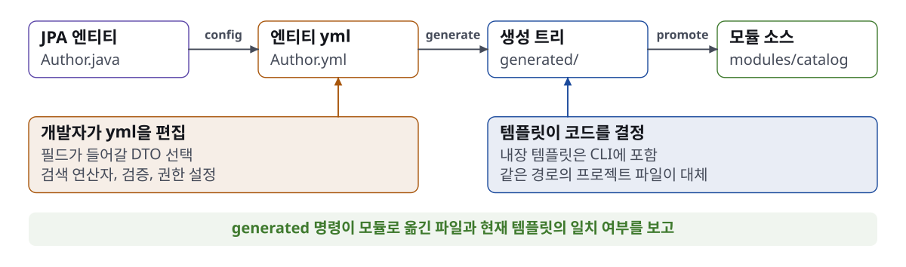

[English](en/cli/readme.md) | **한국어**

# SimpliX CLI

`simplix-boot`는 JPA 엔티티를 읽어 그 엔티티를 SimpliX로 제공하는 서비스, REST 컨트롤러, DTO, 테스트를 생성합니다. 필드별 동작은 yml 파일에 한 번만 적으면 되고, 이후 템플릿이 바뀌어도 생성된 코드와 직접 고친 내용을 함께 유지합니다.



## 언제 사용하나

- 엔티티를 추가하고, 프로젝트의 다른 SimpliX API와 같은 형태의 CRUD API가 필요할 때
- 필드를 바꾸고 DTO, 검색 조건, 테스트에 그 변경을 반영해야 할 때
- 생성된 클래스를 직접 고친 내용을 다음 템플릿 변경 이후에도 유지해야 할 때

엔티티 하나에 대응하지 않는 화면(대시보드, 여러 집계를 합친 보고서)은 직접 작성합니다. CLI가 생성의 근거로 삼을 엔티티가 없기 때문입니다.

## 요구 사항

- Node.js 20 이상
- SimpliX에 의존하는 Gradle 또는 Maven 프로젝트
- 프로젝트의 SimpliX와 같은 릴리스 라인의 CLI

| 프로젝트 | SimpliX 라인 | 설치 |
|---|---|---|
| Spring Boot 4 | 2.x | `npm install -g @simplix-boot/cli` |
| Spring Boot 3 | 1.x | `npm install -g @simplix-boot/cli@spring-boot-3x` |

## 설치

```bash
# Spring Boot 4 projects (SimpliX 2.x)
npm install -g @simplix-boot/cli

# Spring Boot 3 projects (SimpliX 1.x)
npm install -g @simplix-boot/cli@spring-boot-3x

simplix-boot --version
```

설치하지 않고 실행하려면 같은 패키지 표기로 `npx @simplix-boot/cli <명령>`을 사용하세요. 팀 단위의 버전 고정과 프레임워크 체크아웃의 CLI를 실행하는 방법은 [버전 관리](ko/cli/managing-versions.md)에 있습니다.

## 빠른 시작

`Author`라는 JPA 엔티티와 그 저장소가 이미 있는 프로젝트의 루트에서 실행하세요.

```bash
# 1. Create the .simplix folder, then write .simplix/simplix-boot.json
simplix-boot init

# 2. Write .simplix/entity/Author.yml from the entity
simplix-boot config Author

# 3. Edit the yml, then generate the code into generated/
simplix-boot generate Author

# 4. Move the generated files into a module
simplix-boot promote Author --module catalog

# 5. Check that every promoted file matches the templates
simplix-boot generated
```

[시작하기](ko/cli/getting-started.md)에서 같은 단계를 설정 파일, yml 편집 내용, 명령별 출력과 함께 따라 할 수 있습니다.

## 문서

| 하려는 일 | 문서 |
|---|---|
| 첫 API를 단계별로 생성 | [시작하기](ko/cli/getting-started.md) |
| 생성되는 코드의 모양 변경 | [템플릿 사용자 지정](ko/cli/customizing-templates.md) |
| 템플릿이나 yml을 바꾼 뒤 직접 고친 내용을 유지하며 다시 생성 | [생성 코드 갱신](ko/cli/updating-generated-code.md) |
| 맞는 라인 설치, 버전 고정, 체크아웃 연결 | [버전 관리](ko/cli/managing-versions.md) |
| generator-simplix를 쓰던 프로젝트 전환 | [generator-simplix에서 전환](ko/cli/migrating-from-generator-simplix.md) |
| 명령과 옵션 확인 | [명령 레퍼런스](ko/cli/command-reference.md) |
| 설정 파일과 엔티티 yml의 키 확인 | [설정 레퍼런스](ko/cli/configuration-reference.md) |
| 템플릿 변수와 내장 템플릿 확인 | [템플릿 레퍼런스](ko/cli/template-reference.md) |
| 명령의 내부 동작 이해 | [동작 원리](ko/cli/how-it-works.md) |
| 오류 해결 | [문제 해결](ko/cli/troubleshooting.md) |

## 라이선스

SimpleCORE License 1.0 (SCL-1.0). [LICENSE](https://github.com/simplix-framework/simplix/blob/main/LICENSE)를 참조하세요.
