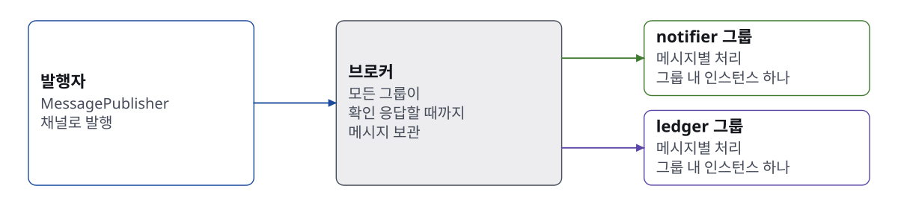

[English](en/messaging/readme.md) | **한국어**

# simplix-messaging

브로커를 사용해 시스템의 구성 요소 사이에서 메시지를 전달하는 모듈입니다. NATS JetStream, Redis Streams, Kafka, RabbitMQ, 테스트용 인메모리 브로커 중 어느 것을 사용하든 같은 API로 호출합니다. 브로커는 각 컨슈머 그룹의 핸들러가 처리할 때까지 메시지를 보관합니다. 메시지 유실을 허용하는 [simplix-sync](ko/sync/readme.md)와 다른 점입니다.



## 설치

이 모듈은 [스타터](ko/starter/readme.md)에 포함되어 있습니다. 단독으로 사용하려면 의존성을 추가하세요.

```groovy
dependencies {
    implementation "dev.simplecore.simplix:simplix-messaging:${version}"
}
```

## 첫 메시지

```java
@Service
@RequiredArgsConstructor
public class LoanDesk {

    private final MessagePublisher messagePublisher;

    public void open(String loanId, String memberId) {
        byte[] payload = JsonCodec.serialize(new LoanOpened(loanId, memberId));
        messagePublisher.publish(Message.ofBytes("loan-opened", payload));
    }
}
```

```java
@Component
public class LoanNotifier {

    @MessageHandler(channel = "loan-opened", group = "notifier")
    public void onLoanOpened(Message<byte[]> message) {
        LoanOpened event = JsonCodec.deserialize(message.getPayload(), LoanOpened.class);
        // notify the member
    }
}
```

설정하지 않으면 브로커는 `local`입니다. 메시지를 같은 프로세스 안에서 전달하므로 개발과 테스트에 그대로 사용할 수 있습니다. 실제 브로커는 이 코드를 변경하지 않고 [브로커 선택](ko/messaging/choosing-a-broker.md)의 설정으로 연결합니다.

## 문서

| 목적 | 문서 |
|---|---|
| 첫 메시지 발행과 처리 | [시작하기](ko/messaging/getting-started.md) |
| 메시지 구성, 헤더와 ID 지정, 백그라운드 발행 | [메시지 발행](ko/messaging/publishing-messages.md) |
| 핸들러 작성, 수동 확인 응답, 중복 건너뛰기, 컨슈머 확장 | [메시지 처리](ko/messaging/handling-messages.md) |
| 핸들러가 처리하지 못한 메시지의 처리 방식 결정 | [실패 처리](ko/messaging/handling-failures.md) |
| NATS, Redis, Kafka, RabbitMQ 선택과 설정 | [브로커 선택](ko/messaging/choosing-a-broker.md) |
| 이전 메시지 다시 읽기, 채널을 사용한 요청-응답 | [메시지 재생과 요청-응답](ko/messaging/replaying-messages-and-request-reply.md) |
| 헬스 체크와 메트릭으로 브로커 확인 | [메시징 모니터링](ko/messaging/monitoring-messaging.md) |
| 클래스별 역할 확인 | [simplix-messaging 동작 방식](ko/messaging/how-it-works.md) |
| 속성 조회 | [설정 레퍼런스](ko/messaging/configuration-reference.md) |
| 문제의 원인 확인 | [문제 해결](ko/messaging/troubleshooting.md) |

## 요구 사항

| 프로젝트 | SimpliX 라인 | 선언할 버전 |
|---|---|---|
| Spring Boot 4 | 2.x | `2.x` 릴리스 |
| Spring Boot 3 | 1.x | `1.x` 릴리스 |

로컬 브로커에는 추가 의존성이 필요하지 않습니다. 실제 브로커를 사용하려면 해당 클라이언트 라이브러리를 애플리케이션의 의존성에 추가하세요: `io.nats:jnats`, `spring-boot-starter-data-redis`, `org.springframework.kafka:spring-kafka`, `spring-boot-starter-amqp`.

## 라이선스

[SimpleCORE License 1.0 (SCL-1.0)](ko/license.md)
