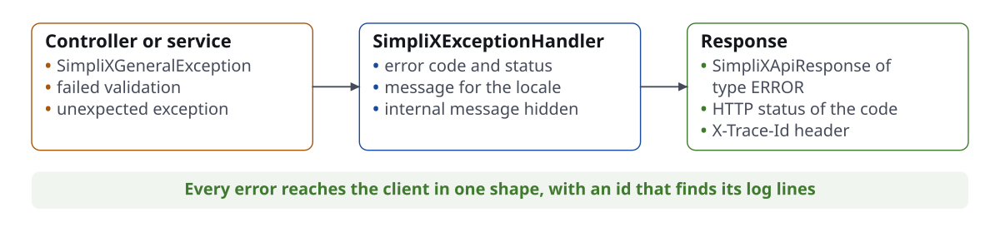

# Handling errors

What the starter answers when a request fails, and how to shape that answer. Every exception that leaves a controller is turned into a `SimpliXApiResponse`, so a client reads `type`, `errorCode` and `errorDetail` in one way for every error.



## An error you throw

A `SimpliXGeneralException` is answered with the status and the code of its `ErrorCode`, your message, and your detail.

```json
{
  "type" : "ERROR",
  "message" : "Note not found",
  "timestamp" : "<time with zone>",
  "errorCode" : "GEN_NOT_FOUND",
  "errorDetail" : {
    "noteId" : "nope"
  }
}
```

## A request that fails validation

A `@Validated` request body with a `@Size(max = 200)` field that is too long is answered with status 400. `errorDetail` lists each failing field with its message, the rejected value and the constraint.

```json
{
  "type" : "ERROR",
  "message" : "Validation failed",
  "timestamp" : "<time with zone>",
  "errorCode" : "VAL_VALIDATION_FAILED",
  "errorDetail" : [ {
    "field" : "text",
    "message" : "Size must be between 0 and 200",
    "rejectedValue" : "<the value sent>",
    "code" : "Size"
  } ]
}
```

The messages are read from the message bundles in the language of the request; see [Messages and locales](./messages-and-locales.md).

| Field of an entry | Holds |
|---|---|
| `field` | the name of the field that failed |
| `message` | the message in the language of the request; the attributes of the constraint fill its placeholders, as `0` and `200` do above |
| `rejectedValue` | the value that was sent |
| `code` | the constraint, such as `NotBlank`, `Size` or `Min` |
| `label` | the label of the field, when the message bundles carry one, so a screen can name the field in the reader's language |

The Java class of an entry is `ValidationFieldError`.

## Which exception becomes which answer

| Exception | Status | Code |
|---|---|---|
| `SimpliXGeneralException` | the status of its `ErrorCode` | the code of its `ErrorCode` |
| `MethodArgumentNotValidException` | 400 | `VAL_VALIDATION_FAILED` |
| `AccessDeniedException` | 403 | `AUTHZ_INSUFFICIENT_PERMISSIONS` |
| `BadCredentialsException` | 401 | `AUTH_INVALID_CREDENTIALS` |
| other `AuthenticationException` | 401 | `AUTH_AUTHENTICATION_REQUIRED` |
| `NoResourceFoundException` (no such path) | 404 | `GEN_NOT_FOUND` |
| `HttpRequestMethodNotSupportedException` | 405 | `GEN_METHOD_NOT_ALLOWED` |
| `MissingServletRequestParameterException` | 400 | `VAL_MISSING_PARAMETER` |
| `MethodArgumentTypeMismatchException` | 400 | `VAL_INVALID_PARAMETER` |
| unsupported or unacceptable media type | 400 | `GEN_BAD_REQUEST` |
| `AsyncRequestTimeoutException` | the status of `GEN_TIMEOUT` | `GEN_TIMEOUT` |
| `IllegalStateException` | 409 | `GEN_CONFLICT` |
| an invalid search condition | 200, with `type` `ERROR` | `SEARCH_INVALID_PARAMETER`, `SEARCH_INVALID_SORT_FIELD`, `SEARCH_INVALID_FILTER_OPERATOR` or `SEARCH_INVALID_QUERY_SYNTAX` |
| any other exception, including a request body that cannot be parsed | 500 | `GEN_INTERNAL_SERVER_ERROR` |

## What a client is not told

The message of an unexpected exception is written to the log and not to the response. A controller that throws `IllegalStateException("database password is ...")` is answered as follows.

```json
{
  "type" : "ERROR",
  "message" : "Conflict",
  "timestamp" : "<time with zone>",
  "errorCode" : "GEN_CONFLICT",
  "errorDetail" : "An error occurred while processing your request"
}
```

### The detail of an unexpected exception

```json
{
  "type" : "ERROR",
  "message" : "Conflict",
  "errorCode" : "GEN_CONFLICT",
  "errorDetail" : "An error occurred while processing your request"
}
```

For an exception that is not a `SimpliXGeneralException`, `errorDetail` is this fixed text. During development the handler writes the exception instead, `java.lang.IllegalStateException: connection to ledger-db refused`, when the JVM was started with the system property `-Dspring.profiles.active` containing `dev`, `local` or `debug`.

> ⚠ Only the system property is read. A profile set in `application.yml` or in the environment variable `SPRING_PROFILES_ACTIVE` keeps the fixed text, and a production JVM started with `-Dspring.profiles.active=dev` would show exception messages to clients.

## Find the log of a failed request

Every response of a request that passes the security filters carries an `X-Trace-Id` header, and the same id is in each log line of that request. The id is created by the server for each request, and a request refused with 401 by the security filters has none. Ask the user for the header value and search the log for it.

## Errors outside a controller

`SimpliXErrorController` answers the errors Spring forwards to `/error`, by what the caller accepts: a `SimpliXApiResponse` for JSON, an HTML error page for a browser, and an event for a server-sent event stream.

## Tell the client when to retry

An exception that implements `RetryAfterHint` of simplix-core has its `retryAfterSeconds()` written to the `Retry-After` header.

## Replace the handler

Set `simplix.exception-handler.enabled: false` and write your own `@RestControllerAdvice`, or register a bean of type `SimpliXExceptionHandler`: the starter registers its handler only when none exists.

## Related documents

- [API responses and errors](../../../simplix-core/docs/en/api-responses-and-errors.md)
- [Error code reference](../../../simplix-core/docs/en/error-code-reference.md)
- [Messages and locales](./messages-and-locales.md)
