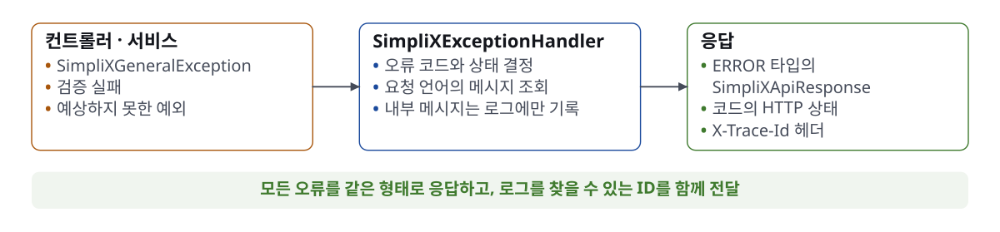

# 오류 처리

요청이 실패했을 때 스타터가 응답하는 내용과 그 응답을 조정하는 방법을 설명합니다. 컨트롤러에서 발생한 모든 예외를 `SimpliXApiResponse`로 변환하므로, 클라이언트는 모든 오류에서 `type`, `errorCode`, `errorDetail`을 같은 방식으로 읽습니다.



## 직접 발생시키는 오류

`SimpliXGeneralException`에는 `ErrorCode`의 상태와 코드, 지정한 메시지와 상세 정보로 응답합니다.

```json
{
  "type" : "ERROR",
  "message" : "Note not found",
  "timestamp" : "<time with zone>",
  "errorCode" : "GEN_NOT_FOUND",
  "errorDetail" : {
    "noteId" : "nope"
  }
}
```

## 검증에 실패한 요청

`@Validated`를 지정한 요청 본문에서 `@Size(max = 200)` 필드가 너무 길면 상태 코드 400으로 응답합니다. `errorDetail`에는 실패한 필드별로 메시지, 거부된 값, 제약 이름이 들어 있습니다.

```json
{
  "type" : "ERROR",
  "message" : "Validation failed",
  "timestamp" : "<time with zone>",
  "errorCode" : "VAL_VALIDATION_FAILED",
  "errorDetail" : [ {
    "field" : "text",
    "message" : "Size must be between 0 and 200",
    "rejectedValue" : "<the value sent>",
    "code" : "Size"
  } ]
}
```

메시지는 요청의 언어에 맞춰 메시지 번들에서 읽습니다. [메시지와 로케일](./messages-and-locales.md)을 참고하세요.

| 항목의 필드 | 내용 |
|---|---|
| `field` | 검증에 실패한 필드의 이름 |
| `message` | 요청 언어의 메시지. 위 예시의 `0`과 `200`처럼 제약의 속성 값이 메시지에 채워집니다 |
| `rejectedValue` | 전송된 값 |
| `code` | `NotBlank`, `Size`, `Min` 같은 제약 이름 |
| `label` | 메시지 번들에 있는 경우 필드의 라벨. 화면에서 읽는 사용자의 언어로 필드 이름을 표시할 수 있습니다 |

항목의 Java 클래스는 `ValidationFieldError`입니다.

## 예외별 응답

| 예외 | 상태 | 코드 |
|---|---|---|
| `SimpliXGeneralException` | `ErrorCode`의 상태 | `ErrorCode`의 코드 |
| `MethodArgumentNotValidException` | 400 | `VAL_VALIDATION_FAILED` |
| `AccessDeniedException` | 403 | `AUTHZ_INSUFFICIENT_PERMISSIONS` |
| `BadCredentialsException` | 401 | `AUTH_INVALID_CREDENTIALS` |
| 그 밖의 `AuthenticationException` | 401 | `AUTH_AUTHENTICATION_REQUIRED` |
| `NoResourceFoundException`(없는 경로) | 404 | `GEN_NOT_FOUND` |
| `HttpRequestMethodNotSupportedException` | 405 | `GEN_METHOD_NOT_ALLOWED` |
| `MissingServletRequestParameterException` | 400 | `VAL_MISSING_PARAMETER` |
| `MethodArgumentTypeMismatchException` | 400 | `VAL_INVALID_PARAMETER` |
| 지원하지 않거나 받을 수 없는 미디어 타입 | 400 | `GEN_BAD_REQUEST` |
| `AsyncRequestTimeoutException` | `GEN_TIMEOUT`의 상태 | `GEN_TIMEOUT` |
| `IllegalStateException` | 409 | `GEN_CONFLICT` |
| 유효하지 않은 검색 조건 | 200(`type`은 `ERROR`) | `SEARCH_INVALID_PARAMETER`, `SEARCH_INVALID_SORT_FIELD`, `SEARCH_INVALID_FILTER_OPERATOR`, `SEARCH_INVALID_QUERY_SYNTAX` 중 하나 |
| 그 밖의 모든 예외(파싱할 수 없는 요청 본문 포함) | 500 | `GEN_INTERNAL_SERVER_ERROR` |

## 클라이언트에 공개하지 않는 내용

예상하지 못한 예외의 메시지는 로그에만 기록하고 응답에는 포함하지 않습니다. 컨트롤러에서 `IllegalStateException("database password is ...")`이 발생하면 다음과 같이 응답합니다.

```json
{
  "type" : "ERROR",
  "message" : "Conflict",
  "timestamp" : "<time with zone>",
  "errorCode" : "GEN_CONFLICT",
  "errorDetail" : "An error occurred while processing your request"
}
```

## 실패한 요청의 로그 찾기

보안 필터를 통과한 요청의 응답에는 `X-Trace-Id` 헤더가 있으며, 해당 요청의 모든 로그 줄에 같은 ID가 기록됩니다. ID는 요청마다 서버에서 생성하며, 보안 필터가 401로 거부한 요청에는 ID가 없습니다. 사용자에게 헤더 값을 받아 로그에서 검색하세요.

## 컨트롤러 밖에서 발생한 오류

`SimpliXErrorController`는 Spring이 `/error`로 전달한 오류에 호출자가 받는 형식으로 응답합니다. JSON에는 `SimpliXApiResponse`, 브라우저에는 HTML 오류 페이지, 서버 전송 이벤트 스트림에는 이벤트로 응답합니다.

## 재시도 시점 안내

simplix-core의 `RetryAfterHint`를 구현한 예외는 `retryAfterSeconds()` 값이 `Retry-After` 헤더에 기록됩니다.

## 핸들러 교체

`simplix.exception-handler.enabled: false`를 설정하고 `@RestControllerAdvice`를 직접 작성하거나, `SimpliXExceptionHandler` 타입의 빈을 등록하세요. 스타터의 핸들러는 같은 타입의 빈이 없을 때만 등록됩니다.

## 관련 문서

- [API 응답과 오류](../../../simplix-core/docs/ko/api-responses-and-errors.md)
- [오류 코드 레퍼런스](../../../simplix-core/docs/ko/error-code-reference.md)
- [메시지와 로케일](./messages-and-locales.md)
